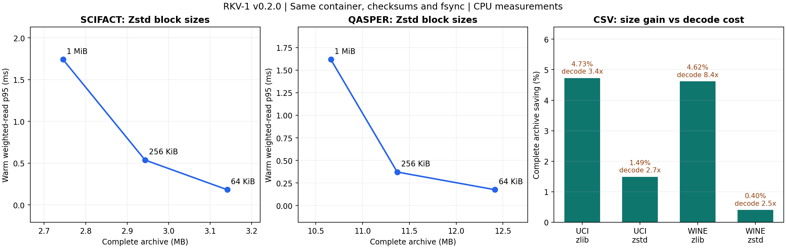

# RKV-1 — Reversible Knowledge Vault

面向科学知识与推理的可逆记忆研究项目。原始证据逐字节保存；摘要、图谱、语义索引和
神经记忆作为未来辅助表示，最终结论能回到精确来源。

[](https://github.com/StarlitPupils/RKV-1/actions/workflows/ci.yml)
[版本发布](https://github.com/StarlitPupils/RKV-1/releases) · [路线](docs/ROADMAP.md) · [格式](docs/FORMAT.md)

## 当前版本：v0.2.0 · 受控基准与 E2 CSV 初步试验

在首版无损核心之上加入 Zstd、可关闭的跨文件去重、可选数值 CSV 列重排，以及
manifest version=2；新读取器仍能恢复首版归档。默认 Zlib/1 MiB、CSV 变换关闭；
codec、块大小和变换策略由参数选择。

本版统一容器、SHA-256 校验、flush/fsync 和原子发布，编码/恢复/随机读分别使用
独立进程。扫描三种块大小、三种 codec 和去重开关；增加按字节加权、大小文件和
跨块请求，分别测已打开清单及每次重新打开的延迟。恢复全部逐字节比较，归档字节
在重复编码之间须相同；每个配置保存源码指纹与输入哈希。

四组真实输入（原 UCI、SciFact、QASPER、Wine；UCI/Wine 共享 red CSV）和一组合成
重复对照，共 **102 个配置**。正式记录 **560 次恢复**、另有 **112 次预热恢复**，
**75,264 次范围读取**全部通过比较。本地 **33 项测试：32 通过、1 权限跳过**；
发布流水线再运行 Windows/Linux、Python 3.10/3.13 和 Rust 骨架测试。

## 主要观察

以下为同容器、1 MiB、去重开启、无变换的归档大小，包含所有容器元数据。

| 语料 | 原始 bytes | Zlib 6 bytes | Zstd 3 bytes | Zstd 归档节省 |
|---|---:|---:|---:|---:|
| SciFact | 8,582,267 | 2,863,283 | 2,745,550 | 4.11% |
| QASPER train/dev | 43,368,073 | 10,902,467 | 10,660,769 | 2.22% |
| UCI Iris/red wine | 88,750 | 25,150 | 26,681 | -6.09% |
| Wine red/white | 348,625 | 93,493 | 98,417 | -5.27% |

Zstd 在这两组科学文本上编码、恢复更快，CSV 的最小体积则由 Zlib 获得。
小块改善范围读取延迟，但增加压缩损失和索引开销；选择应结合查询工作负载。
在相同流式容器下，两 codec 恢复内存相近，首版与整流 TAR 的内存差距受实现方式影响。

E2 的列重排保留数值原文、表头、换行及跨块边界。Zlib 条件下归档节省约 **4.6–4.7%**，
但 Python 解析、恢复和范围读取明显变慢，所以保留为可选试验。真实输入在本次三种
固定分块下没有重复块收益；合成对照验证去重机制，但不代表自然科学语料。



[完整结果与原始样本](results/v0.2.0/SUMMARY.md) · [复现协议](docs/EXPERIMENTS.md) ·
[数据署名/许可](docs/DATASETS.md) · [运行时成本记录](results/v0.2.0/runtime-footprint.json)

归档字节不等于部署总占用。本机可选 Zstd distribution 另占约 1.13 MB；共享 RKV
源码、transform 模块以及安装占用都记录在成本账本，Python/全部共享原生依赖尚未
分摊到单归档。本版没有外部字典、模型权重或语义索引。

## 快速开始

```powershell
python -m venv .venv
.\.venv\Scripts\python.exe -m pip install -e ".[bench]"
.\.venv\Scripts\python.exe -m unittest discover -s tests -v
.\.venv\Scripts\python.exe -m rkv1 fetch data/scifact --dataset scifact
.\.venv\Scripts\python.exe -m rkv1 pack data/scifact data/scifact.rkv --codec zstd
.\.venv\Scripts\python.exe -m rkv1 verify data/scifact.rkv
.\.venv\Scripts\python.exe -m rkv1 unpack data/scifact.rkv data/restored
.\.venv\Scripts\python.exe -m rkv1 compare data/scifact data/restored
.\.venv\Scripts\python.exe scripts/run_controlled.py --out results/local-controlled
.\.venv\Scripts\python.exe scripts/summarize_controlled.py results/local-controlled
```

Python 3.10+；Linux/macOS 使用 `.venv/bin/python`。核心 Zlib 模式可安装 `pip install -e .`，
Zstd 可仅安装 `.[zstd]`。绘图可另装 `.[plots]`。归档默认不覆盖，恢复目标须不存在。

```powershell
python -m rkv1 pack data/scifact data/small-blocks.rkv --codec zstd --chunk-size 65536
python -m rkv1 pack data/scifact data/no-dedup.rkv --codec zstd --no-dedup
python -m rkv1 fetch data/wine --dataset wine
python -m rkv1 pack data/wine data/columns.rkv --codec zlib --transform csv-columns-v1
```

## 路线与版本

| 阶段 | 状态 |
|---|---|
| E0 基准 | 完成首版对照与新版受控测量；仍是单机温缓存实验 |
| E1 无损核心 | Python 原型、Zstd、格式 v2、旧格式读取兼容、扩展增量场景 |
| E2 类型感知可逆编码 | 已开始数值 CSV；数组、代码、数学文本待开展 |
| E3 神经预测 + 熵编码 + 精确残差 | 后续，计入模型和解码成本 |
| E4 科学记忆、检索、证据回溯与可验证推理 | 后续，尚无质量结果 |

Rust 目前是格式前缀和块范围计算的边界骨架，尚未接入性能路径。增量编码可验证并
复用旧块，仍全量读源并写出独立完整快照；中间插入会改变固定块边界。

[FORMAT Draft 0.2](docs/FORMAT.md) 只恢复普通文件路径和内容，不保留权限、时间戳、
空子目录或链接；恢复合计上限 2 GiB。新归档需 v0.2.0+ 读取器，旧归档继续可读。
SHA-256 用于完整性检查，不能证明来源身份或科学结论正确。当前没有神经压缩、
无限精确上下文或科学推理收益的验证。

[首版 v0.1.0 记录](results/v0.1.0/SUMMARY.md) 保留；两版协议不同，不能直接把耗时
变化全归为单个优化。每版本在 [Release](https://github.com/StarlitPupils/RKV-1/releases)
更新改动、结果和限制；tag 不改写。代码 [MIT](LICENSE)。
