# RKV-1 — Reversible Knowledge Vault

面向科学知识与推理的可逆记忆研究项目。原始证据逐字节保存；摘要、图谱、语义索引和
神经记忆作为未来辅助表示，最终结论能回到精确来源。

[](https://github.com/StarlitPupils/RKV-1/actions/workflows/ci.yml)
[版本发布](https://github.com/StarlitPupils/RKV-1/releases) · [路线](docs/ROADMAP.md) · [格式](docs/FORMAT.md)

## 当前版本：v0.26.0 · 全dev科学检索与上下文证据覆盖

新增独立`qasper_audit`离线评分器，扩到固定QASPER v0.3 dev全量281篇/1005问题
实例（948种问题文本，比此前64题新增884种字符串）。原语料论文已使用，不算新
独立论文；qas/答案/标注不进FTS，不给检索目标论文或gold证据，0模型请求。

| 指标 | 结果 |
|---|---:|
| 目标论文召回@1 / @5 / @20 | 29.65% / 44.28% / 56.02% |
| 8KB正文预算完整参考可见 | 107/927 · 11.54% |
| 24KB正文预算完整参考可见 | 232/927 · 25.03% |
| 48KB正文预算完整参考可见 | 295/927 · 31.82% |
| 24KB已召回且文本可映射、但预算遗漏 | 134题 |

927题有非空可答参考，其中800题至少一整组可映射文本；图表/无法映射项仍在
分母。原QASPER任务给定论文，此处是281候选池定位和上下文诊断，不是官方
Answer/Evidence F1，也不是模型回答正确率。正文UTF8预算不含标题/ID/JSON；
24KB条件实际context JSON中位25689B。更大预算覆盖在本数据没有真→假回归，
不由合成反例推断实际发生。下一版同检索/同预算对照问题相关证据选择。

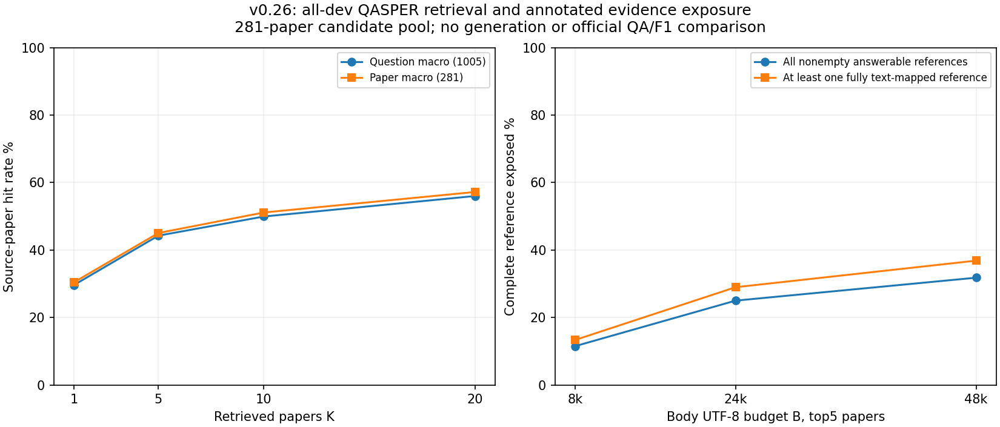

3015正式top20查询/3轮，keys、BM25、原记录身份SHA和覆盖分数全一致，3预热排除；
完整原文起止逐字节恢复、持久树不变。187测试通过、1权限跳过。top20检索wall
中位23.175ms，不与历史top5/top10算加速。实际Memory6065400B，全部52模块/HTML源
一次367366B，共计6432766B；公共运行时未全额计入，不是完整部署净压缩。

[冻结协议](docs/QASPER-COVERAGE.md) · [详细实验报告](results/v0.26.0/SUMMARY.md) ·
[全量原始指标](results/v0.26.0/trials.json) · [验证](results/v0.26.0/validation.json) ·
[Release](https://github.com/StarlitPupils/RKV-1/releases/tag/v0.26.0)。

## v0.25.0 · 内容锚定段落预检与停止集成决策

独立JATS审计API新增显式`mode='content'`：父论文ID/角色/text SHA/重复序号构键，
分别保留完整父SHA与原range SHA，避免把派生文本当原文。已有position/xml-id及
默认输出与实际v0.24发行包的36个描述逐字段一致；旧v0.24明确拒绝新content模式。
Memory默认/来源kind/清单格式不改，仍不自动用片段。

| 记录规则 | 固定/v4 range乐观可过/12 | Gear/v4 range乐观可过/12 | 当前完整父校验可过/12 |
|---|---:|---:|---:|
| 整篇 | 0 | 0 | 0 |
| 位置段落 | 1 | 1 | 0 |
| 内容锚定段落 | 3 | 2 | 0 |

同批六篇18版本/12真实修订，内容键减少部分插入级联，但改写变成删除+插入操作，
完整父验证仍超预算，未压缩13状态定位候选达1631278B。
只有相邻状态必要条件，没有实际索引节省或查询加速。**暂缓片段Memory集成**，
不调高预算追求正结果；下一轮转向扩大离线科学检索任务与上下文覆盖评测。

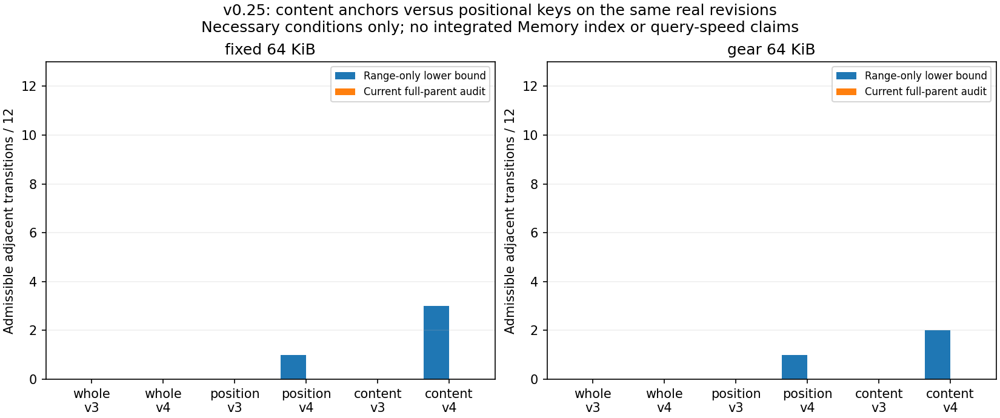

1854范围审计含两规则重复；9新进程162解析、144规划、26历史CAS快照核验；
183测试通过、1权限跳过。0新独立论文/科学QA/模型请求，现有API密钥不参与本轮。
全部51模块/HTML源一次、Gear整个精确库/元数据另计；定位候选仅部分账本，
未计FTS/Memory清单/公共运行时，不与旧完整系统体积算净压缩。仅本机温缓存。

[冻结协议](docs/JATS-ANCHORS.md) · [详细实验报告](results/v0.25.0/SUMMARY.md) ·
[逐转换计划](results/v0.25.0/plans.json) · [验证](results/v0.25.0/validation.json) ·
[Release](https://github.com/StarlitPupils/RKV-1/releases/tag/v0.25.0)。

## v0.24.0 · 精确论文片段身份与预算预检

新增独立的`rkv1.jats_fragments`审计API：定位原始XML标题/摘要/正文p的连续字节，
绑定父论文ID/完整父SHA与range SHA；不重写XML，不把派生text冒充原文。修复外部
DTD未加载时跳过未解析实体的遗漏，改为拒绝。现有Memory默认/来源kind/格式不变。

复用v0.23六篇/18版本、12真实修订，1854次范围校验含两种键规则重复，927个版本内
投影单元均无元素id，xml-id全部回退位置。保留32变化/256KiB记录/2MiB CAS预算。

| 记录规则 | v3乐观下界可过/12 | v4乐观下界可过/12 | 当前完整父校验可过/12 |
|---|---:|---:|---:|
| 整篇 | 0 | 0 | 0 |
| 段落位置 | 0 | 1 | 0 |
| 优先元素id | 0 | 1 | 0 |

固定/Gear同计数；v4片段下界9次变化数、2次CAS字节超限。两种键规则解析18文件约
0.273/0.276s，whole为0.057s；13状态未压缩定位候选1114496B，对整篇20904B。
这只是相邻状态必要条件与部分候选账本，没有集成片段Memory、实际索引空间或查询
加速。完整父校验费用不能省略。下一轮先测内容锚定键与重复段落规则，避免位置级联。

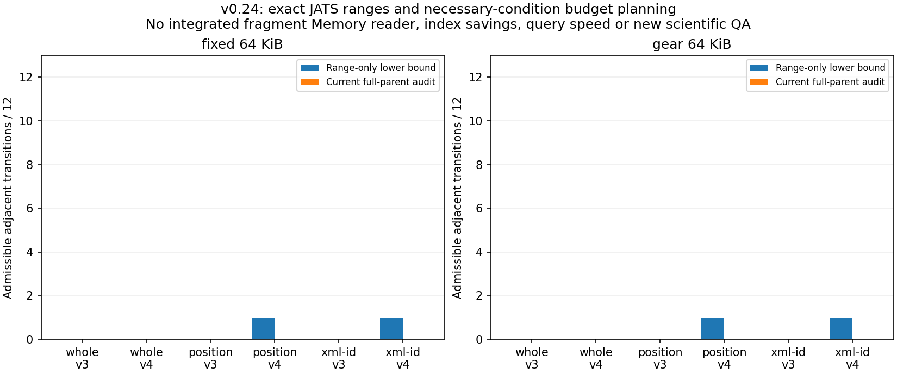

9新进程、162次文件解析，26历史CAS快照全源核验；181测试通过、1权限跳过，0模型/
新增独立论文/科学QA。全部51模块/HTML源一次、Gear整份旧实测库/元数据另计；公共
运行时/实际FTS未全额计入，不与v0.23系统体积算净压缩率。仅本机温缓存。

[冻结协议](docs/JATS-FRAGMENTS.md) · [详细实验报告](results/v0.24.0/SUMMARY.md) ·
[逐转换规划](results/v0.24.0/plans.json) · [验证](results/v0.24.0/validation.json) ·
[Release](https://github.com/StarlitPupils/RKV-1/releases/tag/v0.24.0)。

## v0.23.0 · 独立真实论文正文修订基线

新增eLife JATS原始XML整文件证据定位，标题/普通摘要/正文段落只作检索投影；
完整原文、评审/图表等所有字节仍在CAS。内部实体声明与外部实体引用拒绝，外部
DTD不加载。新来源kind需v0.23，旧v0.22不能解码，归档/CAS/清单格式不变。

实现/协议于a58d640冻结。固定官方提交、内容查看前选定的前六篇三版本论文，
18文件、12次实际正文投影变化；不是正文相同的QASPER标注发布。逐篇v2再逐篇v3，
初始加12更新，共13快照。固定/Gear、三策略各三轮，全部历史保留。

| 条件 | 全部历史计入B | 总提交wall中位s | 基础索引数 |
|---|---:|---:|---:|
| 固定 重建 | 3556231 | 0.943 | 13 |
| 固定 预算v3 | 3556330 | 0.900 | 13 |
| 固定 投影v4 | 3663389 | 0.999 | 13 |
| Gear 重建 | 3645981 | 0.860 | 13 |
| Gear 预算v3 | 3646080 | 0.863 | 13 |
| Gear 投影v4 | 3753139 | 0.923 | 13 |

**整篇记录粒度没有获得增量索引收益。** 每次旧+新记录都超过256KiB，预算v3/v4
均因记录字节建立检查点；没有为获得收益调高门槛，v4指纹表还增加空间。
Gear CAS和原生依赖另计，不能把CAS复用当成v4索引收益。下轮研究更细证据粒度。

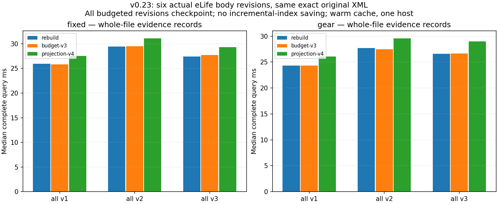

4212正式/936历史身份查询全部匹配重建排序、BM25和精确当前来源；234历史实例
全源核验、234阴性控制通过。同表示CAS树一致，查询不改持久树。177测试通过、
1权限跳过，0模型调用/新增科学QA。18自动诊断词项非人工gold题，六篇非大样本。
全部50模块/HTML计一次、Gear另计整份旧实测库/元数据；公共运行时未全额分配。
默认继续预算v3，v4显式。仅本机温缓存；E3、多跳、长期对话等仍未验证。

[协议及输入](docs/PAPER-REVISIONS.md) · [全矩阵](results/v0.23.0/SUMMARY.md) ·
[核验](results/v0.23.0/validation.json) · [Release](https://github.com/StarlitPupils/RKV-1/releases/tag/v0.23.0)。

## v0.22.0 · 降低v4查询定位准备成本

v4查询批量核对全部重绑定，仅在命中时替换当前locator；纯定位/位移overlay直接
查询只读基础，不再复制SQLite。有FTS删除/upsert仍复制并完整重放；完整基础/
overlay/源树、CAS原字节、原记录与投影SHA校验保留，非命中重绑定也全部核对。
不加跨查询缓存，writer/格式/默认策略不改，v4继续显式选择。

实现/协议于659c354冻结。复用v0.21六个完整保留库、15状态，实际已发布v0.21
读取器、批量但强制复制消融、当前直接读取、当前v3参考各三轮。同轮查询结果：

| 官方发布组/阶段 | 旧v4中位/p95 | 当前v4中位/p95 | 配对加速 | 同轮v3中位 |
|---|---:|---:|---:|---:|
| 固定64KiB，v0.2 | 23.37/25.45ms | 19.41/21.37ms | 1.200× | 12.40ms |
| 固定64KiB，v0.3 | 23.24/25.57ms | 19.54/21.83ms | 1.200× | 12.42ms |
| Gear64KiB，v0.2 | 24.64/27.08ms | 20.68/23.06ms | 1.189× | 14.18ms |
| Gear64KiB，v0.3 | 24.64/27.29ms | 20.60/23.13ms | 1.177× | 13.94ms |

末版新进程峰值固定41.10→35.55MiB、Gear41.06→35.80MiB；只是同轮完整进程
峰值，不是查询增量RAM。批量消融约1.02倍，免复制在此基础上再配对快1.15–1.17倍。
初始/单条标注无稳定收益，小合成基础的免复制也无额外稳定收益；**v4仍慢于v3，
默认继续预算v3。** 混合FTS变化仍复制，不能由纯定位收益推导所有更新更快。

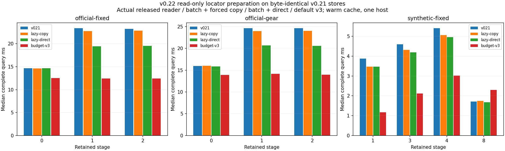

6336正式查询、720历史完整身份查询均匹配实际v0.21及原发布记录的排序、BM25和
精确当前来源。108未来探针阴性，30历史快照实例全源核验，180新进程前后整库
逐文件大小/SHA不变；6个原库完全不改。174测试通过、1项权限跳过，0模型调用/
新科学问题。官方正文相同，合成控制非真实正文修订；仅本机温缓存。

无新增持久索引/压缩收益或提交性能结论。全部49个Python模块/HTML分配
352222→353491B，增加1269B一次；Gear保留原生成库/元数据124419B，查询不加载
原生模块。公共运行时/pyc/安装/文件系统元数据未全额分配，不称完整部署净压缩。
worker使用相同小问题输入，不与v0.21历史RSS直接相除。旧v0.21仍可读写同格式v4，
旧v0.20拒绝v4，旧记忆v1–v3及归档v1–v6/CAS1兼容，无迁移。

下一步转向独立真实论文正文修订，继续记录精确来源、索引空间与读取代价。E3、
长期对话、多跳、冷缓存/跨机器、并发/掉电及GC仍待验证，新问答需另定API预算。

[冻结协议/复现](docs/PROJECTION-QUERIES.md) · [全矩阵](results/v0.22.0/SUMMARY.md) ·
[核验](results/v0.22.0/validation.json) · [Release](https://github.com/StarlitPupils/RKV-1/releases/tag/v0.22.0)。

## v0.21.0 · 分离论文文本与精确字节定位

新增显式候选 compact-projection-v4：论文title/abstract/full_text段落指纹与当前
原始成员定位分开。仅路径、标注、JSON排版改变时保留FTS，更新当前SID/原路径/
偏移/长度/原SHA；正文变化仍完整重放。每个命中验证当前原文与完整论文投影SHA。
所有原始字段/全部历史保留；归档v1–v6/CAS1不变，新应用清单v4需v0.21读取器。

实现/协议于419b6b8冻结；三策略、三组、各三轮。QASPER官方dev原始三次发布
每版281论文、正文投影相同，复用既有64问题；固定/Gear单列，非真实论文正文修订。

| 官方发布组，全部历史 | v0.20预算v3 | 投影v4候选 |
|---|---:|---:|
| Gear：最终计入空间 | 15.718 MB | **9.441 MB，省39.94%** |
| 固定64KiB：最终计入空间 | 18.129 MB | **11.851 MB，省34.63%** |
| Gear：末版查询中位/p95 | **13.79 / 16.14ms** | 24.17 / 26.92ms |
| 固定：末版查询中位/p95 | **12.29 / 13.87ms** | 22.90 / 27.32ms |
| Gear：三次提交wall总中位 | 1.716s | 1.635s |
| 固定：三次提交wall总中位 | 2.168s | 2.114s |

每版新写索引由3182592B变成约27000B定位overlay，但首份基础多32768B指纹表；
真实组三份完整基础减至一份。空间收益明确，查询准备变慢；小幅提交差异不证明
普遍提速。**默认继续compact-budget-v3；v4显式选择，不迁移现有库。**

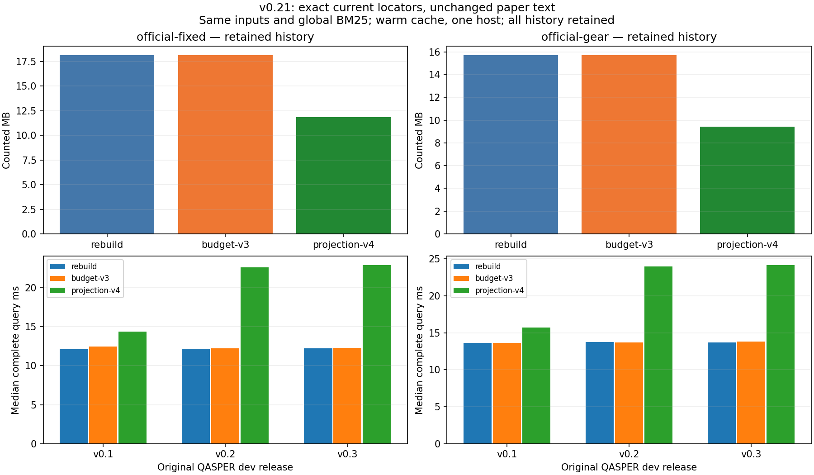

160篇合成论文9状态另测标注/改名/重排、正文增删、33篇标题改写、恢复和label别名。
v4在0/5/6建基础，预算v3建5份；最终计入685095B/709315B。正文变化不被当作标注
跳过，三预算/25%/256位移规则保留，重绑定另限4096条；并非所有控制阶段更快。

4752正式、540历史完整身份查询均匹配重建的排序/BM25/精确来源；135历史快照
实例全源核验，81未来探针阴性。同表示CAS树一致，查询不改持久树。170项测试
通过，1项Windows权限跳过；0新增科学问题或模型调用，仅本机温缓存。

成本含全部49个RKV Python模块/HTML共352222B一次，Gear另计整个实测库/元数据
124419B；公共运行时未全额分配，非完整部署净压缩。不与旧版不同成本口径混比。
旧v0.20读取器拒绝v4，v1/v2/v3继续兼容。新库显式启用候选：

```powershell
python -m rkv1 memory-init path/to/new-memory path/to/evidence --index-profile compact-projection-v4
```

下一步优先减少v4查询定位准备，再补独立真实论文正文修订。E3、长期对话、多跳、
冷缓存/跨机器、并发/掉电、GC仍未验证，新问答实验需另定API预算。

[冻结协议/复现](docs/MEMORY-PROJECTION.md) · [全矩阵](results/v0.21.0/SUMMARY.md) ·
[核验](results/v0.21.0/validation.json) · [Release](https://github.com/StarlitPupils/RKV-1/releases/tag/v0.21.0)。

## v0.20.0 · 为增量索引增加回放预算

新建记忆库默认 compact-budget-v3：相对基础的累计变化最多32条、重放原记录
最多256KiB、逐次CAS解码工作最多2MiB，超过任一项则建立完整索引检查点。
保留既有25%变化/256位移区间门槛；原文、全部历史和全部校验继续保留。
预算约束重放工作量，不能保证总查询时延或RSS上限。

实现与协议于7df94f7冻结。四组合成控制×四策略×三轮，包含上一版100更新原样
回归、默认固定分块复测，以及大记录/大分块定向控制。同轮同源码对照：

| 场景 | 旧策略查询中位/p95 | 新三预算查询中位/p95 |
|---|---:|---:|
| 固定64KiB，第42次更新 | 534.47 / 684.67ms | **2.36 / 8.18ms** |
| Gear64KiB，第42次更新 | 589.44 / 780.32ms | **2.19 / 9.03ms** |
| 大记录，第2次更新 | 11.14 / 21.66ms | 2.61 / 13.49ms |
| 固定1MiB，第2次更新 | 29.77 / 66.21ms | 7.91 / 45.90ms |

第42次更新提前检查点，保留全部101个状态的Gear总计成本由旧策略9.162MB变为
9.140MB（完整重建83.739MB），检查点从0/43/80变为0/42/80，数量仍为3。
大记录/大分块组则各从1个基础增至3个：总计成本1.159→2.461MB、5.620→10.977MB。
这是读写与空间取舍；第43/79次更新新策略约5ms、旧策略约2–3ms，不能称处处更快。

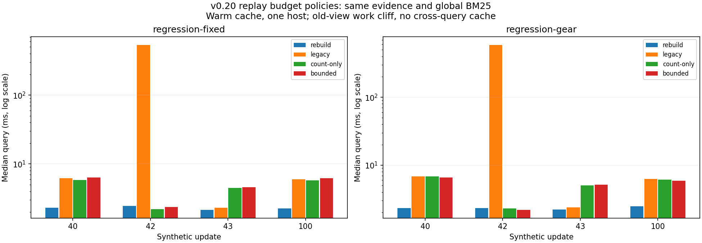

4032正式查询、10176历史身份查询均匹配完整重建的排序、BM25和精确来源；2544
历史快照实例全源核验通过，2544未来探针阴性。同表示CAS树一致，查询不改持久树。
164项测试通过、1项Windows权限跳过。0次新模型调用，0条新增科学问题；这些是
合成定向控制与已见回归，本机温缓存，不能推出新科学推理质量或真实修订泛化收益。

成本统一计入全部48个RKV Python模块及HTML一次，Gear另计完整实测DLL/元数据
124419B；公共运行时未全额分配，不是完整部署占用。口径与v0.19不同，不跨版算
压缩提升。物理归档v1–v6、CAS1、记忆清单v1–v3不变；v0.19能读新v3视图，但其
writer拒绝新策略。旧库不自动切换，显式启用只影响未来新建视图：

```powershell
python -m rkv1 memory-budget path/to/existing-v3-memory
```

该命令不改HEAD、不修复旧慢快照；复用同一输入/标签仍返回原视图。新库可显式
`--index-profile compact-base-v3` 保留旧策略。QASPER路径/标注耦合仍待修正；冷缓存、
跨机器、并发/掉电、E3、长期对话和多跳验证仍未完成。

[冻结协议/复现](docs/REPLAY-BUDGET.md) · [全矩阵](results/v0.20.0/SUMMARY.md) ·
[核验](results/v0.20.0/validation.json) · [Release](https://github.com/StarlitPupils/RKV-1/releases/tag/v0.20.0)。

## v0.19.0 · 原始QASPER与100更新边界

新增QASPER原始JSON成员字节定位，只索引论文title/abstract/full_text，不索引问答
标注。原文件名、空白/转义/全部原字段仍在CAS原样保存。单个成员可独立恢复ID与
原文SHA；未知模式、重复key、截断拒绝。新来源kind需v0.19；旧文本/SciFact兼容，
归档v1–v6、CAS1与记忆v1-v3物理格式不变。

**本轮发现明确限制：真实发布未获增量空间收益；25%门槛前可出现严重查询退化。**
实现/协议于26a8e89冻结。三轮对照都用同Gear/Rust提交，隔离完整重建与v3增量；
默认仍固定/v3，本轮不代表默认固定提交性能。全部原文/历史保留，无GC。

| 实验组 | 完整重建计入成本 | v3增量计入成本 | 全部提交wall中位，重建/增量 |
|---|---:|---:|---:|
| QASPER官方dev三次发布 | 15.40 MB | **15.40 MB** | 1.689 / 1.704s |
| 2048合成记录，初始＋100更新 | 83.43 MB | **8.86 MB，省89.38%** | 6.239 / 5.372s |

真实组每版281篇，正文投影相同，原成员改变281/9条；保留版本化文件名后，每次
均完整建索引。它验证真实数据集发布，不代表论文正文修订。三版各保留一个索引，
v3未有空间优势。控制组仅在初始/更新43/80写完整基础，其余保留累计差异。

| 合成控制位置 | 完整重建查询中位/p95 | v3增量查询中位/p95 |
|---|---:|---:|
| 更新42：512变化，恰为25% | 2.10 / 7.88ms | **462.80 / 478.63ms** |
| 更新43：513变化，检查点 | 2.03 / 7.32ms | 2.11 / 7.87ms |
| 更新80：260区间超256，检查点 | 2.17 / 8.28ms | 2.11 / 7.85ms |
| 更新100：小幅差异 | 2.16 / 7.72ms | 5.62 / 10.50ms |

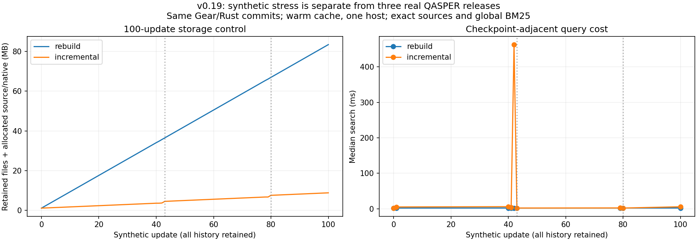

固定记录占比门槛不能约束实际重放耗时。空间/提交收益不等于读多负载收益，下一步
优先修正检查点代价策略，并分离论文投影变化与原始路径/标注变化，再扩论文真修订。

1800正式查询、2496完整身份历史查询均匹配完整重建；606未来词项探针阴性，624
历史快照全源大小/SHA重读一致，同表示CAS树逐字节相同，查询不改持久文件。
新增64个QASPER问题，其来源论文@5为22/64，仅为全局检索诊断；原任务给定论文，
不与SciFact召回或答案质量混比。控制问题非科学样本；**0次模型调用**。

统一计四份完整源36,033B＋整个实测DLL/元数据124,419B一次；公共运行时未全额分配，
不是完整部署净压缩。本机温缓存；158测试通过、1项Windows权限跳过。无E3、长期
对话、多跳、冷缓存/跨机器、并发/掉电或GC结论。Release保留精确实测库，与CI新库区分。

[冻结协议/复现](docs/MEMORY-HISTORY.md) · [全矩阵](results/v0.19.0/SUMMARY.md) ·
[核验](results/v0.19.0/validation.json) · [Release](https://github.com/StarlitPupils/RKV-1/releases/tag/v0.19.0)。

## v0.18.0 · 减少查询重复准备与定位重放

每次查询只打开/验证一次各个不同CAS快照与overlay，结束全部释放。v3仍完整重放
FTS改写并使用全库BM25，先检查所有位移范围计数、非负与不重复，再只换算命中的
未改写记录位置。完整基础索引/overlay SHA、每次CAS stored/raw及原记录SHA保留；
没有跨查询缓存或校验跳过。仍复制基础SQLite视图，不称消除全部准备工作。

实现/协议于4926af6冻结。固定/Gear两种现有v3存储、五阶段、三计划各三轮，
90个新进程完成**17,190次正式查询**。每阶段全部188条标注主张＋3探针的排序、
BM25和完整来源身份匹配实际v0.17发布模块。22个历史快照全源重读核验，两组持久
树每个文件大小/SHA完全不变。0次新模型调用，不是新推理质量结果。

| 同轮阶段 | v0.17中位 / p95 | v0.18中位 / p95 | 逐问题配对加速中位 |
|---|---:|---:|---:|
| 固定，原始 | 15.36 / 19.03ms | 13.78 / 17.50ms | 1.122× |
| 固定，追加 | 22.28 / 26.14ms | 18.80 / 22.29ms | 1.195× |
| 固定，13B插入 | 33.72 / 44.32ms | **22.04 / 30.03ms** | **1.543×** |
| 固定，最终 | 33.31 / 37.44ms | 21.08 / 24.84ms | 1.586× |
| Gear，13B插入 | 33.55 / 38.23ms | **22.26 / 26.38ms** | **1.515×** |
| Gear，最终 | 33.95 / 38.43ms | 22.48 / 27.87ms | 1.516× |

只复用资源消融在13B插入阶段为25.94/26.70ms（固定/Gear）；延后定位在此基础上
再配对快1.197/1.199×。无位移阶段无额外定位收益，部分中位略慢于消融。进程峰值
RSS约39–50MiB，无全面下降结论。wall含整个search及清理，启动另列；本机温缓存。

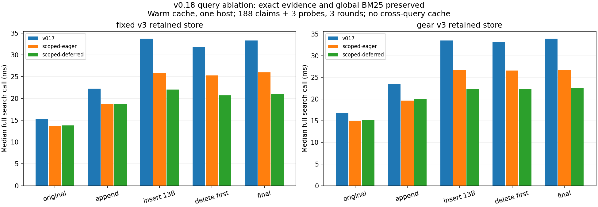

无新持久索引/压缩收益或提交时序结论。两份完整专用源25,552→29,353B，增加
3,801B一次；公共Store/core/Python/SQLite/OS未全额分配。查询不加载Rust库。
记忆v1/v2/v3、归档v1–v6/CAS1兼容；默认固定/v3、Gear/Rust提交仍显式选择。
154项测试通过，1项Windows权限跳过。无格式迁移、GC、长期对话、多跳、E3或新
问答质量结论。主张仍188条，重复计时不增加科学样本量，不跨历史批次直接算加速。

[冻结协议/复现](docs/MEMORY-QUERIES.md) · [全矩阵与原始记录](results/v0.18.0/SUMMARY.md) ·
[核验](results/v0.18.0/validation.json) · [Release](https://github.com/StarlitPupils/RKV-1/releases/tag/v0.18.0)。
本机检索演示：http://127.0.0.1:8768 ，25条既有派生记录逐字节保留，未配置模型。
下一步扩真实版本/更长历史与基础索引成本；新问答评测需另定API预算。

## v0.17.0 · 降低短插入与连续版本的重写放大

新v3应用索引用单份基础相对差异与偏移区间表示每个快照，未改写记录仅更新位置，
不再因为整批偏移变化重建索引。复用已有Gear-v1和可选Rust扫描，分别对照CAS复用
与索引更新。新建库默认固定分块＋v3；Gear/Rust显式选择，既有库不自动迁移。

5条件×3轮、每组11个连续快照，包含追加、等长改写、短插入/撤销、删除。全部
原文/历史/索引保留，**8,070次正式查询＋1,815次旧快照查询**的排序及来源身份
匹配固定/v2；165个历史快照最终重开核对整源SHA/大小。初始188条主张排名保持
v0.16水平，无新模型调用，不作新科学推理质量结论。

| 条件 | 11快照＋源码/原生分配 | 对固定/v2净省 | 11次提交总wall中位 |
|---|---:|---:|---:|
| 固定/v2 | 39.29 MB | — | 6.923s |
| Gear Python/v2 | 30.47 MB | 22.45% | 24.563s |
| 固定/v3 | 17.47 MB | 55.53% | 5.569s |
| Gear Python/v3 | 8.65 MB | 77.98% | 23.142s |
| Gear Rust/v3 | **8.78 MB** | **77.66%** | **4.097s** |

统一计整份memory.py/memory_index.py/chunking.py源28,756B一次，Rust另计完整实测
DLL＋元数据124,419B；公共Python/SQLite/Store/core/OS、文件系统元数据未全额分配。
不是完整部署净压缩，也不与v0.16不同阶段/回答账本直接算版本提升。

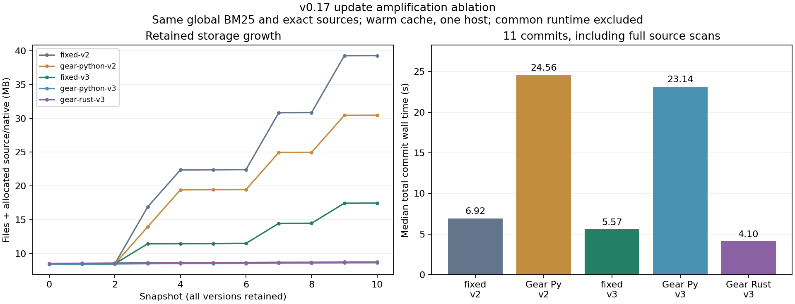

13B插入时，固定分块新增127个CAS对象，Gear仅1个；v2新写5,455,872B索引，v3
只需387B（固定）/385B（Gear）差异。11快照中v2完整建基础索引5次，v3仅初始1次。
Python/Rust Gear的整个持久树逐阶段逐字节一致；Rust只加速扫描，不加速查询。

查询有代价：13B插入后固定/v2中位/p95为16.37/20.83ms，Gear Rust/v3为
36.70/44.73ms；新查询进程峰值36.21→40.21MiB。位置重放使v3查询更慢，不称
全流程支配；Python Gear提交也明显更慢。仅本机温缓存，启动时间另列。

本机149测试：148通过、1项Windows权限跳过。新v3清单需v0.17；旧v1/v2继续原
策略，归档v1–v6/CAS1不变。累计非位置改动超过25%或偏移区间超过256仍建检查点，
无自动迁移或GC，不声称任意更新恒定成本。E3、长期对话、多跳/形式验证仍未实现。

```powershell
python -m pip install -e .
python -m rkv1 memory-init data/new-memory data/memory-source
# 可选Gear；每次Rust提交都显式指定已核验库和相邻native.json。
python -m rkv1 memory-init data/gear-memory data/memory-source --chunker gear-v1 --chunker-backend rust --native-library measured/rkv1_core.dll
python -m rkv1 memory-add data/gear-memory data/updated-source --chunker-backend rust --native-library measured/rkv1_core.dll
```

[冻结协议/复现](docs/MEMORY-UPDATES.md) · [全部成本与原始记录](results/v0.17.0/SUMMARY.md) ·
[核验](results/v0.17.0/validation.json) ·
[Release](https://github.com/StarlitPupils/RKV-1/releases/tag/v0.17.0)。
Release另附**实际参与测量的旧Gear库及原始元数据**，区别于本次CI新编译的原生库。
下一步剖析查询定位重放，扩真实更新家族与更长历史；新问答评测需另定API预算。

## 记忆索引成本对照（v0.16.0）

新建库使用紧凑FTS5基础索引与增量重放：去掉索引中的正文副本，小幅更新复用基础
索引；每次查询核验完整基础/增量SHA，在内存中重放当前完整视图，再用SQLite全库
BM25排序。命中仍回CAS读精确原记录，保留所有旧快照和旧索引，不删除历史。

三策略×三轮，**4,275次正式查询＋1,764次旧快照检查**的排序与来源身份全部匹配
旧完整索引，BM25误差<=1e-10。初始188条主张排名与v0.15一致，gold文档召回@5仍
**88.34%**。本轮**0次模型生成**；已有模型请求SHA/响应引用的离线重放不算新推理结果。

| 同轮同来源成本 | 旧完整索引 | 紧凑完整索引，计专用源 | 紧凑增量，计专用源 | 增量相对旧策略净省 |
|---|---:|---:|---:|---:|
| 初始一快照 | 19.32 MB | 8.43 MB | 8.43 MB | 56.36% |
| 追加88B，保留两快照 | 35.69 MB | 13.90 MB | **8.44 MB** | **76.34%** |
| 定位大幅变化，保留三快照 | 55.01 MB | 22.32 MB | 16.86 MB | 69.34% |
| 删除控制，保留四快照 | 74.32 MB | 30.73 MB | 25.28 MB | 65.99% |

一份索引从16,355,328B降至5,455,872B；88B追加只新写**234B**索引增量。仍全量
读取/哈希提交来源。超过25%记录定位改变或已有8层增量时完整建紧凑检查点，旧文件
全部保留。改写/删除是合成机制控制，不代表新科学数据或推理提升。

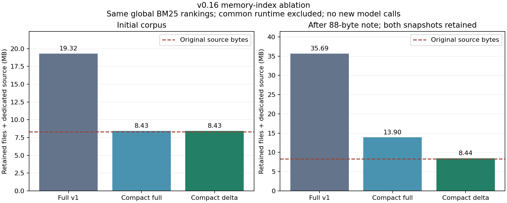

追加场景查询中位/p95：旧索引37.09/54.46ms，紧凑完整16.82/24.55ms，紧凑增量
25.61/36.37ms。增量相对旧策略配对加速中位1.393倍，但比紧凑完整更慢；查询进程
峰值RSS分别48.35/38.01/46.76MiB（含解释器/加载）。增量完整提交中位298.37ms，
旧策略666.44ms。空间、速度、内存分别衡量，不称全流程支配；本机温缓存。

计入整个memory_index.py源10,731B一次后，初始库仍为原文8.31MB的**1.015倍**。
公共Python/SQLite/core、文件系统元数据未全额分配，尚无整个记忆系统净压缩结论。
本轮没有回答写回，不能直接用v0.15含回答的35.73MB计算配对节省。

本机141项测试：140通过、1项Windows权限跳过。归档v1–v6/CAS1不变；旧v1记忆库
继续原策略，新v2应用清单需v0.16读取器，v0.15拒绝新清单。无自动迁移或GC。

```powershell
python -m pip install -e .
python -m rkv1 memory-init data/new-memory data/memory-source
python -m rkv1 memory-search data/new-memory "rare genetic variants"
python -m rkv1 memory-add data/new-memory data/updated-source --label revision-2
python -m rkv1 memory-serve data/new-memory
```

模型仍按本机RKV_LLM_BASE_URL/MODEL/API_KEY配置，未配置时仅检索，密钥不写仓库。
[冻结协议](docs/MEMORY-INDEX.md) · [全部时序/资源与结果](results/v0.16.0/SUMMARY.md) ·
[核验](results/v0.16.0/validation.json) ·
[Release](https://github.com/StarlitPupils/RKV-1/releases/tag/v0.16.0)。
下一步压低单份索引/定位元数据，扩大更新负载和独立问题评测，再测长会话；
E3神经压缩、多跳及形式化验证仍未实施。新增模型评测需另定调用预算。

## 首个证据记忆与模型回答（v0.15.0）

已打通原始资料CAS保存 → SQLite FTS5/BM25检索 → 原记录SHA校验 → 模型判断 →
句子引用绑定 → 派生回答写回。新增CLI与本机中文演示页，支持资料更新及读取旧快照。
这是E4最小基线；E2尚未完成，E3神经压缩尚未实施，不宣称无限上下文。

SciFact 5,183篇摘要（8,307,875B）逐字节保存，索引不含主张/gold标签。188条有标注
主张三轮共564次查询，重复轮次不是独立样本。gold文档宏平均召回@1/@5/@10分别
**70.70% / 88.34% / 94.21%**；含索引和CAS校验的本机温缓存检索中位43.58ms、p95
57.47ms。冷缓存、跨机器未测，词法基线不代表跨语言语义检索。

| 同一个证据约束模型，两种输入 | 格式/引用绑定有效 | 标注判定正确 | 8条有证据主张判定与完整依据同时正确 |
|---|---:|---:|---:|
| 空证据 | 12/12 | 4/12 | 0/8 |
| top5检索证据 | 12/12 | **10/12** | **6/8** |

真实DeepSeek `deepseek-flash` 官方API共24次生成，12条预定平衡dev主张每条件一次，
关闭thinking、JSON模式、最多256输出token，无重试。资料/检索本机CPU，模型远程。
空证据仍被要求仅据所给证据回答，不是无约束闭卷或成熟RAG对照；公开dev小样本、
模型可能见过数据，不据此宣称通用推理提升。引用绑定不证明科学蕴含。两条错误的
完整gold依据都已提供，失败在模型判断/引用选择，原始记录全部保留。

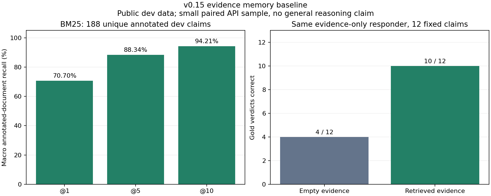

资源成本尚未达标：初始库加一个完整索引为**19,319,447B，原文2.325倍**；保留两个
索引快照和派生记录后**35,728,598B，原文4.301倍**，索引占32,710,656B。不能称整个
记忆系统净压缩；公共运行时、文件系统元数据和远程模型成本未完整分配。服务报告
输入30,634、输出1,029token，实际账单未知。派生回答不会自升格为原始证据。

本机132项测试：131通过、1项Windows权限跳过。旧归档v1–v6/CAS1保持兼容。

```powershell
python -m pip install -e .
python -m rkv1 fetch data/scifact --dataset scifact
New-Item -ItemType Directory -Force data/memory-source
Copy-Item data/scifact/corpus.jsonl data/memory-source/corpus.jsonl
python -m rkv1 memory-init data/my-memory data/memory-source
python -m rkv1 memory-search data/my-memory "rare genetic variants"
$env:RKV_LLM_BASE_URL="https://api.deepseek.com"
$env:RKV_LLM_MODEL="deepseek-flash"
# RKV_LLM_API_KEY只在本机环境配置；未配置模型时页面仅检索。
python -m rkv1 memory-serve data/my-memory
```

浏览器打开 http://127.0.0.1:8765 。手动回答每次会调用API，正式评测不会自动重跑。
`memory-add`的source为完整新版资料树，旧快照仍保留；当前每快照一份完整索引。

[协议/执行说明](docs/MEMORY.md) · [原始结果与失败分析](results/v0.15.0/SUMMARY.md) ·
[独立核验](results/v0.15.0/validation.json) ·
[Release](https://github.com/StarlitPupils/RKV-1/releases/tag/v0.15.0)。
下一步优先扩大独立问题、诊断弃答/引用选择和检索误差，并降低索引重复成本；
之后再测长会话、多跳与语义检索，不把存储无损等同于推理无损。

## 跨领域字节重排与代码/数学对照（v0.14.0）

E2复测既有简单字节重排：新增地球物理SAC样例和分子动力学DCD样例，加入完整
Python源码、LaTeX数学文档作为非数值对照，另保留已见ECG与固定噪声。输入、规则、
算法在新压缩结果前冻结；本轮没有新增归档格式或编码算法。六组各8条件，统一
v4：Zlib6/Zstd3 ×64KiB/1MiB ×普通/重排；恢复全部显式files，含文件fsync。

**240次正式完整恢复、43,520次正式范围读取**，另48次恢复预热、5,440次查询预热
全部逐字节一致。正式完成文件fsync请求320次；20次Windows目录发布重试等待
计入时序，全部阶段和范围返回有追加日志，不重跑整次任务。本机120项测试：
119通过、1符号链接权限跳过；冻结候选Windows/Linux CI通过。

下表为本矩阵中每方法事后最小完整归档，重排另计整个numeric.py源1,431B一次；
不是预先固定的部署策略或速度最优，公共运行时未全额分配：

| 输入 | 最小普通归档 B | 最小重排归档 B | 加源后净省 |
|---|---:|---:|---:|
| 新SAC地震样例 | 66,749 | 47,854 | **26.16%** |
| 新DCD分子轨迹 | 3,634,034 | 3,067,142 | **15.56%** |
| Python源码对照 | 6,148 | 6,161 | −23.49% |
| LaTeX数学文档对照 | 22,478 | 22,491 | −6.42% |
| 已见ECG | 865,389 | 627,711 | 27.30% |
| 合成噪声 | 262,677 | 262,690 | −0.55% |

两份新科学输入共用专用源一次：普通3,700,783B；重排3,114,996+1,431B，净省
**15.79%**，由较大DCD主导。不能与不同语料的v0.11/v0.12百分比当作升级幅度。

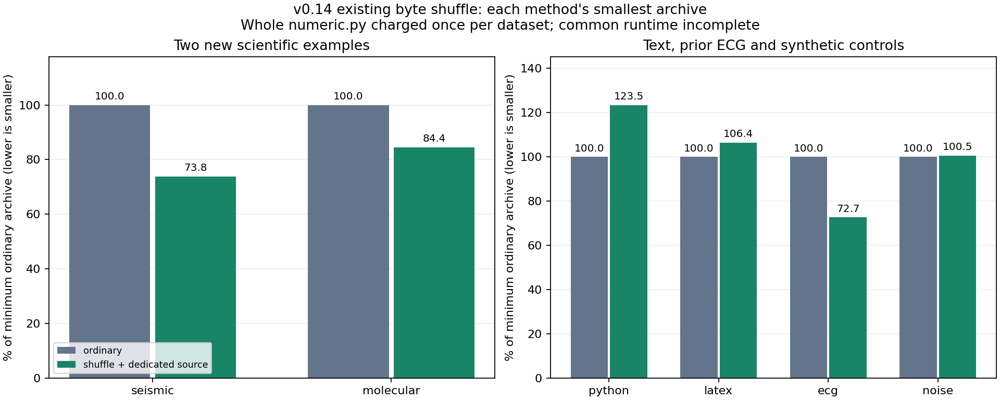

两个新科学输入的主联合验收 **2/8通过**，均为DCD的Zlib工作点。相对同codec/块
普通编码，64KiB/1MiB重排计源净省14.69%/15.36%，完整恢复配对加速1.371×/1.308×，
常驻p95 1.713×/1.407×，重开p95 1.196×/1.445×；但编码配对仅0.600×/0.595×，
编码更慢。两个工作点的无发布重试配对子集恢复仍快1.220×（3对）/1.330×（4对），
仅作事后诊断，全部原轮次保留。通过不代表胜过所有普通codec或全流程支配。
本轮比较重排与普通编码；v0.12比较分段与普通/整文件重排，不能把0/8→2/8当版本胜负。

SAC有空间收益但同步恢复/读取未满足全部速度门槛。文本和噪声均无实际重排块，
完整归档仍多13B顶层标签，并有失败压缩尝试成本；时序波动不当作重排收益。
没有新增AST/数学语义压缩，也不把已有ECG当新验证样本。八个ECG归档完整SHA与
v0.10相同，证明这次没有改变其编码字节；不跨历史同步批次计算速度提升。

SAC只有一个公开样例；DCD只有一个分发测试文件，3,341原子、实际98帧，原头声明
500帧差异完整保留。不是完整数据库/模拟运行、严格盲测或大样本跨域泛化。
默认编码不切换，原始输入/用户研究文档不进入发行包。冷缓存、跨机器性能、数值Rust、
CAS+数值及E3/E4推理未测；文件同步不等于目录或真实掉电持久性证明。

```powershell
python -m pip install -e ".[zstd]"
python -m scripts.run_crossdomain --out results/local-crossdomain
```

[冻结协议](docs/CROSSDOMAIN.md) · [全部原始结果与逐阶段日志](results/v0.14.0/SUMMARY.md) ·
[独立核对](results/v0.14.0/validation.json) ·
[Release](https://github.com/StarlitPupils/RKV-1/releases/tag/v0.14.0)。
下一步优先在明确负载下筛选工作点，并实现代码/数学的可逆语义候选；根据计算热点
决定数值Rust，不把同步等待误判为Python循环成本。

## 恢复文件同步、故障边界与账本更正（v0.13.0）

归档 `unpack` 默认在每个完整文件 SHA 验证后执行 **flush → fsync → close**，
空文件同样处理，全部文件完成后再发布目录。同步错误直接失败；显式
`--sync-policy close` 保留历史关闭边界作为对照。编码与 v1–v6 格式不变，
不宣称压缩率改善；CAS 恢复不在本次同步策略变更范围内。

同归档、同 SHA、十轮配对，本机 Windows/E: NTFS 温缓存，80 次正式恢复和 8 次
预热全部逐字节一致；正式完成 1,350 次文件 fsync 请求。以下耗时包含校验、关闭、
发布和实际 Windows 重命名重试等待，不含进程启动与外部真值比较：

| 案例 | 文件数 | close 中位 ms | files 中位 ms | 配对额外 ms | files/close 配对中位 |
|---|---:|---:|---:|---:|---:|
| ECG / v4 | 3 | 7.038 | 22.231 | 15.298 | 3.135× |
| M13 / v4 | 1 | 29.660 | 87.844 | 58.733 | 3.003× |
| M13 / v6 | 1 | 27.365 | 88.260 | 61.207 | 3.257× |
| 合成文件数对照 / v2 | 130 | 40.273 | 553.017 | 512.846 | 13.716× |

差值和倍率先逐轮计算再取中位。130 文件案例不是科学语料；同步成本依文件数、
设备和缓存变化，不能将这些倍率推广到其他机器或解释为纯 fsync 内核延迟。

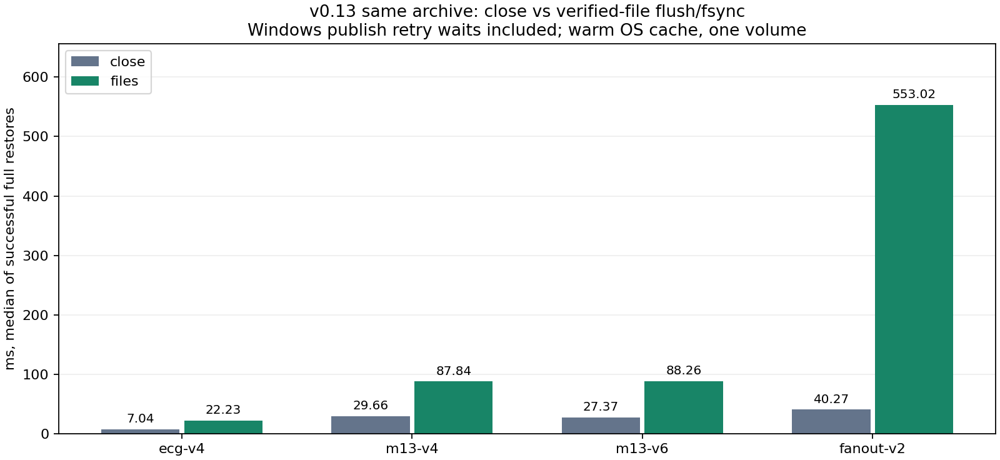

v1–v6 ×11 情形×3轮的 **198 条故障审计**均符合预期：写/flush/fsync/关闭/发布前
失败不发布；发布前强杀留下私有暂存，目标不存在；发布后强杀目标完整存在，但
客户端可能未收到成功。没有自动孤儿恢复，也没有目录/卷同步或真实掉电证明。
本机115项测试：114通过、1 Windows符号链接权限跳过。

首轮实验因 Windows rename 拒绝及诊断编码问题中止，记录单独保留。修订版仅对
Windows rename 的5/32/33错误最多尝试4次，等待10/50/100ms，所有等待计时；
最终正式样本有1次发布重试、0失败，不重试同步或整次恢复。

**历史更正：** v0.12 分段读取的分析性工作量误用固定块偏移。本版按真实前缀定位，
重编码100个归档确认完整SHA不变，再以独立线性扫描核对96,000次原请求；24个
分段配置、720组账本需更正。旧标签/结果不覆盖，原延迟和0/8联合验收计算不变。

```powershell
python -m pip install -e ".[scientific]"
python -m rkv1 unpack evidence.rkv restored
python -m rkv1 unpack evidence.rkv close-control --sync-policy close
python -m scripts.run_sync --out results/local-sync
```

[协议与边界](docs/PERSISTENCE.md) · [原始结果与分析](results/v0.13.0/SUMMARY.md) ·
[中止记录](results/v0.13.0/attempt-history.json) ·
[账本更正](results/v0.13.0/v012-work-ledger-correction.json) ·
[Release](https://github.com/StarlitPupils/RKV-1/releases/tag/v0.13.0)。
后续继续 E2 类型候选、代码/数学与热点筛选；E3/E4、冷缓存、跨机器性能及推理未测。

## FITS 类型分流与区域分块（v0.12.0，历史实验）

E2新增显式FITS白名单和区域分块：识别一个完整2D float32/64主图像，头、图像、
填充按原始边界分块，只对图像字节重排；不转换数值/端序，不重写文件。未知格式
保守回退普通编码。新v6保存实际块配方，解码不依赖外部FITS解析器，支持精确范围读。
默认none/v2、数值/v4、Blosc/v5、单元/v3、CAS1保持不变，旧读取器拒绝v6。

规则与验收先固定，再测新验证记录：11,586,240 B的M13叠加float64图像及478,080 B
的ROSAT float32图像。另保留已见Spitzer开发记录、ECG和噪声回退对照。
全部20条件/组、五轮、统一v6：Zlib6/Zstd3 ×64KiB/1MiB ×普通固定、整文件重排、
固定块类型分流、仅分段、分段类型分流。**500次正式完整恢复、96,000次正式范围
读取**，另100次恢复预热、12,000次查询预热全部逐字节一致。本机104项测试：
103通过、1符号链接权限跳过；Windows/Linux CI通过。

**新增布局未超过已有整文件重排的联合收益。** 两份新验证输入各自按最小归档
选参，专用源共用一次（不是预先固定的部署策略或速度最优）：

| 方法 | 合计完整归档 B | 专用源一次 B | 对最小普通归档加总净省 |
|---|---:|---:|---:|
| 普通固定块 | 2,921,262 | 0 | 基线 |
| 整文件字节重排 | 1,961,771 | 1,431 | **32.80%** |
| 固定块仅图像重排 | 2,068,709 | 4,824 | 29.02% |
| 仅区域分块 | 2,921,393 | 3,393 | −0.12% |
| 分段且仅图像重排 | 1,960,598 | 4,824 | **32.72%** |

分段类型归档合计比整文件重排少1,173 B，但新增整个layouts.py计3,393 B后，
反而多2,220 B。M13/ROSAT整文件重排单组计源后分别净省35.70%/8.92%，分段类型
为35.56%/8.31%；这些是新数据上的观察，不能把32.80%与v0.11的13.60%当成升级收益。
两个新记录的四种codec/块工作点共 **0/8通过预定联合验收**：须同时相对普通固定
和整文件重排，在计源后不增大，恢复/常驻p95/重开p95配对中位均>=1且各至少4/5轮更快。
编码成本另列，空间单项收益不冒充联合通过。规则没有按结果回调，默认不切换。

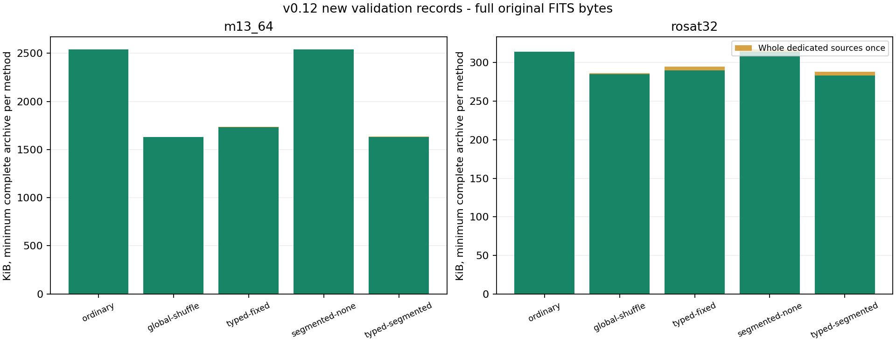

分段读取器额外建立unsigned-64前缀偏移数组，其逻辑字节和进程RSS均报告。
识别与分段也有成本；ECG不在本次FITS白名单内，回退会错过人工声明int16重排的收益。
M13大文件主导合计，ROSAT约22.66%正零；两个新样本仍是同一项目的天文数据，
不是跨科学领域验证。专用源4,824 B不是完整部署大小，公共Python/core/Zstd/pyc未全额分配。

```powershell
python -m pip install -e ".[zstd]"
python -m scripts.run_layout --out results/local-layout
python -m rkv1 pack data/layout/m13_64 m13.rkv --codec zstd --chunk-size 65536 --layout fits-segments-v1 --transform fits-byte-shuffle-v1
python -m rkv1 verify m13.rkv
```

[冻结协议与执行说明](docs/LAYOUT.md) · [全部原始结果与对照](results/v0.12.0/SUMMARY.md) ·
[独立核对](results/v0.12.0/validation.json) · [Release](https://github.com/StarlitPupils/RKV-1/releases/tag/v0.12.0)。
持久性描述同步校正：归档写入flush/fsync；既有归档解包关闭文件、校验后发布目录，
没有逐文件fsync。此前部分说明对此描述过强，不把未执行操作计入成本，不声称掉电持久性。
冷缓存/跨机器、数值Rust、代码/数学、CAS+布局和推理收益仍未测。下一步先补持久性
语义的明确对照，再按热点与新领域数据筛选类型方案；E2未完成，E3/E4待开展。

## 完整浮点 FITS 与 Blosc 对照（v0.11.0）

E2 增加三个完整公开 FITS 示例（两个 float32、一个 float64），复测同一 ECG int16，
并保留随机字节负对照。完整文件、头、填充和 NaN payload 均逐字节恢复，不转换
数值/端序。新增固定 python-blosc **1.11.4** / C-Blosc 的 Zstd 无过滤、字节重排和
位重排，单线程、内部块 64KiB；不是 Blosc2 或 NDArray 子块随机读。

每组 18 条件、五轮、全部同 **v5 平块容器**；普通 Zlib6/Zstd3 与 Python 字节重排/
XOR 为对照。**450 次正式完整恢复、86,400 次正式范围读取**，另 90 次恢复预热、
10,800 次查询预热全部逐字节一致。源/源码/整份专用依赖冻结，各轮归档确定性一致。
本机 97 项测试：96 通过、1 Windows 符号链接权限跳过；Windows/Linux CI 通过。

下表在本次有限矩阵内分别按最小完整归档选参，不按速度选。Python 重排列为
Zlib/1MiB，净节省另计整个 numeric.py **1,431 bytes**；Blosc 列仅为依赖已安装
情景的归档增量。跨后端 Zstd 版本、级别映射与分块不同，不把差异归因于单个过滤器。

| 科学输入 | 最小普通归档 B | Python 字节重排归档 B | 加源后净省 | 最小 Blosc 过滤器 / 归档 B | 已安装情景节省 |
|---|---:|---:|---:|---|---:|
| Spitzer float32 | 1,838,171 | 1,631,953 | 11.14% | shuffle / 1,649,920 | 10.24% |
| Bolocam float32 | 1,455,509 | 1,333,725 | 8.27% | shuffle / 1,358,357 | 6.67% |
| MSX float64 | 109,110 | 92,840 | 13.60% | bitshuffle / 94,400 | 13.48% |
| ECG int16 | 865,389 | 627,711 | 27.30% | shuffle / 650,199 | 24.87% |

**归档收益没有覆盖本次小语料的整份专业库成本。** 实测 Blosc 发行包 4,876,827 B，
适配源 2,690 B；合计专用资源 **4,879,517 B**，独立环境没有 NumPy。
四组科学输入均选 Blosc shuffle、共用资源一次时：归档共 3,756,343 B，较各组最小
普通归档合计少 11.99%；加资源后共 8,635,860 B，反而多 **102.33%**。
同样四组 Python 字节重排加源一次共 3,687,660 B，净省 **13.60%**。
这些仍未完整分配公共 Python/core/Zstd/OS 成本，不称完整部署占用。

**速度取舍也分场景。** 完整恢复计入首次 Blosc 导入/设置，三个 FITS 的最小
Blosc 过滤归档恢复均慢于各自最小普通归档；正式范围读在查询预热后测量。
同 Blosc/64KiB 的 ECG 位重排相对无过滤：归档少 22.59%，编码/完整恢复/常驻 p95/
重开 p95 逐轮配对加速中位为 1.27×/1.10×/1.43×/1.27×，均 5/5 轮更快；
这只支持该工作点的同后端消融，不代表比所有普通 codec 更优或跨机器稳定。
Python XOR 在两个 float32 上恢复明显较慢，位重排也并非普遍比字节重排更省空间。

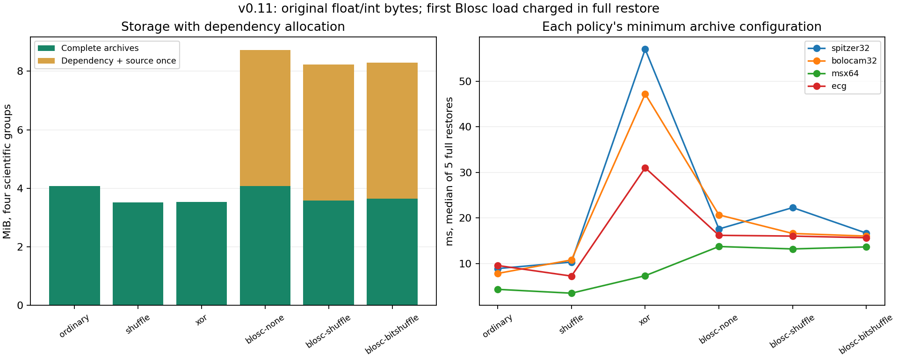

默认 none 仍写 v2，数值策略仍自动写 v4，专业 codec 自动写新 v5；旧读取器拒绝 v5。
既有 v3 单元/CAS 格式不变，未组合数值与共享 CAS 的收益。噪声全部回退 raw，
仍有策略标签与编码尝试成本，默认不启用新策略。

```powershell
python -m pip install -e ".[scientific]"
python -m scripts.run_scientific --out results/local-scientific
python -m rkv1 pack data/scientific/spitzer32 spitzer.rkv --codec blosc-zstd-bitshuffle-4 --chunk-size 65536
python -m rkv1 verify spitzer.rkv
```

正式复现请使用不含 NumPy 的独立环境，完整步骤见 [SCIENTIFIC.md](docs/SCIENTIFIC.md)。
[原始结果与完整比较](results/v0.11.0/SUMMARY.md) · [独立核对](results/v0.11.0/validation.json) ·
[数据来源](docs/DATASETS.md) · [Release](https://github.com/StarlitPupils/RKV-1/releases/tag/v0.11.0)。
三个 FITS 同属天文领域且同一托管项目，float64 很小，Bolocam 约 5% NaN；不外推
全部科学数组。冷缓存/跨机器/跨日、数值 Rust、代码/数学、CAS+数值、推理质量
尚未实测，E2 未完成，E3/E4 待开展。下一步优先按成本和读取工作点筛选类型/布局策略。

## 精确数值字节原型（v0.10.0）

E2新增显式`byte-shuffle-{2,4,8}-v1`和`xor-shuffle-{2,4,8}-v1`策略。
它们重排原始字节，或先对相邻字做XOR，再重排；不解析/舍入数值、不改端序，
残尾原样保留。数值策略写新 **v4** 平块归档，旧读取器拒绝v4；默认none仍写v2，
CSV/v3单元/CAS格式不变。块/文件/manifest SHA、有界解压和发布fsync均保留。

实测两个公开数据库各一条原始int16记录：EEGMMIDB S001R01的完整EDF+，以及
PTBDB s0010_re的dat/xyz/hea；另有固定种子随机字节负对照。无采样或文件转换，
原始头和注释也计入；每组12条件、五轮、全部同v4容器。
**180次正式完整恢复、34,560次正式范围读取**，另36次完整预热、4,320次查询预热
全部逐字节一致。本机90项测试：89通过、1符号链接权限跳过；Windows/Linux CI通过。

下表在本次Zlib6/Zstd3、64KiB/1MiB集合内，分别按体积选最小归档，包含全部
容器成本；另给每个候选全额加专用numeric.py源文件 **1,431 bytes**。这不是完整
部署成本；无额外DLL、模型或字典，公共Python/core/codec未全额分配。

| 原始记录 | 策略 | 归档+专用源 bytes | 对最小普通净节省 | 编码 ms | 恢复 ms |
|---|---|---:|---:|---:|---:|
| EEG | 普通 Zstd/1MiB | 682,548 | 基线 | 14.268 | 7.874 |
| EEG | 重排 Zlib/1MiB | 640,179 | **6.21%** | 114.230 | 8.417 |
| EEG | XOR重排 Zlib/1MiB | 585,333 | **14.24%** | 174.255 | 35.985 |
| ECG | 普通 Zlib/1MiB | 865,389 | 基线 | 44.029 | 9.307 |
| ECG | 重排 Zlib/1MiB | 629,142 | **27.30%** | 62.011 | 8.007 |
| ECG | XOR重排 Zlib/1MiB | 637,699 | **26.31%** | 120.620 | 32.224 |

**字节重排有值得继续验证的空间收益；XOR不自动更优。** EEG的XOR进一步缩小存储，
但恢复中位需普通最小归档约4.57倍时间；ECG中XOR既比单纯重排大，也恢复更慢。
所有真实记录的候选编码均比相同codec/块的普通编码慢，五轮均如此。

也存在有利的局部工作点：ECG/Zlib/64KiB重排归档减少26.90%，同轮恢复、常驻p95、
重开p95配对加速分别1.30×/1.97×/1.31×，均5/5轮更快；编码加速倍率为0.657×（更慢）。
大块虽能减少元数据，仍需整块反变换/校验，不能从压缩率直接推断随机读取改善。
所有配对倍率逐轮相除再取中位，不用两个耗时中位之比替代。

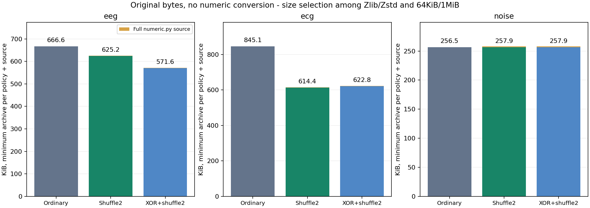

噪声12条件全部回退普通块，但策略标签仍增加12/13bytes，专用源另计，编码尝试
还需时间；因此默认保持none。v4数值本轮只测独立归档，未与共享CAS组合测量，
不能将本轮收益与v0.9的共享节省比例叠加。

```powershell
python -m scripts.run_numeric --out results/local-numeric
python -m scripts.summarize_numeric results/local-numeric
python -m rkv1 pack data/numeric/eeg eeg.rkv --codec zstd --chunk-size 65536 --transform byte-shuffle-2-v1
python -m rkv1 verify eeg.rkv
python -m rkv1 unpack eeg.rkv restored
python -m rkv1 compare data/numeric/eeg restored
```

运行器先下载并校验原始数据；[协议/格式/执行说明](docs/NUMERIC.md)、
[完整记录](results/v0.10.0/SUMMARY.md)、[数据来源与引用](docs/DATASETS.md)、
[独立核对](results/v0.10.0/validation.json)。首批仅两个int16单记录，4/8字节与浮点
特殊位模式仅为正确性测试；真实浮点数组、专业压缩器广泛对照、冷缓存/跨机器/
跨日和推理质量未测。本版没有数值Rust加速，E2仍待扩大，E3/E4尚未实测。

## 既有同格式对象 IO 消融与第二个真实版本家族（v0.9.0）

新增显式 `--io-backend bounded` 与 Windows `--publisher rename` 候选：减少重复的
目录/对象长度查询，用有界读取检查精确 EOF；发布使用不覆盖已有目标的重命名。
每个新文件仍 flush/fsync，复用仍验证旧对象，全部原文/存储摘要保留；CAS 格式不变。
**默认仍为 reference/link**，Gear 默认仍为 Python，Rust 扫描须显式选择。

QASPER v0.1→v0.2→v0.3，加 Evidence Inference v1.2→v1.3→v1.4 的两张原始主 CSV 表；
每家族八条件、五轮本机温缓存。冻结 v0.8 Store 与当前 reference 作对照，全部 Gear
条件使用同一个实测 Rust 库。**240 次正式完整恢复、92,160 次正式范围读取**，另
48 次恢复预热、5,760 次查询预热全部逐字节一致。同表示完整存储树、快照与账本
完全相同；QASPER 结果也与 v0.8 同表示的字节相同。

| 三版指标 | QASPER | Evidence Inference 两表 |
|---|---:|---:|
| 独立 1 MiB 归档 bytes | 31,519,475 | 3,760,981 |
| 共享 Gear CAS bytes | 23,946,864 | 2,608,262 |
| 共享 Gear + 整份原生库 bytes | 24,071,283 | 2,732,681 |
| 含库后相对独立归档节省 | 23.63% | 27.34% |
| reference 提交中位 s | 2.397 | 0.223 |
| 组合候选提交中位 s | 2.124 | 0.214 |
| 组合提交配对加速中位 | **0.974×，2/5 轮更快** | **1.026×，4/5 轮更快** |

**IO 候选未证明稳定、全面提速，因此不升级默认。** 配对倍率先按同轮 reference/
candidate 计算，再取中位；它与两个耗时中位之比不同。单独 bounded 的提交配对
为 0.889×/0.766×，单独 rename 为 0.760×/0.929×；负结果和全部波动均保留。
bounded 常驻范围 p95 配对为 1.103×/1.081×，重开为 0.991×/1.036×；收益依赖指标。

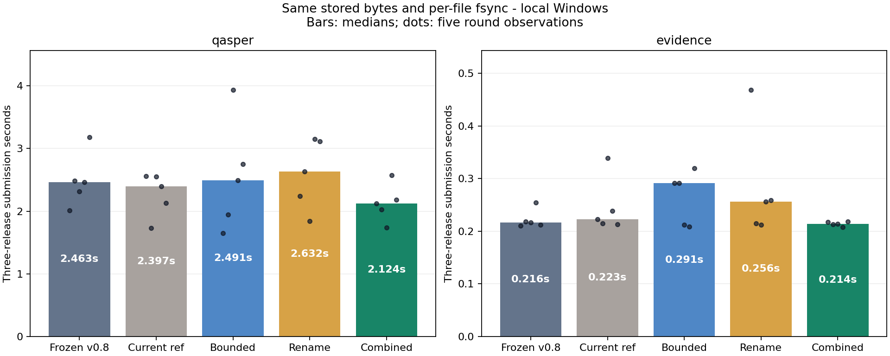

原生库继续复用 v0.8 实测 DLL 123,904 bytes + 原始元数据 515 bytes，各家族上表全额
加一次。Evidence Inference 的 prompts 三版完全相同，约占每版原文 17.9%；较高共享
收益不能直接推广到全文或独立科学数据。逻辑字节包含所有对象/头/双摘要/快照/
配置/未引用对象；文件数据分配另记，目录/MFT/日志与公共运行时未全额分配。

本机 82 项测试：81 通过、1 Windows 符号链接权限跳过；Windows/Linux CI 通过。
覆盖损坏与尾部多字节、复用验证、并发发布、同步/快照失败、不覆盖已有文件和旧版
读取兼容。冷缓存、跨机器、跨日、断电耐久性和推理质量未测，E3/E4 尚未实测。

```powershell
python -m rkv1 store-init vault --chunker gear-v1 --codec zstd
python -m rkv1 store-add vault data/qasper-versions/v0.1 --io-backend bounded --publisher rename --chunker-backend rust --native-library native/rkv1_core.dll
python -m scripts.run_io --native-library native/rkv1_core.dll --out results/local-io
python -m scripts.summarize_io results/local-io
```

先从 [v0.9 Release](https://github.com/StarlitPupils/RKV-1/releases/tag/v0.9.0) 解压
`rkv1-native-measured-v0.9.0-windows-x86_64.zip` 到 `native/`，保留原始 `native.json`。
该冻结实测库与通用平台新构建资产分开标识，不能假定其二进制相同。
[完整记录](results/v0.9.0/SUMMARY.md) · [IO 协议与复现](docs/IO.md) ·
[数据来源](docs/DATASETS.md) · [独立核对](results/v0.9.0/validation.json)。下一优先项
转向 E2 数组/数值类型，先做完整成本基线和负对照，再决定编码方案。

## 既有热点剖析与精确 Rust Gear 扫描（v0.8.0）

冻结v0.7源码的cProfile诊断定位到逐字节Gear循环；v0.8新增显式Rust扫描后端。
同一表、u64递推、最小/最大边界和流状态保持不变。Python仍组装原文字节，执行
全部哈希、压缩、旧对象验证、fsync和发布。CAS格式与默认Python后端不变。

原始QASPER三个发布，六条件、五轮本机温缓存；Python/Rust所有轮次的完整存储树、
对象账本及快照ID相同，并与v0.7已发布的同表示存储树字节完全一致。
**90次正式完整恢复、34,560次正式范围读取**，另18次恢复预热、2,160次查询预热
全部逐字节一致。本机75项测试：74通过、1 Windows符号链接权限跳过；跨平台CI通过。

| 三版存储/扫描方式 | 完整逻辑存储 bytes | 三版提交中位 s | 完整恢复中位 s | v0.3重开p95 ms |
|---|---:|---:|---:|---:|
| 独立RKV / 固定1MiB | 31,519,475 | 0.623 | 0.260 | 2.233 |
| 共享CAS / 固定64KiB | 35,981,908 | 3.970 | 0.572 | 4.704 |
| 共享CAS / Gear Python | 23,946,864 | 28.989 | 0.519 | 3.893 |
| 共享CAS / Gear Rust | **23,946,864** | **2.971** | 0.517 | 3.793 |

同轮提交配对加速中位：共享Gear **9.88倍**、独立Gear **10.54倍**，两者均5/5轮
更快。配对比值中位与表内耗时中位之比不是同一统计量；结论使用本轮内部对照，
不将历史版本耗时变化直接当作迁移收益。恢复/读取仍用同一Python实现，未获Rust解码收益。
共享配对逐轮加速范围8.15–16.66倍，仅为观测范围；Rust三版提交wall为1.70–3.56秒，
波动仍存在，不声称统计显著或固定倍率。

实测冻结DLL 123,904 bytes + 原始native.json 515 bytes，整份共享资源 **124,419 bytes**。
三版共享Gear加一次全额库成本为 **24,071,283 bytes**，相对旧独立1MiB归档节省
**23.63%**；公共Python/codec/OS和目录/MFT/日志未全额分配，不是完整部署或物理卷成本。
提交仍为旧1MiB归档 **4.77倍耗时**，完整恢复约 **1.99倍**，重开p95约 **1.70倍**。
原生扫描解决了主要诊断热点，综合性能仍有明确取舍。

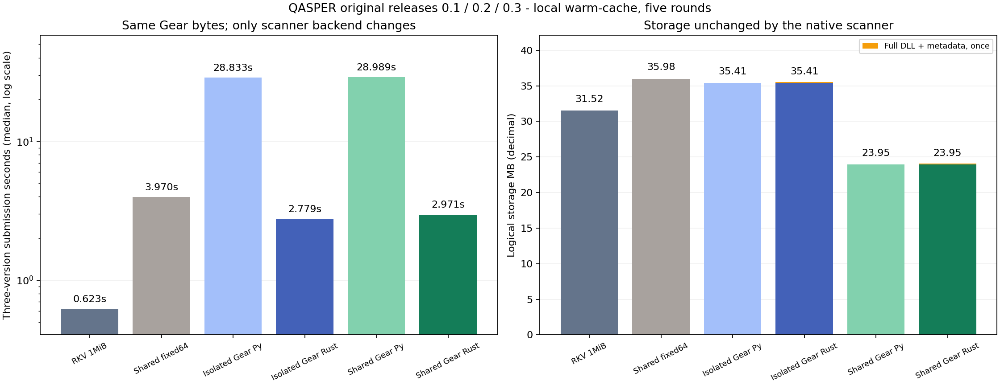

```powershell
python -m rkv1 store-init vault --chunker gear-v1 --codec zstd
python -m rkv1 store-add vault data/qasper-versions/v0.1 --label v0.1 --chunker-backend rust --native-library .tools/native-v0.8-measured/rkv1_core.dll
python -m scripts.run_gear --native-library .tools/native-v0.8-measured/rkv1_core.dll --out results/local-gear
```

[完整记录](results/v0.8.0/SUMMARY.md) · [原生协议/复现](docs/NATIVE.md) ·
[逐轮原始结果](results/v0.8.0/qasper-gear.json)。Release另附
`rkv1-native-measured-v0.8.0-windows-x86_64.zip`，保留通过源CI的实测库和元数据原字节。
通用新构建库须按自己的身份使用，不能假定与实测库相同。源/输入/库/元数据前后
指纹一致；诊断树与主实验均保留。一个家族三版、温缓存五轮；冷缓存、跨机器、
跨日和科学推理质量未测。对象 IO 消融和第二个版本家族由 v0.9 补充；E2 其他类型待开展。

## 既有真实版本序列与共享 CAS（v0.7.0）

新增可选目录 CAS：不可变内容对象、独立快照、全量/局部恢复与逐层校验。支持固定
分块和简单 Gear CDC；对象按原文字节 SHA-256 寻址，跨版本引用已有对象，实际只
存一份。旧归档 v1/v2/v3 和 pack/read/unpack 默认行为保持不变。

使用 QASPER 官方原始 train/dev **v0.1→v0.2→v0.3**，保留原始文件名和全部字节，
不重序列化 JSON。一个语料家族、三次真实发布，128,076,252 bytes 原文；八条件：
独立 RKV、同格式独立 CAS、共享 CAS，固定64KiB/1MiB及 Gear scale64KiB。
**120 次正式完整恢复 + 24 次预热恢复、46,080 次正式范围读取 + 2,880 次查询
预热全部逐字节一致**。本地70项测试：69通过、1符号链接权限跳过；跨平台CI通过。

所有方法 Zstd3，无CSV/模型/字典/原生后端。同边界的独立/共享 CAS 快照ID相同，
对象文件字节并集相同，避免将不同编码表示的收益当成共享效果。

| 三个版本的存储方式 | 完整逻辑文件 bytes | 分配文件数据 bytes | 文件数 | 三版提交 s |
|---|---:|---:|---:|---:|
| 独立 RKV / 固定1MiB | 31,519,475 | 31,522,816 | 3 | 0.650 |
| 独立 CAS / Gear64 | 35,408,908 | 38,224,616 | 1,436 | 23.040 |
| 共享 CAS / 固定64KiB | 35,981,908 | 39,780,480 | 1,928 | 3.100 |
| 共享 CAS / Gear64 | **23,946,864** | **25,759,992** | 914 | 22.529 |

共享 Gear 相对同格式独立 Gear 节省 **32.37%**；相对独立1MiB RKV逻辑字节减少
**24.03%**，但提交约 **34.69倍耗时**，三版完整恢复约 **2.00倍耗时**。v0.3 的
跨版本独特对象复用 **94.21%**（独特原文91.23%）；固定64KiB对应仅4.83%/4.84%。
v0.3 新增对象+快照约1.05MB，固定1MiB约10.42MB。固定分块会受字节偏移影响，
CDC改善了这组真实修订的复用，Python扫描/大量对象也增加了时间成本。

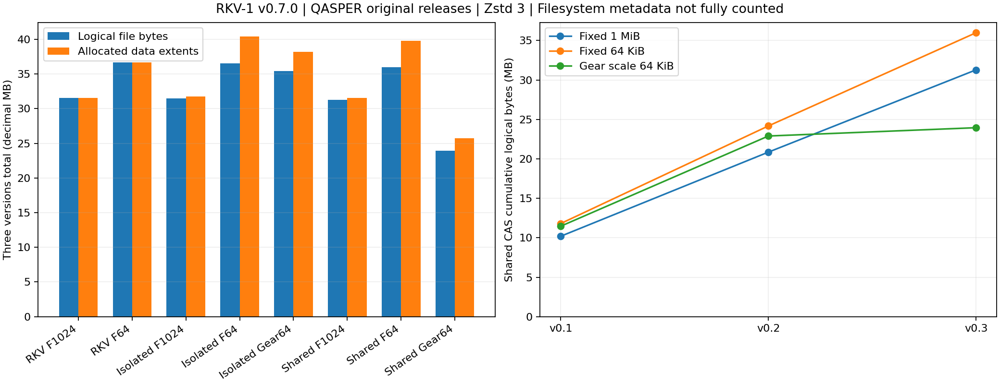

逻辑字节包含所有对象头/双摘要/payload、快照/config与未引用对象；额外报告文件
数据分配空间和文件数。目录/MFT/日志/公共运行时未全额计入，不称为完整物理卷
占用。Gear64是mask scale，实际平均块约89,500 bytes（约87.4KiB），
不是与固定64KiB实际平均严格匹配，也不是FastCDC复现。

[本轮完整记录](results/v0.7.0/SUMMARY.md) · [格式/协议/执行说明](docs/STORE.md) ·
[固定数据来源](results/v0.7.0/dataset-provenance.json)。使用 store-init/store-add/
store-verify/store-unpack/store-read/store-stat。局部验证只证明触及对象；每次复用
验证旧对象，完整恢复验证文件。失败提交可留下计费对象，无GC和断电耐久性证明。
仅本机温缓存、一个语料家族；冷缓存/跨机器/跨日、E3/E4科学推理质量未测。
Gear热点剖析与原生扫描已由v0.8补充；其他真实版本家族和E2类型仍待扩大。

## 既有 Rust 反变换与本机配对（v0.6.0）

新增读取器实例级 `--decoder-backend rust --native-library ...`，只替换 CSV v1 的
字面量检查和精确反变换。保留原有受限解压、单元/父块/文件 SHA-256；两个后端
读取同一个归档。默认仍为 Python、Zlib/1 MiB、v2，CSV 和独立单元须显式启用。

Wine、超导材料、HTRU2；26 份确定性归档、52 个条件，**260 次正式完整恢复 +
52 次预热恢复、99,840 次正式范围读取 + 6,240 次查询预热全部逐字节一致**。
本机使用 v0.5 Release 的冻结 Windows DLL，库/元数据/源码/输入哈希前后一致。
本地 63 项测试：62 通过、1 符号链接权限跳过；Windows/Linux CI 验证新后端。

超导材料、Zstd、CSV：同归档 Python → Rust，恢复含库校验/加载、FFI 和复制；
范围已预热。五轮配对，不做显著性结论。

| 布局 | 总 bytes | 完整恢复 ms | 恢复配对加速 | 重开 p95 ms |
|---|---:|---:|---:|---:|
| 1 MiB 整块 | 7,442,705 | 427.17 → 91.94 | 4.63× | 30.997 → 4.496 |
| 1 MiB + 64 KiB 单元 | 7,817,638 | 395.15 → 99.45 | 3.97× | 2.457 → 1.009 |
| 1 MiB + 16 KiB 单元 | 8,423,479 | 626.74 → 120.09 | 5.22× | 1.491 → 0.924 |

上述 CSV 恢复/重开均五轮更快，但普通 Zstd/1 MiB 本轮恢复 **61.08 ms**、重开
**2.346 ms**；不能把 CSV 后端加速当作普通编码已被全面超过。额外 DLL+元数据
**121,747 bytes** 单列部署成本：本轮体积最小的超导材料 CSV/Zlib 归档 7,284,903
bytes，比最小普通 Zstd 的 7,548,059 bytes 减小 263,156 bytes；计入一次原生资源后
净省 **141,409 bytes**，恢复却为 **136.34 ms**（普通约61.08 ms）。Wine 单份归档
的节省不足抵消原生资源；HTRU2 CR-only 回退并无变换收益。默认策略保持不变。

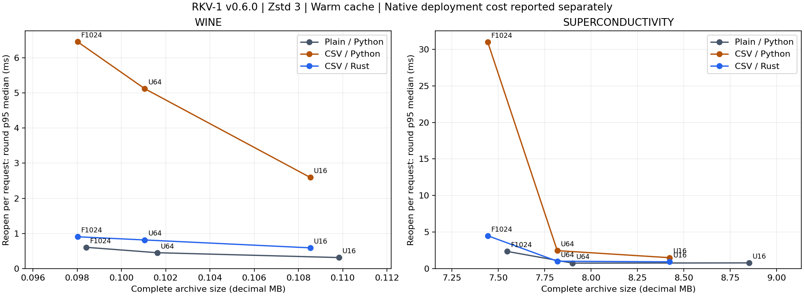

[完整配对结果](results/v0.6.0/SUMMARY.md) · [原生协议与执行说明](docs/NATIVE.md) ·
[库来源](results/v0.6.0/native-provenance.json)。归档格式不变，兼容 v1/v2/v3；
Release 附 Windows/Linux 原生库 ZIP，复现实验须选协议指定的冻结二进制。
冷缓存/跨机器/跨日、推理质量未测。真实版本序列、CDC与共享CAS已由v0.7补充；
数组/代码/数学类型、E3/E4仍待开展。

## 既有独立单元与索引实验（v0.5.0）

显式 `--unit-size` 生成 RKV v3：1 MiB 父块内含独立 16/64 KiB 单元，每个单元有
大小、codec、变换标志和原始 SHA-256。二进制索引按需校验并缓存，范围请求只
解码触及单元；完整恢复继续验证父块和文件。默认仍写 v2，CSV 仍关闭。

四组科学输入、53 个条件；**265 次正式完整恢复 + 53 次预热恢复、101,760 次正式
范围读取 + 6,360 次查询预热全部逐字节一致**。本地 56 项测试：55 通过、1 权限跳过。
所有大小包括索引；对照包含整块、直接小块、普通编码及关闭索引缓存。

Zstd、同源码/同请求、温缓存，各轮 p95 中位数：

| 数据 / 变换 | 布局 | 总 bytes | 重开 p95 ms |
|---|---|---:|---:|
| 超导材料 / CSV | 1 MiB 整块 | 7,442,705 | 30.921 |
| 超导材料 / CSV | 直接 16 KiB 块 | 8,761,101 | 13.645 |
| 超导材料 / CSV | 1 MiB + 16 KiB 单元 | 8,423,479 | 1.378 |
| QASPER / none | 1 MiB 整块 | 10,660,769 | 2.221 |
| QASPER / none | 直接 64 KiB 块 | 12,415,158 | 5.208 |
| QASPER / none | 1 MiB + 64 KiB 单元 | 12,299,774 | 0.870 |

两层单元相对同大小直接小块改善了较大语料的打开成本并减少元数据；常驻读取并非
全胜。超导材料/CSV/16 KiB 对直接小块节省 3.85%，配对重开 p95 加速中位约9.75倍；
但对原1MiB CSV归档仍增大约13.18%，完整恢复也未必更快。不能只拿整块 CSV 作参照：
普通 Zstd 的两层64KiB方案本组重开约0.703ms，优于相同CSV约2.463ms。

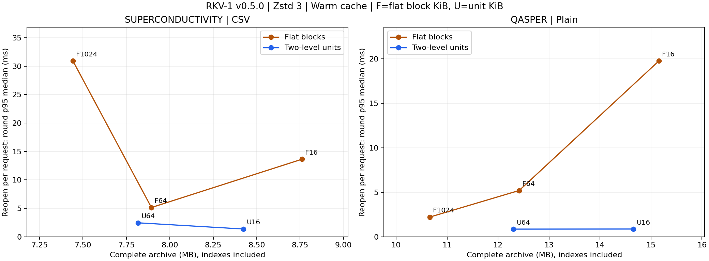

[本轮记录](results/v0.5.0/SUMMARY.md) · [协议](docs/UNITS.md) · [v3 格式](docs/FORMAT.md)。
v0.5 读取器兼容 v1/v2/v3；旧读取器不支持 v3。局部读取只证明触及单元，完整 verify
检测所有损坏；索引摘要的校验链不代表来源身份。单元哈希尚未实现跨父块 CAS/增量共享。

Rust 新增精确 CSV 反变换 C ABI 候选，Windows/Linux CI 做函数及 Python 差分验证，
Release 附带平台库/来源哈希；本轮时序实验全部使用 Python，尚无 Rust 加速结论。
下一里程碑量化原生内核，再推进真实版本序列/共享块存储。冷缓存/跨机器继续未测。

## 既有 CSV 反变换试验（v0.4.0）

在首版无损核心之上加入 Zstd、可关闭的跨文件去重、可选数值 CSV 列重排，以及
manifest version=2；新读取器仍能恢复首版归档。默认 Zlib/1 MiB、CSV 变换关闭；
codec、块大小和变换策略由参数选择。

本版新增 HTRU2 脉冲星候选与 Superconductivity 超导材料数据，固定 ZIP/原始成员
哈希。CSV 反变换保留全部校验，把按单元 Python 索引改为列切片 + zip；与冻结旧
反变换读取同一归档、匹配同一查询。默认仍为 Zlib/1 MiB，CSV 关闭，格式仍为 v2。

**18 个条件、90 次正式完整恢复 + 18 次预热恢复、15,360 次正式范围读取 + 1,920
次预热读取全部逐字节一致。** 本地 44 项测试：43 通过、1 权限跳过。

| 数据 / codec | CSV 对同 codec 归档节省 | 旧/新 CSV 完整恢复耗时 | 新 CSV/普通恢复耗时 |
|---|---:|---:|---:|
| Wine / Zlib | 4.62% | 1.21× | 6.68× |
| Wine / Zstd | 0.40% | 1.09× | 2.17× |
| Superconductivity / Zlib | 11.79% | 1.15× | 7.17× |
| Superconductivity / Zstd | 1.40% | 1.16× | 6.94× |

优化使有实际变换的条件恢复速度提高约 9–21%（耗时减少约 8.6–17.1%），但仍明显慢于普通编码，超导材料条件
峰值内存增加约 1.5–1.9 MiB。与本轮最小普通归档 Zstd 比，超导材料的最小 CSV
归档 Zlib 只再省约 3.49%，恢复慢约 11.1 倍，不能把同 codec 的 11.79% 当作全面优势。
HTRU2 为 CR-only，当前 CSV v1 不适用，回退保留全部原文，启用策略仅多 10 bytes
头部成本；不为获得正结果改换行。正则验证与整块重建仍是后续优化候选，尚无 Rust 加速。

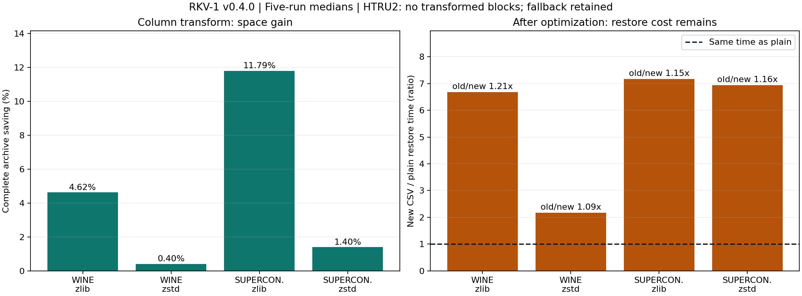

[本轮完整结果](results/v0.4.0/SUMMARY.md) · [E2 配对协议](docs/CSV-TRIALS.md) ·
[成本账本](results/v0.4.0/runtime-footprint.json)。发布前 CI 再运行跨平台 Python/Zstd 和 Rust 骨架测试。

## 已完成的多轮读取评测（v0.3.0）

上一版沿用 RKV v2 格式和压缩核心，补强 E0 读取协议。SciFact/QASPER × 三种 codec
× 三种块大小，18 个配置；每配置两个连续批次、每批五轮不同查询种子。常驻读取器
与每次重开分别使用独立 worker，配置/轮次/模式交错打乱，记录打开、读取和关闭
阶段。非跨块请求完全配对；原始请求、样本、执行顺序和输入/源码指纹随版本保存。

全部归档先完整校验，每个请求逐字节验证，实验末尾检查输入、实现和归档未变。
正式范围读取 **161,280 次**，另有 **10,080 次预热读取**，全部逐字节一致；
共 360 个独立 worker，18 个完整校验的归档与 v0.2 对应条件字节完全相同。
计时前预读完整归档，只报告本机温缓存结果；冷缓存、跨机器与跨日结果明确未测。
该版本地 **38 项测试：37 通过、1 权限跳过**；
发布流水线再运行 Windows/Linux、Python 3.10/3.13 和 Rust 骨架测试。

读取统计报告十轮各自 p95 的中位数、最小/最大值和配对方向；范围不是置信区间。
[本轮结果](results/v0.3.0/SUMMARY.md) · [读取协议](docs/READING.md)。

Zstd、温缓存、按文件字节加权的短范围请求：

| 数据 | 块 KiB | 常驻：十轮 p95 中位 ms | 每次重开：十轮 p95 中位 ms |
|---|---:|---:|---:|
| SciFact | 64 / 256 / 1024 | 0.177 / 0.442 / 1.749 | 1.465 / 1.027 / 2.140 |
| QASPER | 64 / 256 / 1024 | 0.152 / 0.413 / 1.623 | 5.298 / 2.014 / 2.321 |

常驻时 64 KiB 在两组全部十轮都快于 1 MiB，但归档增加 14.41%/16.46%。重开时
256 KiB 对 SciFact 十轮全胜，对 QASPER 九轮胜过 1 MiB，后者收益更小且有波动。
QASPER 64 KiB 清单打开中位约 4.658 ms，说明只优化块解码不能解决重开成本。
这些结果支持按读取器生命周期选候选配置，尚不改变默认策略。

## 压缩观察（v0.2.0）

以下为同容器、1 MiB、去重开启、无变换的归档大小，包含所有容器元数据。

| 语料 | 原始 bytes | Zlib 6 bytes | Zstd 3 bytes | Zstd 归档节省 |
|---|---:|---:|---:|---:|
| SciFact | 8,582,267 | 2,863,283 | 2,745,550 | 4.11% |
| QASPER train/dev | 43,368,073 | 10,902,467 | 10,660,769 | 2.22% |
| UCI Iris/red wine | 88,750 | 25,150 | 26,681 | -6.09% |
| Wine red/white | 348,625 | 93,493 | 98,417 | -5.27% |

Zstd 在这两组科学文本上编码、恢复更快，CSV 的最小体积则由 Zlib 获得。
小块改善范围读取延迟，但增加压缩损失和索引开销；选择应结合查询工作负载。
在相同流式容器下，两 codec 恢复内存相近，首版与整流 TAR 的内存差距受实现方式影响。

E2 的列重排保留数值原文、表头、换行及跨块边界。Zlib 条件下归档节省约 **4.6–4.7%**，
但 Python 解析、恢复和范围读取明显变慢，所以保留为可选试验。真实输入在本次三种
固定分块下没有重复块收益；合成对照验证去重机制，但不代表自然科学语料。

[多轮读取与打开方式图](results/v0.3.0/reading.png)

[完整结果与原始样本](results/v0.2.0/SUMMARY.md) · [复现协议](docs/EXPERIMENTS.md) ·
[数据署名/许可](docs/DATASETS.md) · [运行时成本记录](results/v0.2.0/runtime-footprint.json)

归档字节不等于部署总占用。本机可选 Zstd distribution 另占约 1.13 MB；共享 RKV
源码、transform 模块以及安装占用都记录在成本账本，Python/全部共享原生依赖尚未
分摊到单归档。本版没有外部字典、模型权重或语义索引。

## 快速开始

```powershell
python -m venv .venv
.\.venv\Scripts\python.exe -m pip install -e ".[bench]"
.\.venv\Scripts\python.exe -m unittest discover -s tests -v
.\.venv\Scripts\python.exe -m rkv1 fetch data/scifact --dataset scifact
.\.venv\Scripts\python.exe -m rkv1 pack data/scifact data/scifact.rkv --codec zstd
.\.venv\Scripts\python.exe -m rkv1 verify data/scifact.rkv
.\.venv\Scripts\python.exe -m rkv1 unpack data/scifact.rkv data/restored
.\.venv\Scripts\python.exe -m rkv1 compare data/scifact data/restored
.\.venv\Scripts\python.exe scripts/run_controlled.py --out results/local-controlled
.\.venv\Scripts\python.exe scripts/summarize_controlled.py results/local-controlled
.\.venv\Scripts\python.exe scripts/run_reading.py --out results/local-reading
.\.venv\Scripts\python.exe scripts/summarize_reading.py results/local-reading
.\.venv\Scripts\python.exe scripts/run_csv_trials.py --out results/local-csv
.\.venv\Scripts\python.exe scripts/summarize_csv.py results/local-csv
.\.venv\Scripts\python.exe scripts/run_units.py --out results/local-units
.\.venv\Scripts\python.exe scripts/summarize_units.py results/local-units
```

Python 3.10+；Linux/macOS 使用 `.venv/bin/python`。核心 Zlib 模式可安装 `pip install -e .`，
Zstd 可仅安装 `.[zstd]`。绘图可另装 `.[plots]`。归档默认不覆盖，恢复目标须不存在。

```powershell
python -m rkv1 pack data/scifact data/small-blocks.rkv --codec zstd --chunk-size 65536
python -m rkv1 pack data/scifact data/no-dedup.rkv --codec zstd --no-dedup
python -m rkv1 fetch data/wine --dataset wine
python -m rkv1 pack data/wine data/columns.rkv --codec zlib --transform csv-columns-v1
```

## 路线与版本

| 阶段 | 状态 |
|---|---|
| E0 基准 | 完成首版、受控对照和多种子读取评测；仍是单机温缓存 |
| E1 无损核心 | v1–v6兼容；共享CAS、真实版本复用与Gear分块；默认v2、CAS1保持不变；归档默认逐文件fsync已测，目录/掉电持久性未验证 |
| E2 类型感知可逆编码 | CSV/小单元/Rust配对、int16/float字节变换、Blosc、FITS布局已测；新布局0/8联合通过，代码/数学待开展 |
| E3 神经预测 + 熵编码 + 精确残差 | 后续，计入模型和解码成本 |
| E4 科学记忆、检索、证据回溯与可验证推理 | v0.15首个检索/API/引用与写回基线；v0.16索引成本、v0.17多版本更新对照；长会话/多跳/形式证明未测 |

Rust 已用于可选CSV反变换与Gear扫描。传统归档的`--base`复用编码结果，仍写独立
完整快照；目录CAS可跨版本只存一份对象。两者仍全量读源、计算哈希并验证旧对象。

[FORMAT Draft 0.6](docs/FORMAT.md) 只恢复普通文件路径和内容，不保留权限、时间戳、
空子目录或链接；恢复合计上限 2 GiB。v3需v0.5+，v4需v0.10+，v5需v0.11+，v6需v0.12+；默认v2仍可由v0.2+读取。
SHA-256 用于完整性检查，不能证明来源身份或科学结论正确。当前没有神经压缩、
无限精确上下文或科学推理收益的验证。

[首版 v0.1.0 记录](results/v0.1.0/SUMMARY.md) 与 [v0.2.0 记录](results/v0.2.0/SUMMARY.md) 保留；各版协议不同，不能直接把耗时
变化全归为单个优化。每版本在 [Release](https://github.com/StarlitPupils/RKV-1/releases)
更新改动、结果和限制；tag 不改写。代码 [MIT](LICENSE)。
