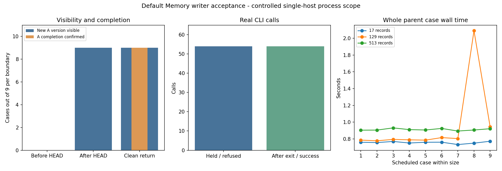

# v0.100 默认写入入口统一锁的正式工程验收

候选源码 `631e62474dea9b4a31707094025702173f4d8657` 的 [CI 42186383255](https://github.com/StarlitPupils/RKV-1/actions/runs/42186383255) 全部成功后，唯一正式轮按固定清单完成 27 个独立库场景。独立核验读取保留的原始 JSONL、完整 Store、命令行输出和父进程退出凭据，162 次查询全部通过。

## 已观察的行为

持锁期间 54 次真实命令行竞争拒绝，库文件身份前后一致。父进程确认原写入进程实际退出后，27 次不同意图的新写入及 27 次预算配置成功。固定读视图和显式旧版本读取均返回旧来源，当前版本按计划变化。

18 次受控终止中的 9 例发生于版本指针发布前，退出后保持旧版本。另 9 例发生于发布后，退出后新版本可见。18 例原调用完成状态均为未知。9 例正常返回有相应返回记录、成功收尾及退出 0 凭据。锁释放由实际进程退出和后续独立调用共同核验。

本轮使用自建 17、129、513 条来源，各三轮、三个边界。三轮用于观察相同工程合同的运行波动。性能改善和科学回答质量需按开发指南另行设计评测。

图已实际查看，图像 SHA256 为 `a7a0497d7a85dfd4ee4f4293e38d479d5a5aeb0fdac5713298aa312669385f4c`。129 条记录的第八个场景出现约 2.09 秒父区间，图中和逐例数据均保留。

## 完整场景

| 场景 | 进程退出码 | 原调用完成 | 退出后 epoch | 核验查询数 | 完整父场景秒数 |
| --- | --- | --- | --- | --- | --- |
|r1-n17-before_HEAD|77|None|0|6|0.7602234000223689|
|r1-n17-after_HEAD|77|None|1|6|0.7561937000136822|
|r1-n17-clean_return|0|True|1|6|0.7695323999796528|
|r1-n129-before_HEAD|77|None|0|6|0.7858614000142552|
|r1-n129-after_HEAD|77|None|1|6|0.7773806999903172|
|r1-n129-clean_return|0|True|1|6|0.7944361999980174|
|r1-n513-before_HEAD|77|None|0|6|0.9041695000196341|
|r1-n513-after_HEAD|77|None|1|6|0.9051411999971606|
|r1-n513-clean_return|0|True|1|6|0.9311853999970481|
|r2-n17-before_HEAD|77|None|0|6|0.7510215000074822|
|r2-n17-after_HEAD|77|None|1|6|0.759958300011931|
|r2-n17-clean_return|0|True|1|6|0.7607709000003524|
|r2-n129-before_HEAD|77|None|0|6|0.7889901999733411|
|r2-n129-after_HEAD|77|None|1|6|0.7853360000008252|
|r2-n129-clean_return|0|True|1|6|0.8155037999968044|
|r2-n513-before_HEAD|77|None|0|6|0.9106902999919839|
|r2-n513-after_HEAD|77|None|1|6|0.9062441000132822|
|r2-n513-clean_return|0|True|1|6|0.924759699992137|
|r3-n17-before_HEAD|77|None|0|6|0.7326693999930285|
|r3-n17-after_HEAD|77|None|1|6|0.7493854999775067|
|r3-n17-clean_return|0|True|1|6|0.7721684999996796|
|r3-n129-before_HEAD|77|None|0|6|0.8037075999891385|
|r3-n129-after_HEAD|77|None|1|6|2.0894584999768995|
|r3-n129-clean_return|0|True|1|6|0.9426812999881804|
|r3-n513-before_HEAD|77|None|0|6|0.8936979999998584|
|r3-n513-after_HEAD|77|None|1|6|0.9060813000251073|
|r3-n513-clean_return|0|True|1|6|0.9214479000074789|

表中 None 表示未知。Windows 受控终止码为 77。原始查询输出、预约、开始、屏障、命令行 stdout/stderr、退出及清理记录私有保留。独立核验期间原工作目录完整身份一致。

## 资源记录

正式父计划用时 23.7940432 秒，自身 CPU 5.968750 秒，父进程峰值 RSS 54206464 字节。独立核验父驱动用时 1.2803463 秒，完整控制器含 CI 等待用时另见 controller-parent.json。各自区间有重叠，按原作用域报告。

162 次主查询完整源返回共 2789478 应用字节，162 次独立核验另返回 2789478 应用字节。查询内部 CAS 解码、系统和物理磁盘读写保持未知。全树 CPU/RSS 及被终止进程缺失的收尾成本保持未知。27 次初始构建、27 次 A 更新尝试、27 次独立 B 更新，以及原始源、索引、残留对象、锁文件、失败准备和审计原始文件均保留。

源码资源清单记录正式源码提交时的全部已跟踪文件指纹，运行时为 70 个 Python 文件及 HTML。报告和后续发行阶段产生的额外文件按各阶段另行记账。过去的科学输入、训练、模型、API、派生和失败费用沿历史账本保留，远程权重及运行资源未知。本轮外部模型调用为 0。应用返回字节与进程峰值内存分别报告。

## 失败记录与交付状态

初版执行器的小规模检查发生超时变量遗漏及已退出进程重复终止错误，修正后才进入本地完整回归。该次测试临时目录由测试框架清理，其原始临时数据和独立资源成本无法恢复。先前独立本地验收仍完整保留。

首个源码 CI 42185454141 在 Windows Python 3.10 的命令行凭据比较处失败。检查发现执行器与核验器对等价目录写法的处理不同，修正路径解析后重新验证。源码 `631e62474dea9b4a31707094025702173f4d8657` 的 CI 全部成功，随后才首次启动正式 27 例。原失败 CI、控制器停止状态和费用记录保留。两次本地完整回归均为 636 项，其中 635 项通过、1 项权限跳过，原日志保留。

当前处于候选工程验收完成阶段，software_release_complete 为 false。已交付版本仍 v0.99。后续需要完成最终版本元数据、源码清单和发行说明、本地实际构建及仓库外安装、发行 CI、实际资产身份与全部源码核验、发布包仓库外安装和最终证明。默认初始化可能在首次写入失败后留下已创建目录，旧版本、直接 Store 写入及外部工具仍需协调。

工程范围以默认写入、预算配置及对应命令行入口为界，随后进入带版本修订的证据问答评测设计。[开发与迭代指南](../../docs/DEVELOPMENT-GUIDE.md) · [协议与清单](../../docs/MEMORY-DEFAULT-WRITER.md)
