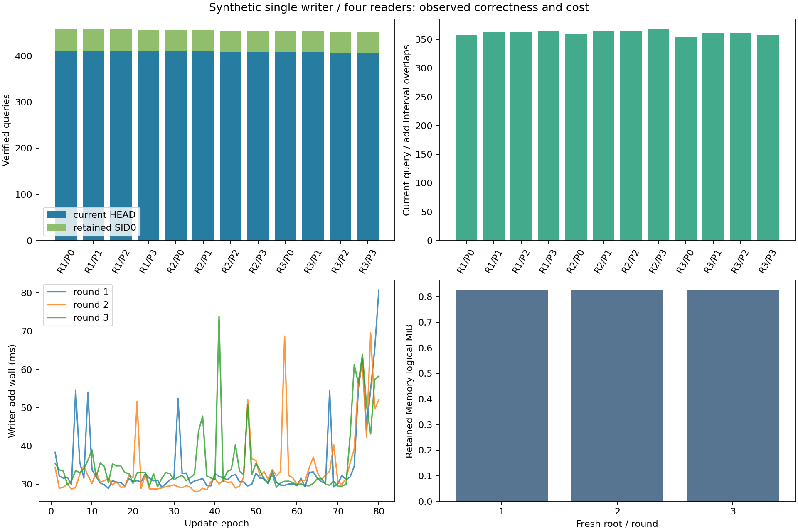

# v0.34.0 实验报告：单写入 / 多读取的快照一致性

## 结论与适用范围

冻结的三轮门槛 **3/3** 通过。正式审计查询
5462 次，其中当前 HEAD 4910 次、显式初始快照 552 次；
原句/位置绑定 21848 条。当前查询与实际 add 区间重叠 4341 次。
观察到的 worker/父进程/历史审计错误共 0 条。所有错误均在 JSON 中保留，不重试失败操作。

这项结果只覆盖本机、合成资料、单 writer / 四 reader 的三个有界调度样本。
它不估计生产错误率，也不证明任意并发顺序、多个 writer、断电恢复或无限上下文可行。
没有模型调用，不能据此声称回答质量、多跳推理或长期会话收益。冷缓存/跨机器未测。

## 背景与冻结假设

v0.32 的代码/数学词法通道科学净空间 0/36、联合 0/36，不能用原生化改变该表示输出的字节数。
因此本版没有继续在这些源文件上搜索规则，而是检查动态证据记忆尚未直接覆盖的并发读取边界。
假设是：默认 search 在一次调用开始选定 HEAD 后，应绑定到一个不可变 SID；writer 提交新的 SID
不应让同一次结果混入其他 epoch。显式指定旧 SID 则须继续读旧内容。

运行库共 57 模块，除版本字符串和memory.py的HEAD读取/名称发布外与实际v0.33标签逐字节相同；
沿用原实验driver及审计器，新增句柄定向测试、分析和修正协议。writer写出/flush/fsync和所有校验不变，
Windows最终名称发布改用POSIX替换语义，权限/共享错误不重试。冻结提交 `b9f15a4`。
协议与 driver SHA、全部运行库 SHA 和所有 81 个合成源 SHA 在 environment.json 保存并于分析时核对。

## 数据、流程与审计方法

每轮新建独立源目录及 Memory，默认 compact-budget-v3 / fixed / Zlib，原 replay budget 不变。
每个源文件 277446B、2048 条 JSONL，4 条 sentinel 每版同时改变四位 epoch，
其余 2044 条背景不变。使用排序键、固定分隔符、ASCII 转义和 CRLF，包含雪字与引号转义。
这是可按 corpus() 再生的合成结构，未将它包装成公开科学任务质量数据。

每轮四个 reader 先用初始 SID 各执行一次排除的预热/审计；共 12 次，
不计正式查询。全部 READY 后才释放 START，writer 连续提交 80 次更新。
reader 每十次有一次显式初始 SID，其他读取当前 HEAD；STOP 后再完成 20 次并要求最后当前读到80。
独立进程清除模型配置环境，所有循环和超时预先固定，失败不重试，不因结果改变预算。

每个查询要求完整 sentinel 集合、四个相同结果 SID、正确原始 key/path/offset/length/SHA，
title 和 sentences 必须等于该 SID 的原 JSONL；再从 CAS 读完整源并验证预生成完整源 SHA。
显式旧 SID 必须保持 epoch0，当前读 epoch 不得倒退。审计时间独立记账，未伪装成免费验证。
查询结束后不再次使用可变 HEAD 决定本次预期版本，避免把正常更新误判为不一致。

writer 停止后，全部成功提交历史 SID 再做完整源与四 locator 审计。
独立于正式 reader 的历史复查共 243 次 / 972 条记录绑定。
原始 Memory 中除 HEAD.json 外所有文件要求仍存在且 SHA 不变，answers 必须为空。
下述区间重叠使用同机 perf_counter：只说明操作持续区间重叠，不证明任何特定指令恰好同时访问。

## 逐轮结果与真实成本

|轮|成功更新|历史复查|门槛|add中位ms|add P95 ms|初始B|保留全部历史B|
|---|---:|---:|---|---:|---:|---:|---:|
|1|80|81|True|31.456|54.812|371538|863971|
|2|80|81|True|31.050|52.308|371538|863971|
|3|80|81|True|32.675|57.452|371538|863971|

|轮/reader|正式审计|旧SID|当前|当前不同epoch|重叠|最后epoch|search中位ms|search P95 ms|额外审计中位ms|
|---|---:|---:|---:|---:|---:|---:|---:|---:|---:|
|1/0|457|46|411|81|357|80|5.581|9.033|1.935|
|1/1|457|46|411|81|364|80|5.600|9.078|1.890|
|1/2|457|46|411|81|363|80|5.622|8.999|1.926|
|1/3|456|46|410|81|365|80|5.613|9.095|1.898|
|2/0|456|46|410|81|360|80|5.476|9.164|1.839|
|2/1|456|46|410|81|365|80|5.421|9.271|1.829|
|2/2|455|46|409|81|365|80|5.488|9.104|1.854|
|2/3|455|46|409|81|367|80|5.497|9.199|1.857|
|3/0|454|46|408|81|355|80|5.802|9.068|1.985|
|3/1|454|46|408|81|361|80|5.871|8.936|1.966|
|3/2|452|46|406|81|361|80|5.878|9.172|2.032|
|3/3|453|46|407|81|358|80|5.812|9.131|1.982|

## 异常与部分完成的解释

add尝试240次，成功240次；query尝试5462次，完成审计5462次。
本次没有观察到worker/父进程/历史审计错误；不意味着所有并发调度都无缺陷。

独立历史审计243次；初始不可变文件保持的轮数3/3。

失败 add 可能已留下 CAS/索引/manifest 但 HEAD 未前移，其实际空间仍计入；没有清理这些文件
来美化大小，未承诺失败写入是无副作用的事务。没有观察到内容错误不能证明不存在其他一致性问题。

本版Windows用CreateFileW的READ/WRITE/DELETE共享打开HEAD，并明确binary/noninheritable FD
及所有权关闭；其他平台仍用普通只读open。定向测试在旧句柄打开时发布新HEAD，旧句柄仍读旧字节，
新句柄读新字节；确认关闭底层handle和不继承，缺失/损坏仍失败。writer用FileRenameInfoEx的替换/POSIX标志，
不支持时仅回到原单次os.replace，兼容降级不保证并发。没有权限重试、缓存SID或宽松校验。
三轮复测使用与v0.33逐字节相同的driver、源生成、原协议和预算，本版干预由MEMORY-HEAD-SHARING.md声明。
公共Windows kernel/Python ctypes依赖不属于新项目原生库，不应视作免费部署成本。
冻结前，读取共享候选在持有旧句柄时替换失败；POSIX命名候选首次定向测试又捕获UTF16名称终止空间遗漏。
两种开发错误均已保留日志/源码SHA，没有进入正式三轮或覆盖旧结果。最终代码完整测试后才冻结。
参考：[CreateFileW官方文档](https://learn.microsoft.com/en-us/windows/win32/api/fileapi/nf-fileapi-createfilew)
和[微软关于重命名共享冲突的说明](https://devblogs.microsoft.com/oldnewthing/20211022-00/?p=105822/)、[Python FD文档](https://docs.python.org/3.13/library/msvcrt.html#msvcrt.open_osfhandle)。




查询频率与具体交错由 OS 调度决定，不要求三轮次数相同，也不将较多查询当质量提升。
所有延迟是含同机争用的观测值，没有串行基线或因果隔离，不能据此声称并行加速。
保留空间包含实际 CAS、全部历史索引/manifest、HEAD 和 answers；分目录原数见 derived-metrics.json。
没有删除历史版本或不收费的隐式全量副本来降低成本。源文件和数据生成/审计/协调的额外 CPU、
工作盘空间不属于 Memory 的目录统计；OS/Python/SQLite/Zlib/硬件不是零成本。
source-resource.json 单列全部运行库源码与 HTML，未将它称为完整部署占用。

## 验证、可复现执行与边界

本版完整单元套件 223 项，222 通过、1 Windows 权限项跳过，0 失败。
新增审计测试不仅覆盖有效结果，还故意损坏投影/位置/SID/记录集合及完整源身份，确认验证器拒绝。
原测试仍覆盖旧归档 v1–v6、Memory 历史、来源格式、预算和显式候选边界。
本实验没有使用 Gear 原生库；发布库只作为兼容功能资产，不能冒充本次性能依据。

```powershell
python -m unittest discover -s tests -v
python -m scripts.run_memory_concurrency --work <不存在的工作目录> --out <不存在的结果目录>
python -m scripts.analyze_memory_concurrency --out <结果目录> --freeze <冻结提交> --test-log <完整测试日志>
```

environment.json 记录 Python/OS/CPU 数与计时器，round-1/2/3.json 公开逐次查询、writer、
完整 SID/源 SHA、历史复查、错误、子进程状态和目录字节。它们都是合成身份和运行记录，
不含真实科学语料、私有文档或模型密钥。Release CI/实际资产和仓库外安装记录随发行资产另附。

未覆盖多 writer、删除/GC、进程被杀、磁盘满、文件系统损坏、远程共享盘、断电、冷缓存、
异机与不同解释器/文件系统。对照v0.33的6次HEAD异常/0轮通过，只能检验本机制的观测差异；交错次数不同，未做吞吐因果实验。零观察错误不是全局线性一致性的形式证明；本次重叠不是对每个
publication 指令的穷举调度。E3 神经预测、推理质量、多跳与长期对话目标仍未完成。

## 后续路线

若三轮门槛通过，下一项冻结单 writer 的故障注入：在固定提交边界终止子进程，检查可见 HEAD
与历史证据，再独立恢复写入；明确区分进程中断与真正断电。若不通过，保留本版原始失败，
下一版依据具体错误提出最小修正及固定复测，不能把失败重新运行后覆盖成通过。
不调整已评估科学任务预算，不因本次正确性结果默认切换检索或压缩表示。


## 与保留的v0.33失败对照

|原计划相同的三轮|v0.33基线|v0.34修正|
|---|---:|---:|
|门槛通过|0/3|3/3|
|实际成功更新|141|240|
|完整源/位置审计查询|2689|5462|
|原文/位置绑定|10756|21848|
|历史版本复查|144|243|
|观察到的worker/audit错误|6|0|
|运行库Python+HTML源码B|391113|393969|


v0.33每轮成功80/48/13次，v0.34按原协议各80次；两版都未重跑替换原正式结果。
由于调度、查询总数和实际成功历史数量不同，此表只比较冻结正确性门槛和观察到的失败，
不是错误率显著性检验、吞吐配对或压缩提升。v0.34三轮保留树均863971B，等于v0.33完成80次的第一轮；
不能拿它与基线提前失败的小树比较后声称压缩得失。新增源码2856B仍需计入，
系统DLL/Python运行时与文件系统元数据未全额分配，没有新增自有原生库或模型权重。
v0.33原源码成本表漏了experiments/下4个模块，共12842B；本表按原标签/实发wheel完整58文件
重算为391113B，补充更正随v0.33 Release追加。原标签、57模块SHA和实验数据不变。

现有原子性测试的故障注入从os.replace改到跨平台_replace_head发布边界；失败后的配置、
HEAD和历史断言保持。原测试目标在Windows新路径上已不会执行，不应以“没有触发假异常”来
跳过故障保持验证。完整测试最终223项222通过/1权限跳过，开发中失败日志SHA见measurement-context。
