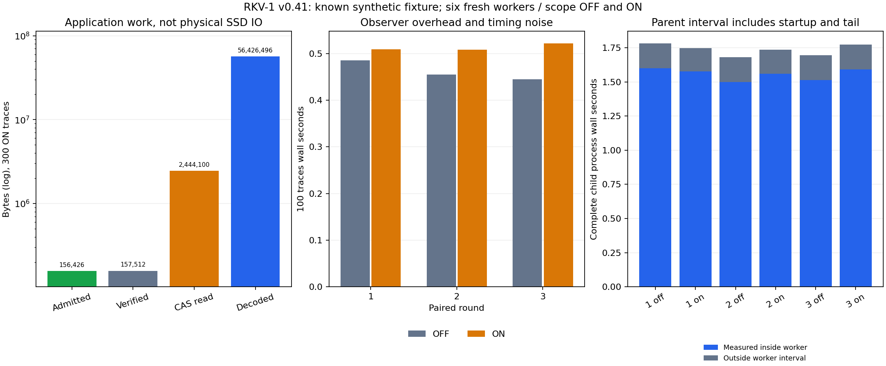

# v0.41.0 实验报告：CAS应用层读放大与完整进程时间

## 结论

在同一已见合成E4 fixture上，3轮OFF/ON配对的600条trace证明与v0.40逐项一致，576主问题、24控制、12篡改负审计符合原预期，1710个原record绑定通过；3对全部memory文件集合/字节/SHA相等。300个ON trace计数守恒、300个OFF计数null，新增6份父测完整process wall与子报告SHA核验通过。

ON入证原record合计156426B、逻辑verified 157512B；同scope CAS应用层文件read返回2444100B（入证的15.6246倍），CAS解码输出56426496B（360.7233倍）。因此4096B入证预算不等于实际CAS算法工作量上限。计数不覆盖物理SSD/整机IO；physical_SSD_bytes与all_system_file_bytes仍null。

v0.40漏记的原进程时间保持null、原资源协议false，本版是独立新批次修复仪表，不回填或覆盖。此次通过的是明确的成本计量协议，不是新科学样本或真实多跳推理/模型回答收益；E3净收益与E4整体仍未验收。

## 假设、冻结和重复性质

v0.40能完成已知根/指定SID的显式三跳证据，但没有父测进程wall，也没有CAS流量仪表。新问题是：入证B与应用实际读/解码工作量差多少？完整process启动、导入、结果写入、退出比worker内区间多多少？计量本身增加多少观测开销？不设追求正收益目标，不改入证预算、跳数、源或gold。

243本地检查242通过/1Windows权限跳过后，代码和PATH-TRAFFIC协议于`55a771aded7b9a4749411cb89676ffd0fa01c3e7`冻结，CI `40315900923`成功后才执行唯一6worker正式计划。旧64个runtime模块只改发行版本，旧worker/fixture/准备器及输入清单与v0.40逐字节核对；输入仍锁`643b6aeb677f66b8fec5a07d85005c053d6df6f1`，没有新源挑选、训练或模型构建。正式重试0。

每轮OFF/ON使用相同seed；奇轮OFF→ON、偶轮ON→OFF，各是新进程/新memory目录。OFF同样有sidecar recorder和proof SHA计算，只是不包CAS，因此并非完全没有评测开销。三轮为重复机械负载，不是三个新任务或样本。

## 仪表边界与守恒

只在trace调用scope包原Path.open返回的read，以及rkv1.store.decompress。只记录该memory CAS objects目录的binary read返回字节；metadata、stat、buffer预取、SQLite C层/全系统IO未覆盖，OS缓存未控制。底层实际磁盘流量可能与应用返回B不同，不能标成冷缓存或SSD读盘B。

解码包装仍调用原函数，原stored/raw SHA、长度、EOF、codec校验不绕过；累计成功payload输入B和CAS输出B，raw codec与压缩codec分开。scope结束恢复原函数，ingest/独立audit/ledger/derived写不计入trace CAS计数。原trace proof不增加计量字段，sidecar单独写，避免改变持久派生路径和对照语义。

真实tiny CAS raw+zlib单元检查验证read返回B等于对象文件B、输出等于原raw长度，损坏对象仍拒绝，ON/OFF proof相等且scope外独立audit不累计。本版正式无损坏trace的300计数全部满足：opens=attempts=successes，read_calls=2*opens，file returned B=payload input B+OBJECT.size*opens，解码总B=raw输出+压缩输出。没有复制Store.block实现。

## 实际ON流量账本（300 trace总和）

| 指标 | 实测 |
|---|---:|
| 入证原record B | 156426 |
| 逻辑verified原record B | 157512 |
| CAS object打开/成功解码次数 | 861 |
| Python read调用次数 | 1722 |
| CAS应用read返回B（含对象header） | 2444100 |
| decoder成功payload输入B | 2371776 |
| CAS解码输出B | 56426496 |
| 其中压缩codec输出B | 56426496 |
| 其中raw codec输出B | 0 |
| SSD物理读B/全系统文件IO | null / null |

本fixture的861次CAS输出每次均65536B，目标小record落在固定64KiB块内；只取一小段仍解码整块。证据链多次lookup重复访问块，QueryResources缓存的是snapshot/delta身份，不缓存decoded块。这个数据解释了当前工作量放大，不能推广为任意数据/布局的固定倍数。

分母含同300 trace的正常失败/预算控制，不只选成功题。per-trace-ratios.json公开每题派生比率，ON有9个admitted=0的控制比率为null，OFF所有比率为null；没有加epsilon、无穷值或把未测流量记0。这是从冻结原计数做报表聚合，没有新增trace评分。

## 完整进程时间与observer开销

父计时perf_counter紧包subprocess.run，child退出后记录parent sidecar并flush/fsync，返回码和实际worker/meter报告SHA均核验。子报告没有回写父字段。下面outside worker interval只是parent减worker内区间，包含启动/导入、最后报告/sidecar序列化/退出等，不是独立分离的“纯启动时间”。

| 轮 | scope | parent完整wall s | worker内wall s | worker区间之外s | 100 trace wall s | trace CPU s | worker采样peakRSS B |
|---|---|---:|---:|---:|---:|---:|---:|
| 1 | off | 1.782224 | 1.602189 | 0.180035 | 0.485922 | 0.453125 | 39366656 |
| 1 | on | 1.747261 | 1.576664 | 0.170597 | 0.509675 | 0.500000 | 39055360 |
| 2 | off | 1.680872 | 1.498951 | 0.181921 | 0.455319 | 0.359375 | 38899712 |
| 2 | on | 1.736364 | 1.558965 | 0.177400 | 0.508502 | 0.484375 | 38617088 |
| 3 | off | 1.697284 | 1.513276 | 0.184008 | 0.444634 | 0.484375 | 39276544 |
| 3 | on | 1.772791 | 1.591422 | 0.181369 | 0.521818 | 0.484375 | 39342080 |

| 轮 | trace wall ON/OFF | trace CPU ON/OFF | parent wall ON/OFF |
|---|---:|---:|---:|
| 1 | 1.048884 | 1.103448 | 0.980382 |
| 2 | 1.116804 | 1.347826 | 1.033014 |
| 3 | 1.173592 | 1.000000 | 1.044487 |

成对比率中位数分别1.116804、1.103448、1.033014。观测的trace wall比率约+11.68%，CPU约+10.34%，parent约+3.30%；observer开销与调度/后台噪声都在差值里，没有统计显著性或算法加速声明，第一轮parent方向相反也保留。

worker CPU和RSS沿用原采样区间，RSS是最后report输出前的历史峰值，不是新外部完整生命周期采样；OFF/ON都会导入计量记录器，不能与v0.40的不同导入集合直接归因比较RSS。CPU量化0保持原值。source/worker内已发生的所有操作保留成本，parent完整wall包含外部启动/退出；物理IO/冷缓存/跨机仍未测。

标准图已实际打开核验，刻度/对数单位/标签/图例完整，图例位于数据区外且不遮柱。左图分清record B、应用文件返回B和解码输出B；右图没有把worker内时间冒充完整process wall。

## 机械一致性与完整存储费用

每worker仍是96主问题（93完成/2missing/1cycle）、4控制、2负审计，6worker合计576主问题=558 complete+12missing+6cycle，24控制、12篡改拒绝和1710接受绑定。全部600 proof与旧v0.40逐case一致；3对源/问题SHA和全memory文件集合/字节/SHA相等，HEAD与所有既有memory文件保持。只修仪表没有改变路径/保留证据。

每个独立memory目录最终1171964B（其中派生记录166682B），6目录是评测重复总量，不表示部署需要保留六副本。所有旧快照、索引、源CAS、HEAD和derived/残留文件已在完整ledger计账。旧v0.40已收费source/derived方案未变，没有空间优化结论。

本轮原始worker JSON 2111827B、meter sidecar 318501B、parent sidecar 2636B，合计2432964B，单列为评测记录费用，不能免费塞进runtime memory，也不把评测日志/metadata重复算作持久证据模型。其他分析JSON、图表、fixture外部源及本地ledger另属评测产物。

整份runtime仍64 Python模块+HTML，共413548B；新计量scope/driver/analyzer与复用旧worker/fixture/准备器源码大小/SHA均列source-resource，评测代码不与已包含的整库重复相加。新增训练/模型/字典/native性能费用0，平台/解释器/依赖完整TCO未分配部分不当免费。本轮事后分析wall 2.777298s、CPU 0.484375s另列，不当query时间。

## 复现、验收与下一步

全新work/out目录运行python -m scripts.run_path_traffic，再以实际243测试日志和冻结Git历史调用analyze_path_traffic；原worker/meter/parent不可覆盖。旧v0.40父计时缺项文件保持原样，本轮6份parent sidecar是新的观测，不是历史回填。raw JSON、source/protocol身份、证明/树一致和计数守恒可分别审计。

243本地检查242通过/1权限跳过；Release需CI后实际资产SHA/64模块+HTML/源码/协议/raw比对、物理仓库外实际wheel/current native、实际sdist计量程序对已装wheel的CAS守恒/scope恢复和既有path/旧兼容、最终proof重下载完成后收尾。native仅既有CSV/Gear功能，不归因计量性能。

下一假设可研究“仅一次trace内、有固定RAM payload上限的已验证decoded block复用”，目标减少同块重复读/解码，保持同SID和逐record SHA；默认不开、跨trace不缓存。必须计新RAM/metadata/源码/校验/CPU与observer费用，测试新trace遇到损坏必须重验，正式代码协议先冻后评估。这个设计尚未实施，不从现有放大率直接声称收益。当前0新增模型API；开放检索/自然语言多跳/真实长对话/回答质量与无限上下文未验收。
