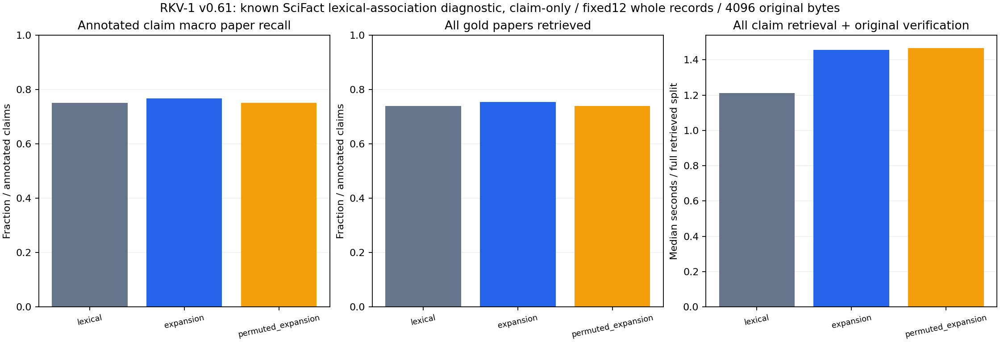

# v0.61.0 实验报告：训练集词语关联的question-only论文来源检索

## 结论和交付阶段

**来源质量True / 时间False / 联合False**。本报告描述唯一一次真实train和9 fresh worker已见dev对照；完整发行资产/外部安装/finalproof核验仍须后续收尾，不能把本报告当已完整发布。方法未生成回答、不判SUPPORT/CONTRADICT或NLI，source identity正确不意味着所引论文支持主张。

| 方法 | annotated宏平均paper recall | 全gold论文完整问题 | recovered paper组 |
|---|---:|---:|---:|
| lexical | 0.7504432624113476 | 139/188 | 146/209 |
| expansion | 0.7677304964539008 | 142/188 | 150/209 |
| permuted_expansion | 0.7504432624113476 | 139/188 | 146/209 |

原300dev排除2 train ID/normalized-question重叠，298检索/188有gold/110无gold。110仍检索但质量null，不能当0或正确；209 gold组是188个标注问题的来源分母。9worker为三方法×三机械轮，不当2682独立科学样本。数据已被v053–57等使用，不称封存未知验证。

质量门槛每轮candidate macro严格大于lexical与permuted两者且complete≥两者；不可用control即False。配对逐题win/loss/tie完整保留：`[{'round': 1, 'expansion_vs': 'lexical', 'tie': 184, 'win': 4}, {'round': 1, 'expansion_vs': 'permuted_expansion', 'tie': 184, 'win': 4}, {'round': 2, 'expansion_vs': 'lexical', 'tie': 184, 'win': 4}, {'round': 2, 'expansion_vs': 'permuted_expansion', 'tie': 184, 'win': 4}, {'round': 3, 'expansion_vs': 'lexical', 'tie': 184, 'win': 4}, {'round': 3, 'expansion_vs': 'permuted_expansion', 'tie': 184, 'win': 4}]`。不丢失负方向、不调0.25/8/16/12/4096追正结果。

## 冻结方法与监督边界

原base10152832B SHA f062c7a784421b71bbfaf3c299be78ff323a391847afbf5420e4c06a4d422be0不重训、不改shared/tokenizer/BM25；新sidecar只读809train行的claim与gold原paperID，同normalized-question union gold并一票，空gold不作负标签，SUPPORT和CONTRADICT文献均视为相关来源。准备仅看训练schema/计数（807 normalized组、505annotated行、2817 query词），实际关联训练在freeze/CI后一次。

每gold paper按旧单term BM25得分保留16词，每原q词留8个target关联（distinct group support/dfq）。推理只给原claim字符串，精确Fraction聚合qtf*support/denominator，去所有原q词、最高8target，词典序并列，归一扩展总量0.25并加原BM25。再按原wholepaper12篇/4096原B admit，未扩大证据预算。

固定SHA排序的query-key循环置换control保留整份target/support/denominator列表multiset和serialized B，≥2key无fixed point，未临时改随机种子。独立结构/评分审计：`{'control_available': True, 'query_terms': 1990, 'edges': 15920}`。sidecar不是语义蕴含器、LLM权重或答案模型；其query-target词表留本地，不发布原文或映射。

## 时间、模型与内存

| 方法 | query+source核验wall中位s | CPU中位s | parent全wall中位s | 三轮观察peak RSS最大B | 实际加载base+sidecar B |
|---|---:|---:|---:|---:|---:|
| lexical | 1.211629 | 1.218750 | 2.014090 | 122273792 | 10152832 |
| expansion | 1.457017 | 1.437500 | 2.257438 | 128995328 | 10762319 |
| permuted_expansion | 1.465826 | 1.468750 | 2.263884 | 129597440 | 10762319 |

candidate/lexical配对中位比：`{'query_wall_s': 1.2114157926755535, 'query_cpu_s': 1.1794871794871795, 'parent_full_process_wall_s': 1.1264442654904427}`。时间门槛要求query wall/CPU和parent全wall均≤1；零分母null且失败。query包括原CAS record验证，parent从启动到退出含base/sidecar加载、source创建/Store导入/计划/评分/完整恢复/JSON。baseline只加载旧base；candidate/control额外加载整个sidecar，没有让基线承担无用模型来改善比值。RSS是观察峰值而非精确增量常驻RAM。

真实新训练1次，sidecar 609487B SHA `fb5b520385cb4b727401bc334566bcfe1b857589a9230ca0afa7e898a6c86f0a`；训练wall 0.374174s、CPU 0.359375s、peak RSS 124022784B，完整训练parent `{'error': None, 'parent_full_process_wall_s': 0.47004940011538565, 'return_code': 0}`另计。旧base文件和历史训练成本继续保留，加载候选需要base+整个含control sidecar，不只报payload/正映射。组件账本：`{'annotated_training_rows': 505, 'annotated_unique_questions': 504, 'component_bytes': {'base_model_sha256': 66, 'control_key_permutation': 41623, 'expansion': 283747, 'parameters': 158, 'permuted_expansion': 283747, 'schema': 38}, 'component_sha256': {'base_model_sha256': '75014c04c69d33a1bb853b36c67d2f457532ae904e9f66a726460ee1db0c2c2a', 'control_key_permutation': '230706f1f1a6cc149de87fb0994e4eb00a16b810936b911fd7d9b7b4ab2c5792', 'expansion': 'c2c52515a1fcf8f7a5616e2c3b8c2041133c2b7799171467e4aed234587e1055', 'parameters': 'b3145a4361ae0aa9b88592a0df2ff415d0af830d6eec5246e17232e4dc94f0b5', 'permuted_expansion': 'e11fb45834016add121c32e3ed32ad7e5a6e6869a989828d153680771a8703d4', 'schema': '149bc4f097d0239cb414b041a452e9dfbae1d48e0e4aa8890540d8d38e35fff9'}, 'control_available': True, 'control_fixed_points': 0, 'gold_training_documents': 365, 'input_training_rows': 809, 'learned_query_terms': 1990, 'new_remote_model_calls': 0, 'retained_target_edges': 15920, 'unique_training_questions': 807}`。

全66递归Python+HTML 426112B，专用/assessment脚本逐文件B/SHA在source-resource；测试/协议/input及历史源码/私有模型/原CAS/快照/负结果残留仍占空间。raw child/parent JSON 4813794B，驱动log 0B；9实际worker文件组如下（不因不发布而免费）：

| 轮 | 方法 | 实际文件分组B |
|---|---|---|
| 1 | lexical | {'other_worker_files_bytes': 98336, 'source_copy_bytes': 8307875, 'store_bytes': 2963638} |
| 1 | expansion | {'other_worker_files_bytes': 98379, 'source_copy_bytes': 8307875, 'store_bytes': 2963638} |
| 1 | permuted_expansion | {'other_worker_files_bytes': 98394, 'source_copy_bytes': 8307875, 'store_bytes': 2963638} |
| 2 | lexical | {'other_worker_files_bytes': 98336, 'source_copy_bytes': 8307875, 'store_bytes': 2963638} |
| 2 | expansion | {'other_worker_files_bytes': 98379, 'source_copy_bytes': 8307875, 'store_bytes': 2963638} |
| 2 | permuted_expansion | {'other_worker_files_bytes': 98394, 'source_copy_bytes': 8307875, 'store_bytes': 2963638} |
| 3 | lexical | {'other_worker_files_bytes': 98336, 'source_copy_bytes': 8307875, 'store_bytes': 2963638} |
| 3 | expansion | {'other_worker_files_bytes': 98379, 'source_copy_bytes': 8307875, 'store_bytes': 2963638} |
| 3 | permuted_expansion | {'other_worker_files_bytes': 98394, 'source_copy_bytes': 8307875, 'store_bytes': 2963638} |

平台/解释器/依赖/pycache未全额归因，未测SSD物理/全系统IO/冷缓存/跨机，不把应用read或源码B当完整系统TCO。无新native性能实验，现有native只用于必要测试/发行功能核验，原v060测量DLL结论不移植到新binary或本检索任务。

## 正式时间线及独立核对

先331检查330pass/1权限skip，新11项包含词语桥接自有fixture、重复normalized-question一票/gold union、精确rational并列/预算、control完整列表与B守恒、无训练回退/错误base与输入拒绝、base不可变/不读verdict、独立ref排名/坏票与control拒绝，以及实际toy Store三角色/基线不loadsidecar/坏baseSHA拒绝。

code/protocol/input freeze `216871604f86746835e0a5b2e6c7604ed21d3b3a`，exact CI `40439353914`成功后真实train一次；exclusive model-freeze记录sidecar/base SHA及CPU成本且先于任何新candidate dev评分。9worker ABC/BCA/CAB、每轮shuffle20261027+round，600s/worker0retry，0重训/搜索/模型API。每query先原字符串ranking/admit/原source验证后才读取gold。

独立ref scorer不调用candidate ranking/lexical函数，从整数关联/精确Fraction和旧BM25定义重算全部9×298排名、admit及metrics；重新核每条原record offset/length/SHA、ID/title/abstract SHA与gold sentence索引，9完整原source恢复/readonly ledger/actual文件和parent-child SHA。绑定总数 **7698**，三方法proof跨轮确定，原v053 lexical全部逐题proof相同 `True`。额外audit wall 12.652167s、CPU 10.828125s、peak RSS 160178176B另计，非新增正式试次。



图已实际打开检查，质量0–1完整轴、wall以全部检索split计、三角色都保留，无生成回答指标。原SciFact corpus/train/dev SHA及CC-BY-4.0 claims/ODC-By-1.0 abstracts见docs/scifact-graph-inputs.json；原数据/模型/fullhits不随发布。

## 复现和后续收尾

```text
python -m scripts.run_supervised_expansion --train --inputs data/scifact --model OLD_FROZEN_BASE_JSON --work NEW_PRIVATE_TRAINING
python -m scripts.run_supervised_expansion --inputs data/scifact --model OLD_FROZEN_BASE_JSON --sidecar NEW_EXPANSION_JSON --model-freeze EXCLUSIVE_MODEL_SHA_RECORD --work NEW_WORKERS --out NEW_RESULTS
```

须严格按协议先代码/CI freeze、训练一次、另冻实际modelSHA再评分，不能拿上述命令在已见dev反复调参追正结果。目录/报告exclusive，不覆盖失败。

本轮0新LLM/API调用（旧24耗尽），只CPU离线。完整代码/协议/rawJSON/图/详实报告形成后，仍需最终安装包、实际sdist新旧候选smoke、CI/Release7base资产SHA（旧5+2current postings，未新测native无需重复measuredzip）、递归source/物理仓库外wheel/currentnative/最终第8proof重下载；这些未完成前不标完整交付。E3净收益/E4整体/NLI/回答/真实长期会话/无限上下文未验收。

## 安装验证时序记录

首次本地安装早于initial build退出，缺少wheel而失败；日志B/SHA与残留临时native副本计入package-harness-recovery.json。已确认initial build exit0后，只重新执行新鲜外部安装/smoke，原训练和9正式worker不重跑。此项不改冻结实验结果。
