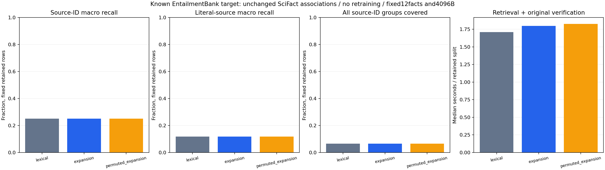

# v0.63.0 实验报告：SciFact训练词语关联无重训迁移到EntailmentBank

## 结论

**来源ID质量False / literal质量False / 时间False / 全联合False**。一次冻结迁移、9 fresh worker，原source/target/sidecar三个输入完全不变，0新训练/模型API。ID与literal指标分开，不能因ID命中就写成蕴含或回答正确。两个语料都已在项目用过，来源域改变也不是未知科学样本验证。

| 方法 | 指标 | 宏平均leaf recall | 完整问题 | recovered/gold组 |
|---|---|---:|---:|---:|
| lexical | ID | 0.25123261694058163 | 22/339 | 266/1348 |
| lexical | literal | 0.1174150906451792 | 6/339 | 136/1524 |
| expansion | ID | 0.25123261694058163 | 22/339 | 266/1348 |
| expansion | literal | 0.1174150906451792 | 6/339 | 136/1524 |
| permuted_expansion | ID | 0.25123261694058163 | 22/339 | 266/1348 |
| permuted_expansion | literal | 0.1174150906451792 | 6/339 | 136/1524 |

本轮339个保留问题对lexical及置换control的来源ID recall均全持平；literal同样没有改善，complete ID22/339、literal6/339。候选querywall中位比1.046759、CPU1.063636、parent1.124600；整输入模型4629668→15391987B，额外10762319B。停止在这套目标题上调该迁移参数，不能把这一负结果写成跨语料提升。

目标原labels-test340行，原v051训练/seen-dev重叠排除和本版新增source训练normalized SHA排除全部记录；每worker实际339问题/1排除，不放宽分母。原v051baseline仍被评所有问题proof一致 `True`。所有未解UUID/nonliteral改写反例仍为负目标，不用sourceID命中冒充literal命中。每workergold mapping `{'provided_UUID': 978, 'annotated_text_differs': 832, 'exact_decoded_text': 471, 'unresolved': 75}`。

## source/sidecar/target身份与无重训定义

源旧SciFact base10152832B SHA f062c7a784421b71bbfaf3c299be78ff323a391847afbf5420e4c06a4d422be0；源v061 learned sidecar609487B SHA fb5b520385cb4b727401bc334566bcfe1b857589a9230ca0afa7e898a6c86f0a；目标旧EntB base4629668B SHA2f82ee4b28c943038e7a37ddcbd8871443f7a441ddd45a1af599decc8bade183。sidecar中的base source SHA不改为目标，不复制重命名伪称新训练。三者总15391987B原文件继续占空间，原训练CPU/字典/graph和所有历史快照账本保留。

候选constructor显式接三个bytes与expected SHA，核source侧association结构/原排列control，parse目标lexical索引。源侧data只有旧训练词语映射，query只原目标question字符串，target图/labels/answer/hypothesis不传给ranker；目标原BM25词分加冻结source top8/.25扩展，缺失target词自然无贡献。原12facts/4096原memberB保持。无新目标监督学习，无新参数搜索、预算变化或语义模型下载。

四transfer core检查+实际toy Store三角色及unresolved/nonliteral反例共5项必要检查、完整340检查339pass/1权限skip后code/protocol/input freeze `55c9191bd40f85684bd0f74233fd1539ec6b0a26`、exact CI `40449606779`成功；正式前另exclusive记录3model身份（不是训练），再唯一9worker ABC/BCA/CAB、每轮shuffle20261027+round，600s/worker0retry/重训/换目标参数。

## 完整时间和内存成本

| 方法 | query+source验证wall中位s | CPU中位s | parent全wall中位s | 三轮观察peakRSS最大B | 实际读入模型bytes |
|---|---:|---:|---:|---:|---:|
| lexical | 1.708541 | 1.718750 | 2.482699 | 66752512 | 4629668 |
| expansion | 1.796947 | 1.828125 | 2.792044 | 121618432 | 15391987 |
| permuted_expansion | 1.824175 | 1.859375 | 2.880254 | 121360384 | 15391987 |

candidate/lexical配对中位比 `{'query_wall_s': 1.0467593640838395, 'query_cpu_s': 1.0636363636363637, 'parent_full_process_wall_s': 1.1246003893372611}`。H1 ID质量每轮macro严格胜lexical与permuted且complete≥两者；H2 literal同规则；H3 query wall/CPU/parent中位比均≤1，零分母null失败。joint三者都过，不能用单指标或部分问题通过替换全联合。

baseline仅旧target模型4629668B；候选/控制额外source base+完整sidecar10762319B，constructor读取/核SHA/parse/源结构验证单列child的transfer_constructor并计worker/parent。prototype为了独立binding又parse目标，额外目标对象/临时源对象/rawbytes也计观察RSS，未提前预热到计时外。query不每次整模型hash，constructor耗时仍在完整父进程中；原source record读取/校验算query时间，gold评分在query完成后，加载并不免费。

观察RSS非纯增量/常驻精确RAM，输入cap不是RSS cap；平台/解释器/依赖二进制/pycache未全分摊，不把源码B当全系统TCO。SSD物理/全系统IO/冷缓存/跨机未测。新native性能调用0，已有Gear/postings仅必要回归及发行功能验证，v060原DLL速度不借给本轮Python检索。

## 独立审计、反例与文件费用

独立reference scorer不调用candidate ranking/lexical helper，按source整数关联/精确Fraction和目标旧BM25公式重算所有query排名/admit；独立gold按UUID/精确text匹配/canonical别名和unresolved/nonliteral集合核ID/literal指标。每条选中原member按snapshotSID/path/offset/length/原SHA/decodedtextSHA核实际Store读，绑定 **36612**；9完整源恢复、source/target/model SHA、read-only ledger和实际全部文件/parent-child SHA通过，三方法proof跨轮确定。纯排名重放与额外audit另计，不当新训练或科学试次。

全部逐题ID方向记录 `[{'round': 1, 'transfer_vs': 'lexical', 'tie': 339}, {'round': 1, 'transfer_vs': 'permuted_expansion', 'tie': 339}, {'round': 2, 'transfer_vs': 'lexical', 'tie': 339}, {'round': 2, 'transfer_vs': 'permuted_expansion', 'tie': 339}, {'round': 3, 'transfer_vs': 'lexical', 'tie': 339}, {'round': 3, 'transfer_vs': 'permuted_expansion', 'tie': 339}]`；literal全部指标和未解/改写分母保留。没有根据target结果调.25/8/12/4096或原source训练16terms，不把目标表现差叫数据无效，也不删除control/失败样本。

额外auditwall 38.141171s/CPU 35.812500s/peakRSS 172605440B。66递归Python+HTML 426112B，全部专用及assessment脚本实际B/SHA见source-resource，测试/协议/input另计。原模型/训练/历史存储账本在measurement-context。rawchild/parent JSON 16430645B、worker logs 0B。9worker实际source复制/科学CAS/plan/private查询/ledger残留分组如下，不因private不发布当零成本：

| 轮 | 方法 | 实际文件分组B |
|---|---|---|
| 1 | lexical | {'other_worker_files_bytes': 139579, 'source_copy_bytes': 909930, 'store_bytes': 315673} |
| 1 | expansion | {'other_worker_files_bytes': 139579, 'source_copy_bytes': 909930, 'store_bytes': 315673} |
| 1 | permuted_expansion | {'other_worker_files_bytes': 139579, 'source_copy_bytes': 909930, 'store_bytes': 315673} |
| 2 | lexical | {'other_worker_files_bytes': 139579, 'source_copy_bytes': 909930, 'store_bytes': 315673} |
| 2 | expansion | {'other_worker_files_bytes': 139579, 'source_copy_bytes': 909930, 'store_bytes': 315673} |
| 2 | permuted_expansion | {'other_worker_files_bytes': 139579, 'source_copy_bytes': 909930, 'store_bytes': 315673} |
| 3 | lexical | {'other_worker_files_bytes': 139579, 'source_copy_bytes': 909930, 'store_bytes': 315673} |
| 3 | expansion | {'other_worker_files_bytes': 139579, 'source_copy_bytes': 909930, 'store_bytes': 315673} |
| 3 | permuted_expansion | {'other_worker_files_bytes': 139579, 'source_copy_bytes': 909930, 'store_bytes': 315673} |



标准图已实际打开检查：ID/literal分图、完整sourceID覆盖、全部目标query总wall，0轴/0–1分数、三角色保留，不画“回答准确率”。EntB来源和Apache许可信息见docs/entailment-test-inputs.json及官方固定repo，真实数据/model/映射/fullhits不重分发。

## 使用、交付与后续

```text
python -m scripts.run_expansion_transfer --inputs TARGET_INPUT_DIRECTORY --model TARGET_BASE_JSON --source-base SOURCE_BASE_JSON --sidecar UNCHANGED_LEARNED_JSON --model-freeze THREE_SHA_RECORD --work NEW_PRIVATE_WORKERS --out NEW_RESULTS
```

输入需取得现有冻结三个model与目标corpus/labels并核SHA，输出exclusive，不覆盖失败。source/sidecar/target绑定和controlled实验只在scripts/sdist，不默认集成Memory/SDK/UI/归档，不生成答案。

代码/必要测试/冻结协议/rawJSON/标准图/详实报告/README/release，CI后7actualbase资产SHA/全Python+HTML/Rust+scripts/物理外actualwheel/currentGear/currentpostings/actualsdist新transfer/旧功能smoke/finalproof8重下载后完整交付。后续按实际H1/H2/H3决定是否停止该迁移或设计新的独立任务，不重复调目标test追正结果。0新增模型API（旧24耗尽），E3净收益/E4整体/NLI/回答/真实长会话/无限上下文未验收。
