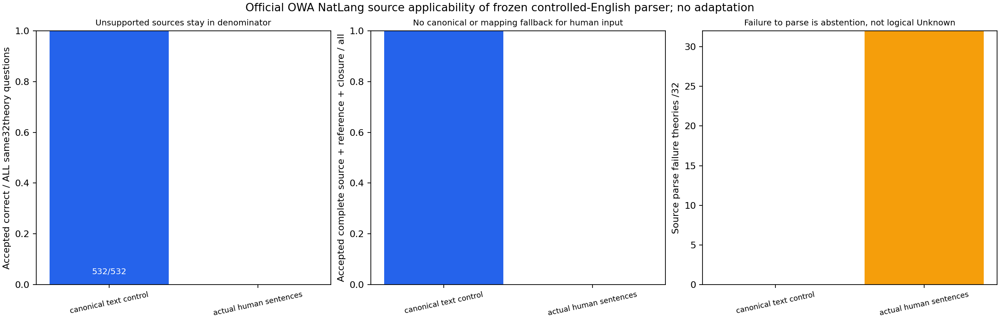

# v0.72.0 实验报告：冻结受限英语在真实人工改写来源上的适用边界

## 结论与全部问题分母

H1人工改写来源allquestion质量 **False**；H2人工改写完整接受/32实际恢复 **False**。固定32官方NatLang理论每method worker共 **532** 问题；规范English控制正确 **532**、接受 **532**，真正human sentences输入正确 **0**、接受 **0**，human源解析失败理论 **32/32**。未知语法和整源不完整均保持abstain/null，不把它们当逻辑Unknown，也不删去失败理论。

这项外部人工改写适用性实验检验了v070语法边界。v0.70合成受限句型1394/1394不能外推为人的任意改写理解；本轮human成绩和canonical控制必须分别读。若human失败而canonical成功，主要说明现有冻结grammar不覆盖这些human source，不能据此说原逻辑引擎推理错误。`scientific_entailment_verified=False`、`unrestricted_English_NLI_verified=False`、无生成回答，E3净收益/E4整体/可靠科学问答/真实长会话/无限上下文仍未完成。

## 为什么必须使用sentences而不是规范旁注

官方[ProofWriter入口](https://allenai.org/data/proofwriter)所给archive README说明NatLang/ParaRules有sentences与mappings额外字段，一条human sentence可以映射多个原规范facts/rules。直接继续用triples/rules.text会重测规范English，不能冒充humanparaphrase成绩。本实验A控制用规范text，Bprimary只用真实sentences值和questions.question；不把canonicaltext或mappings拆分结果给human预测器。

只读NatLang train首1行用于schema（12552B/SHA46ca917cd26287738925747eca8e5d55f37d9596183c2f10ec7889a420058549），查看字段/数量/映射multiplicity，没有改grammar或对NatLang训练评分。官方archive214185889B/SHA bbc5694901e8306d0bd659aa1ad53ccfd02c201864f4b320ffa3777827d1fc26保持。旧depth5train/dev/test的既有暴露如实保留，不称整个数据源从未见；本NatLang dev/test成员在freeze前未读。

## 冻结、次数与固定方法

完整412检查411pass/1既有Windows权限skip，source/protocol/input冻结 `63d5225ff60a65d64accdc4c760d6512a73b5af6`，exactCI `40470668279`成功后才首次取OWA/NatLang/meta-dev.jsonl前32物理行并在任何预测/评分前冻结prefixSHA/size。全部问题分母数量首次读取后报告，不挑短句/易映射/theory/class/depth。原v070Englishparser和v069symbolicparser byteSHA未变，未根据NatLang失败做新规则或调预算。archive/hash/prefix准备CPU和wall在context.input_freeze单列，不是免费的数据下载或准备。

6freshworker：canonical/human各3，固定AB/BA/AB，每worker600s/0retry，同一32theory/allquestion。三轮为机械重复，非3个独立科学数据集。A按旧v070text方法，B逐sentences值尝试同一个冻结factgrammar或rulegrammar，自己判断fact/rule，不读annotations分类，也不以oracle把compound句子拆回多个fact。任何未覆盖source句子拒绝整源解释，所有题继续留分母；query unsupported单题abstain，100000work/1MiBloader/1024record64rule上限不变。

每method-theory内部全部预测及certificate先exclusive持久化，然后post-audit和gold/QDep访问。WholeJSON先被解码、字段存在但不作为预测输入。guard测试在human预测阶段访问triples/rules/mappings/representation/answer/QDep即抛错；示例证明规范控制可成功而真实paraphrase全部题abstain。instruction-like/empty/CWA输入拒绝，未加语义fallback。

## 原human范围和后置reference审核

Bderivedrecord绑定原JSONpointer到sentences与实际sentenceSHA、derivedlineoffset/length/SHA。预测后才读取原mappings与formalrepresentations，为每sentence构造精确语义Counter；conjunctive premises在reference对齐时仅按可交换顺序归一。若一句映射2facts而parser仅产生1，alignment拒绝，即使rawlabel碰巧对也不accepted，不用oracle补全或重跑。新的6必要单元测试覆盖这个多对一边界与原pointer/SHA篡改，源类型完全由grammar判断。

DAG仍定位derivedfile，不称offset是原human字符串位置。接受需要原human-reference语义覆盖+原recordDAG/独立completeclosure；source未成功parse时没有CAS构造/原source审核或恢复，不能以prefixSHA代替。独立检查全部method-theory预测落盘文件 **192** 份，追加实际translation audit **96**、acceptedDAG audit **1596**、actual原文件恢复 **96**；这些counts合计6worker，human/控制分项见下面恢复表。失败source的原prefix行仍私存并计费。

## 方法对照、负结果和重复一致性

| method |goldclass分母/正确 |正确/全部题 |接受 |sourceparse失败theories |reference对齐失败theories |
|---|---|---:|---:|---:|---:|
| canonical | {'False': {'correct': 133, 'total': 133}, 'True': {'correct': 133, 'total': 133}, 'Unknown': {'correct': 266, 'total': 266}} | 532/532 | 532 | 0 | 0 |
| human | {'False': {'correct': 0, 'total': 133}, 'True': {'correct': 0, 'total': 133}, 'Unknown': {'correct': 0, 'total': 266}} | 0/532 | 0 | 32 | 0 |

Human round1 source errors：`{'UnsupportedEnglish:Explicit controlled rule required': 32}`；human query errors：`{'UnsupportedEnglish:Explicit controlled rule required': 532}`。Sourcefailure会传播为该theory全部题失败，保持显式错误类型，而非假称每题完成逻辑推断。Accepted-wrong与abstain在raw报告分开。

H1预先固定human allcorrect/allquestions>=95%且三class齐，每轮均满足才True；H2human全题accepted且32actual原/derived恢复，每轮均满足才True。Canonical控制不是human可部署成绩或给human预测的隐藏oracle。全部6worker原theorySHA/questionID/gold相同，method内三轮quality projection一致；没有挑最好一轮或改primary。若B快速拒绝全部输入，速度不是质量或推理收益，本轮明确无speedgate。

## 所有费用与未测项

| round |method |workerwall s |workerCPU s |parent完整wall s |peakRSS B |实际恢复theories |全部worker残留B |
|---|---|---:|---:|---:|---:|---:|---:|
| 1 | canonical | 3.970762 | 3.484375 | 4.097551 | 38735872 | 32 | 6543337 |
| 1 | human | 0.543503 | 0.359375 | 0.667598 | 34557952 | 0 | 893599 |
| 2 | canonical | 3.916890 | 3.390625 | 4.047046 | 38850560 | 32 | 6543332 |
| 2 | human | 0.570913 | 0.234375 | 0.712610 | 34566144 | 0 | 893585 |
| 3 | canonical | 3.939176 | 3.515625 | 4.068407 | 39317504 | 32 | 6543370 |
| 3 | human | 0.542033 | 0.296875 | 0.664071 | 34578432 | 0 | 893538 |

每query prediction/audit、原parse/ingest/reference/恢复及原/derived/fileSHA在rawworkerJSON。Source失败前0CAS不代表0原始输入读，prefix原JSON依然读取并已在inputfreeze记录bytes；受计量的sourcepayload/原JSON重读在每accepted项audit中，metadata/SQLite/OS/SSD/all-systemIOnull，冷缓存/跨机未测。没有把拒绝输入更快当优势；平台CPU0为粒度，不当无成本。

整库递归66Python+1HTML源码 **426112B**，全部当前scripts保守 **1613993B**，包括共享/未执行历史，不称动态import集合。所有新protocol/tests/input另列；全部6worker source/CAS/snapshots/mappings/predictions/certs/aggregate残留 **22310761B**，另有32prefix、archive214MB、NatLang train1schema和private准备 **43847B**（逐SHA在context，archive不重打包）。所有旧science/English/model/train/proof/frame/restored/history成本保留，当前model0/新training0不抹除历史。依赖/OS二进制/allocator/metadataRAM未分配项显式保留，不从源码或payloadB推算总RSS。

## 可运行交付与下一步

```powershell
python -m unittest discover -s tests
```

human_source_coverage.py只应用冻结grammar于实际sentences，audit_human_source_coverage.py只在预测后以mappings/formalreference验证覆盖，run_human_source_coverage.py提供同32theory两方法worker。正式需private官方prefix/冻结inputmeta；owned新旧sdist功能例无需原语料，原parser和默认SDK/UI不改，66runtime仅version、HTML一致。



图已实际视觉检查，三个面板的规范控制、human零接受与32整源失败一致。本报告tag前状态，localbuild/actual物理外wheel-currentnative/actualsdist新旧smoke/finalbuildsourceaudit退出0，tagReleaseCI/实际7baseSHA/所有递归Python+HTML和source/外actualreleaseinstall/finalproof8重下载齐备后，以published-verification.json判发行完成，不回写原formal。Win206外部脚本方式保留，不重引入-c长命令。

后续不能在已见NatLang dev追加模板追正。需要另选有明确边界的语义方法/独立数据或新增授权模型服务后，才能研究开放NL与科学证据关系；旧24模型API已用完，本轮0新调用。E3净收益/E4整体/科学NLI/真实长会话/可靠回答/无限上下文仍未完成；原human/科学/canonical数据、model、私研/模板/个人报告/密钥不发布。

## 启动与分析故障保留

首次private controller在首次NatLang读取前缺少repo导入路径退出；修复private启动路径后仅一轮6个正式worker。正式评分及独立审计完成后，matplotlib文本参数labelsize导致绘图退出；仅用已完成JSON恢复绘图/报告，改为fontsize，没有重跑worker、评分或source/DAG审计。两次失败日志SHA/size保留在harness-analysis-recovery.json，failed分析总wall未完整记录为null，不能视为零；analysis-timing仅恢复绘图报告阶段，不冒充完整分析总成本。
