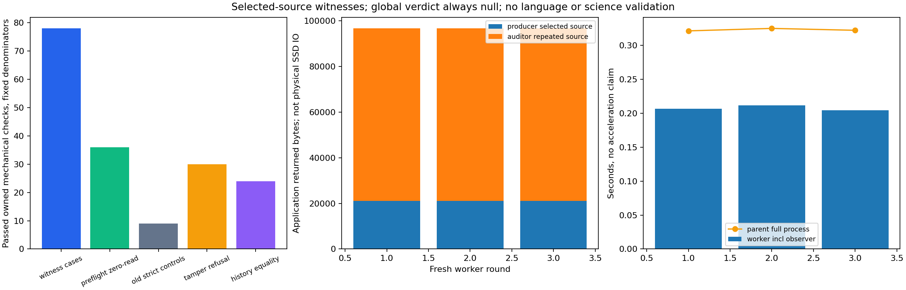

# v0.73.0 实验报告：部分记忆中的可核验证据

## 结果与用途

冻结协议H1=True、H2=True。3fresh worker共78证据case、36预算前置拒绝、9旧严格接口控制、30篡改拒绝、24历史证明相等全部通过。追加78实际原source DAG审计与63完整owned原文件恢复通过。所有global_verdict均null。找到证据可核验，不等于已读全库或不存在反证；未找到也不是全局false/unknown。这是人工显式公理机制，不是科学NLI、自然语言理解、回答质量或无限上下文完成。

v072真实人工改写源32/32拒绝、532题0接受的负结果不变，没有增加已见模板追正。本版只解决独立的E4部分检索证据契约，旧完整来源接口仍严格，默认SDK/UI不集成。

## 冻结与固定次数

427检查426pass/1权限skip，source/protocol/input freeze `c6451e16ce1affb799cc0b8516f3bde330a69e5c`，exactCI `40473910484`成功后才唯一执行3worker；每worker600s/0retry。owned fixture和显式gold固定在公开源码，不是未知科学数据。initial9 eligible sources、updated10、historical oldSID，选集最多3文件（API上限8）和1MiB，工作0/100000，组合record1024/rule64。完整26case/12preflight/3旧控制/10篡改/8历史的精确组成见[冻结协议](../../docs/SELECTED-WITNESS.md)和input manifest，失败不会删分母或重跑覆盖。

Independent aggregate自行按case ID解释期望flag，没有调用engine生成gold，三轮机械projection一致。另从每个实际Store再次核对所有78原DAG及旧/新SID全部63原文件原bytes。追加分析读取全部eligible owned files是独立恢复核验，**不属于worker selection IO**，不能用它声称worker没读的文件也被查询读过。分析audit application返回226809B、分析完整恢复返回10890B单列。

## 契约与审计限制

新RKVSELECTWITNESS1输出support/opposite found及selected_closure_complete，global_verdict永null。即便证据均在选集中、闭包完整或发现双方，也只陈述选集证据。实际全目录metadata独立核对，原SID/path/offset/length/SHA保持；只有内部显式Projection复用旧引擎和独立DAG/finite closure检查器，旧内部full-source flag不会作为新格式全局证书暴露。producer/auditor共享Projection和schema常量，不能声称整个实现完全独立或形式化证明。

单调Horn无NAF/爆炸：后来加入反证可能改变全库分类，但不消除在显式axioms下已经存在的正证推导。科学真实性、自然语言抽取、来源适当性仍未证明。元数据需枚举全universe，不受selected文件数/payload预算保证，超大目录CPU/RAM尚未作扩展性实验。

## 费用与全部重复

| round | worker wall s | worker CPU s | parent full wall s | peakRSS B | producer source returned B | auditor repeated returned B | worker retained B |
|---|---:|---:|---:|---:|---:|---:|---:|
| 1 | 0.20645359996706247 | 0.21875 | 0.32127880002371967 | 34381824 | 21052 | 75603 | 70289 |
| 2 | 0.21132360002957284 | 0.203125 | 0.32491849991492927 | 34459648 | 21052 | 75603 | 70289 |
| 3 | 0.20457449997775257 | 0.203125 | 0.32212259992957115 | 34406400 | 21052 | 75603 | 70289 |

所有worker读observer ON，producer实际返回恰好selected原payload；auditor所有whole-file/record重复返回另计并守恒。这不是CAS decode、SQLite/metadata/OS/SSD或全系统IO；1MiB是selected payload cap，不是audit/总IO上限。没有OFF/ON开销实验、输出等价速度baseline或速度gate，表内时间不能声称加速。old严格接口因9/10文件超原cap拒绝只是契约对照，不能把更宽松found witness与全局结论作性能胜利比较。

整库递归66Python+HTML合计426112B；全部scripts保守1629520B，按实际递归集合逐SHA，不只计新代码。专用source/tests/protocol/input另列；全部source/CAS/snapshots/certificates/history与残留210867B完整记账。metadata allocator/OS/未分配依赖不当零。当前model/训练/API均0，所有旧science/English/model/training/frames/restored/history费用继续保留。analysis timing和新增原证恢复CPU单列，未测物理IO/冷缓存/跨机。

## 交付状态与后续

```powershell
python -m unittest discover -s tests
python -m scripts.run_selected_witness --work fresh-owned-work --report fresh-report.json
```



图已实际视觉检查，固定分母、producer/auditor返回B和observerON时间各自清晰。原始3worker+完整parent sidecar、input/source SHA、aggregate和费用齐备；本报告不等于发行完成。必须再完成本地build退出0、物理仓库外actualwheel/currentnative+新旧actualsdist、finalbuild/sourceaudit、tagReleaseCI、实际7资产SHA/全源码/物理外actualpublishedinstall和finalproof重下载，最终以published-verification为准。

后续仍需冻结新语义候选与独立数据才谈灵活语言/科学NLI，旧24 API预算耗尽，本轮无新调用。E3净收益/E4整体/真实长对话/回答/无限上下文未完成；原科学/English/model/私研/课程模板个人报告密钥不公开。额度到实际100或普通调用不允许/窗口结束立即保存partial，不把未发布候选称交付。
