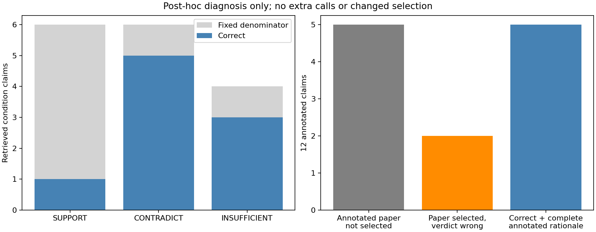

# RKV-1 API证据干预实验报告

## 结果和范围

完整48调用=True；独立mechanical审计=True；检索同时优于两对照的冻结质量门槛=True。本版是已见SciFact16题（6SUPPORT/6CONTRADICT/4无标注代理）单次三条件，不能称未知科学泛化、自动科学蕴含、真实长期会话或无限上下文。所有missing仍在16/48分母，引用身份与标注rationale分别计数。

|条件|已尝试/16|schema引用接受/16|判定正确/16|有标注判定+rationale/12|
|---|---|---|---|---|
|empty|16|16|4|0|
|retrieved|16|16|9|5|
|rotated|16|16|4|0|

## 方法与隔离

源/协议/input与exactCI见measurement-context，16题按冻结SHA分层，排除旧v01512题和trainID/query，无检索后筛题。旧PaperRetriever/源SID/模型SHA/12篇4096原B预算不改。empty是同一only-evidence提示无证据，retrieved取本题词法原文，rotated取SHA固定环下一题原文。donor可能仍相关，重合完整见derived JSON，不观察后改控制。推理只读question和corpus/model，全部预测持久化后再读gold；源码/原文件/title/句子/citation/prompt/slot/原始响应/usage和label由独立审计程序核对。

## API与失败

用户指定DeepSeek deepseek-flash，temperature0/thinking关闭/JSON/512out/每请求20000B/响应1MiB/90s；48slot传输前exclusive+fsync，失败占名额，HTTP/timeout/redirect策略错误停止后续，不补发已预留slot。真实返回model/system_fingerprint/usage、raw响应bytesSHA均私存，远程权重/运行库/RAM/能耗未知null。模型可能训练见过公开数据，alias不等于冻结权重。secret仅认证头，拒绝redirect；原prompt/output/科学原文不公开。13项owned机制检查是本机fake和loopback，不是API结果。

## 评分与小样本边界

H2要求48完整且retrieved的16题判定正确数及12annotated“判定+至少一个完整gold rationale”都严格大于empty/rotated。unannotated INSUFFICIENT只是注释代理，不证明全库没有证据；citation精确率仅对已标注集合。混淆/paired win-loss-tie、描述性exact McNemar和Wilson95区间在derived JSON，不将16条重复解释为大样本。失败/未知保持原分母，没有调阈值/样本/预算/提示追正。

## 完整成本和复现

新实际调用48，旧24次费用单独保留；可计算usage的调用48，未知或缺失0，已知部分参考USD区间{'low': 0.00692832, 'high': 0.01385664}，不是账户账单或未知项0。价格参考book必须随实际冻结输入保存，peak/假期/折扣未知用区间，原始usage/cache守恒不满足时unknown。检索constructor/16query CPU与RAM、API各wall与wireB、完整parent/worker/finally及后置audit成本另附。旧model10152832B、原corpus8307875B、完整store/快照/派生/旧science/model/训练/API费用和全部残留文件均保留，不以复用视为免费。整库实际67Python+HTML和全部scripts/新代码/测试/协议/依赖分别记账；源码资源账本可重算，不硬编码旧模块数。

图需实际视觉检查后才能记true。API质量不是本机CPU推理收益；存储是本机，生成是云端。冷缓存/跨机/SSD全系统IO未测，E3净空间/E4整体/开放科学NLI/真实长会话/无限上下文未完。完整本地发行/实际GitHub资产SHA/递归源码/物理外安装/proof重下载齐才交付；代码或本报告存在不代表发行已通过。

## 事后错误分解（0额外模型调用，不改冻结门槛）

原48次输出完整保留后补充观察：retrieved中SUPPORT仅1/6正确，CONTRADICT5/6，无标注代理3/4；9/16并非各类均匀改善。12 annotated中5题未取回标注论文，7题取回，其中2题判定仍错、5题判定和完整rationale均对；另有1题未取回标注论文却判定正确，不把该结果冒充有标注依据。标注不一定穷尽所有有效证据，未取回gold不等于科学上不可能回答。

48/48格式及引用身份接受说明约束和定位机械有效，不保证语义正确，不能把100%合法引用写成100%真实科学回答。retrieved相对empty/rotated均6赢1输9平，描述性双侧exact McNemar p=.125，16题不足以支持普遍提升或显著性结论。所有rotated donor与本题已选文献和标注gold交集实际均0；该结果是后置核查，没有用来重选对照。

530全回归529pass/1权限skip，13项owned机制检查；最初.venv被第三方tests包遮蔽的导入失败日志保留，实际完整回归使用既有scientific-venv。私有uploader因旧quota reference在远端写入前拒绝，保留失败日志后仅改续跑参数；未修改冻结runtime/问题/提示、未重跑API。

该分解来自同48输出，属于已见事后诊断，不是额外独立样本或新的科学验证；附加诊断的完整child wall/CPU未专门记录，保留null；完整外层exec_command工具回执wall=.9189081s单列，pre-plot局部时间不当全程。主API/独立审核父子计时保持原值，不回填正式API时钟。
