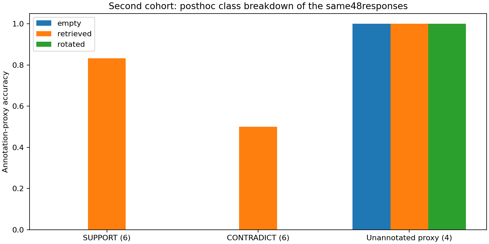

# RKV-1 API证据干预实验报告

## 结果和范围

完整48调用=True；独立mechanical审计=True；检索同时优于两对照的冻结质量门槛=True。本版是已见SciFact16题（6SUPPORT/6CONTRADICT/4无标注代理）单次三条件，不能称未知科学泛化、自动科学蕴含、真实长期会话或无限上下文。所有missing仍在16/48分母，引用身份与标注rationale分别计数。

|条件|已尝试/16|schema引用接受/16|判定正确/16|有标注判定+rationale/12|
|---|---|---|---|---|
|empty|16|16|4|0|
|retrieved|16|16|12|7|
|rotated|16|16|4|0|

## 方法与隔离

源/协议/input与exactCI见measurement-context，16题按冻结SHA分层，排除旧v015/v084共28题和trainID/query，复测批问题固定未用于旧API，不按旧检索质量筛选，无检索后筛题。旧PaperRetriever/源SID/模型SHA/12篇4096原B预算不改。empty是同一only-evidence提示无证据，retrieved取本题词法原文，rotated取SHA固定环下一题原文。donor可能仍相关，重合完整见derived JSON，不观察后改控制。推理只读question和corpus/model，全部预测持久化后再读gold；源码/原文件/title/句子/citation/prompt/slot/原始响应/usage和label由独立审计程序核对。

## API与失败

用户指定DeepSeek deepseek-flash，temperature0/thinking关闭/JSON/512out/每请求20000B/响应1MiB/90s；48slot传输前exclusive+fsync，失败占名额，HTTP/timeout/redirect策略错误停止后续，不补发已预留slot。真实返回model/system_fingerprint/usage、raw响应bytesSHA均私存，远程权重/运行库/RAM/能耗未知null。模型可能训练见过公开数据，alias不等于冻结权重。secret仅认证头，拒绝redirect；原prompt/output/科学原文不公开。复用原13项owned机制与新增5项选择检查是本机fake和loopback，不是API结果。

## 评分与小样本边界

H2要求48完整且retrieved的16题判定正确数及12annotated“判定+至少一个完整gold rationale”都严格大于empty/rotated。unannotated INSUFFICIENT只是注释代理，不证明全库没有证据；citation精确率仅对已标注集合。混淆/paired win-loss-tie、描述性exact McNemar和Wilson95区间在derived JSON，不将16条重复解释为大样本。失败/未知保持原分母，没有调阈值/样本/预算/提示追正。

## 完整成本和复现

新实际调用48，旧24+48次费用单独保留；可计算usage的调用48，未知或缺失0，已知部分参考USD区间{'low': 0.007171314, 'high': 0.014342628}，不是账户账单或未知项0。价格book为v084历史参考快照，不能称本批当前报价；随实际冻结输入保存，peak/假期/折扣未知用区间，原始usage/cache守恒不满足时unknown。检索constructor/16query CPU与RAM、API各wall与wireB、完整parent/worker/finally及后置audit成本另附。旧model10152832B、原corpus8307875B、完整store/快照/派生/旧science/model/训练/API费用和全部残留文件均保留，不以复用视为免费。整库实际67Python+HTML和全部scripts/新代码/测试/协议/依赖分别记账；源码资源账本可重算，不硬编码旧模块数。

图已实际视觉检查，三面板分母/柱值与独立JSON一致，无遮挡或裁切。API质量不是本机CPU推理收益；存储是本机，生成是云端。冷缓存/跨机/SSD全系统IO未测，E3净空间/E4整体/开放科学NLI/真实长会话/无限上下文未完。完整本地发行/实际GitHub资产SHA/递归源码/物理外安装/proof重下载齐才交付；代码或本报告存在不代表发行已通过。

## 第二批复测及执行状态

源码/协议/input冻结6cecbe908c977ec511bc97bcfb5cb85915aba82e，exactCI40845384087成功；549项回归548通过、1权限skip。旧v084检索9/16、两控制各4/16；本批不同16题检索12/16、两控制各4/16，标注依据完整正确7/12对0/12和0/12。新批固定门槛H1/H2通过，但公开dev被项目使用过，模型alias权重不由本项目冻结；不把复测正结果当未知科学泛化或无限上下文完成。两批不合并替代新批门槛。

首次controller在exactCI成功后的官方额度只读接口临时获取失败，发生于finalfreeze/真实slot创建前；没有任何真实API请求。保存原formal-v087.log，后续官方额度工具与原只读helper恢复成功，确认finalfreeze及campaign目录均不存在后仅恢复未执行的预检阶段。唯一48次正式调用零补发，全部响应持久化后独立分析；原失败日志不覆盖。

本批新增48次授权现已全部用完，旧24+48单列，没有继续远程调用授权。详细原始usage、响应SHA、48分母和完整父/子/分析计时均保留。当前图/报告完成，完整打包/仓库外安装/发行CI/实际资产SHA与proof重下载尚未执行，不能称本版已交付。

## 配对比较、区间与全部成本

|检索证据相对|改善|退步|持平|双侧exact描述性p|
|---|---|---|---|---|
|empty|8|0|8|0.0078125|
|rotated|8|0|8|0.0078125|

本批retrieved正确率75%，Wilson95描述区间约50.50%–89.82%；两组控制25%，区间约10.18%–49.50%。配对p=.0078125只描述这批预先固定的16题和同提示干预，不消除公开数据训练污染、同一远程服务时间漂移、标注不穷尽、题目相关性与有限样本风险，不据此声明通用科学推理已解决。

独立核验46份原source记录绑定、62978B应用返回，非全库新科学样本数，非SSD物理读取。模型回答和citation/schema接受率分别记账：48/48机械接受无法替代判定/依据评分。

API完整父进程wall97.593807s，独立审计父进程wall1.138358s；worker和analysis自身CPU/wall/RSS在对应原始finally文件，时钟作用域分开。48次usage均可计参考费用，历史pricebook得到USD0.007171314–0.014342628，仅参考带，不是服务商当前价格或账户账单。原远端模型weights/runtime/RAM/能耗未知null；本地检索/旧10152832B模型、原Store、全部源码/历史训练/API费用/失败文件继续分列。

当前新额度窗口由用户再次明确继续授权，停止参考已改为1793286008；原实测窗口和freeze里的1793272390不回写。API已全部完成，后续仅发行工程，不重复请求或科学评分。

## 原48响应的事后分层与控制审计（零新调用）

|条件|标注类|正确/该类分母|
|---|---|---|
|empty|SUPPORT|0/6|
|empty|CONTRADICT|0/6|
|empty|INSUFFICIENT|4/4|
|retrieved|SUPPORT|5/6|
|retrieved|CONTRADICT|3/6|
|retrieved|INSUFFICIENT|4/4|
|rotated|SUPPORT|0/6|
|rotated|CONTRADICT|0/6|
|rotated|INSUFFICIENT|4/4|

固定donor的选中来源有交集题数0/16，包含本题标注gold来源题数0/16；均是预测后审计，不据此重选donor。实际response model名称['deepseek-flash']，alias相同不证明服务端权重固定。此图只解释同一批48输出，不增加科学样本或改变主门槛。

新分层图已实际视觉检查。支持类5/6、反驳类3/6、无标注代理4/4；仍有4道有标注题判定失败，不能仅报告总体75%而隐藏类别差异。对照受到相同only-evidence提示约束，主要选择不足证据，不能等同无约束闭卷模型能力。新增事后诊断完整child/parent CPU/wall/RSS均单列，零API/新检索；不回填旧正式计时。
