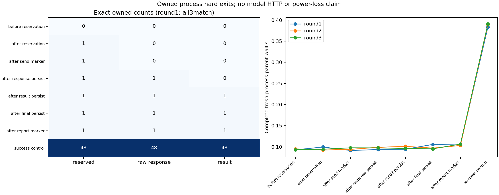

# v0.90 活动状态只读检查与report-only恢复实验

H1固定边界/计数/原文件不变及独立核验通过；H2检查和报告步骤零额外fake发送通过。24fresh子进程（三轮七硬退出边界+一成功控制）和4篡改负控制，0真实模型HTTP、0科学样本/训练/检索。进程os._exit77不是断电；机械结果不是科学理解、无限上下文或生产收益。

|边界|预期初始状态|每轮预留/原响应/结果/fake发送|
|---|---|---|
|before_reservation|open_no_reservations|(0, 0, 0, 0)|
|after_reservation|open_ambiguous|(1, 0, 0, 0)|
|after_send_marker|open_ambiguous|(1, 0, 0, 1)|
|after_response_persist|open_ambiguous|(1, 1, 0, 1)|
|after_result_persist|open_outputs_no_final|(1, 1, 1, 1)|
|after_final_persist|closed_incomplete|(1, 1, 1, 1)|
|after_report_marker|closed_incomplete_report_bound|(1, 1, 1, 1)|
|success_control|closed_complete_report_bound|(48, 48, 48, 48)|

每次inspection前后campaign所有文件原bytes/SHA不变；显式report步骤仅允许生成一个绑定身份marker，已存在有效marker幂等、不覆盖，open状态拒绝，fake发送marker未增加。marker只证明机械身份，不是科学审计通过。预留后缺result一律ambiguous，即使没有owned发送marker，也不能断言真实服务未收到；所有返回model_send_allowed=False。四份篡改克隆独立拒绝且不改文件，原成功fixture不变。未读取或恢复v089真实失败轮，其7尝试/6响应/41未尝试永久保留。

全部24parent完整wall/CPU/exitstatus已记录；21硬退出无childfinally，其childCPU/RSS未知null，不能填0或声称完整worker时钟。成功控制childbodyfinally另外记录，包含状态观察/marker写入成本的matrix/分析/parent费用分列；父计时总和3.2096053997520357s。总计{'reserved': 162, 'responses': 156, 'results': 153, 'owned_fake_send_markers': 159}仅是owned假发送/原记录数，不是真实远程请求或新增科学样本。没有性能优化前后对照，不据此声称提速。

实际整库67Python+HTML、所有scripts/测试/协议/input、每case原文件/日志/派生marker、4克隆、全部旧科学/模型/Store/训练/API/快照/帧/恢复/派生/失败费用继续计账。source大小非物理SSD、内存峰值非完整系统RAM，冷缓存/跨机/真实掉电未测。新功能是显式实验脚本，不改默认运行库或原API科学协议。

图已实际视觉检查，0/1/48计数用标注网格显示、完整父时间三轮曲线与JSON相符；完整软件打包/外安装/CI/实际资产及源码核验/proof重下载齐才交付。

## 冻结、完整资源与解释范围

源码/协议/输入冻结4d41bcdbf6cf2ecf5786ff4181e0091c1cd6351a，exactCI40871514250成功后唯一正式轮，570检查569通过1权限skip，新增8项必要检查覆盖只读/marker幂等与篡改/非法slot和真子进程硬退出、完整parent计时。未运行24矩阵预检或按结果换边界。

正式matrix完整parentwall34.4771819s，parentCPU0s为粒度记录，matrix自身bodywall34.4078439s、CPU2.140625s；后者包含每case官方额度读取、全部inspection/marker/克隆/写出与child调用，不能只拿约0.1s子进程wall称全流程成本。独立审计完整parentwall1.1982932s，analysis自身wall1.0643414s、CPU1.078125s、peakRSS80203776B，CPU和wall可能因计时粒度/调度出现微差。每case的全部原文件、fake-send marker和4副本逐文件size/SHA保留；它们是owned机械fixture，不是真实模型调用或科学数据。

21硬退出无finally是预定观察，不回填childCPU/RSS；3成功控制保留childbody时钟。3轮同一边界不是24个不同科学问题。状态检查从未给出model-send权限，报告marker只绑定campaign原bytes，不验证语义或证明报告内容正确。原v089七次尝试仍保持关闭，41未使用名额没有复用。后续若接入真实生产流程，仍需单独集成、并发及真实故障验证，当前不默认集成。
