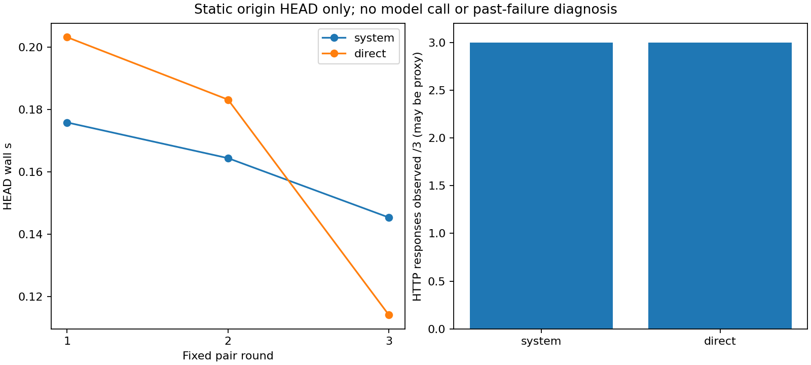

# v0.91 固定根路径HEAD访问路径观测

H1固定6请求/HEAD/无认证正文/不跟redirect/0模型调用原元数据核验通过。H2direct非HTTP响应失败严格少于system=False。这是当前时间极小静态网络样本，不能确认v089历史URLError原因、生成服务可用性或回答质量。

|路径|固定尝试|观测HTTP响应|无HTTP响应错误|HEAD wall合计s|status|error class|
|---|---|---|---|---|---|---|
|system|3|3|0|0.48545209993608296|[401, 401, 401]|['HTTPError', 'HTTPError', 'HTTPError']|
|direct|3|3|0|0.5002755001187325|[401, 401, 401]|['HTTPError', 'HTTPError', 'HTTPError']|

唯一freshworker固定system/direct、direct/system、system/direct三对，15s/次、0transportretry；所有失败原样保留，不根据结果换路由/超时/服务。GET或模型chat/completions从未调用，未读取APIkey/HKCU密钥；默认TLS验证保留，NoRedirect拒绝跨源跳转。system路径使用当时OS代理策略，proxy presence仅布尔；无代理URL/凭证/原header/body。HTTPError可能来自代理，HTTP响应不等于originTLS成功或生成端可用。NoRedirectValueError只记错误类/unknownstatus，不猜响应码。3次重复不能估计普遍可靠性；无服务重试或历史故障复现。

worker/parent/analysis完整CPUwallRSS分开原JSON；每请求wall不等全流程成本，官方额度读取和Python启动也有开销。完整运行库67Python+HTML、所有scripts/新代码/测试/协议和原全部科学/模型/Store/训练/API/快照/帧/恢复/派生/失败费用保留，不把复用视为免费。本轮6轻量HEAD不产生模型token生成，服务供应商其他计费未知，不声明任何费用账单。源字节非SSD物理IO、进程RSS非全系统RAM，coldcache/crossmachine/powerloss/真实长期会话/科学NLI/无限上下文未测或未完成。

图已实际视觉检查，三对HEAD墙钟与两组HTTP响应计数均与原JSON一致；完整本地打包/外安装/CI/实际发布资产SHA/递归源码/外实际发行安装/proof重下载齐才交付。原v0897尝试6响应41未尝试继续关闭，不能补发或据本轮结果改写过去失败。

## 原始六请求和完整时钟

|index|round|route|status|HTTP响应观测|wall s|
|---|---|---|---|---|---|
|0|1|system|401|True|0.17579160|
|1|1|direct|401|True|0.20313330|
|2|2|direct|401|True|0.18311530|
|3|2|system|401|True|0.16434850|
|4|3|system|401|True|0.14531200|
|5|3|direct|401|True|0.11402690|

六次均返回HTTP401，不是认证成功。system与direct均3/3观测HTTP响应、均0次无响应错误，所以H2False；不能由此宣布绕过系统代理更稳定，也不能拿毫秒差声称可靠提速。HEAD根路径不携带密钥，401是正常需鉴权回应的可能形式，但也可能是代理响应，未依据headers/body识别origin。本轮不验证现有密钥有效性、模型可调用性或真实生成服务稳定性，更没有解释过去URLError的证据。

完整worker parentwall9.8030575s、parentCPU0s是粒度记录，workerbodywall9.6656710s、CPU0.1875s、RSS45068288B；六HEADwall仅system合计0.48545210s、direct0.50027550s，其余含六次官方额度控制面读取、Python启动和输出fsync等，不能隐藏。独立审计parentwall0.7644655s，analysiswall0.6244626s、CPU0.609375s、RSS75739136B，原footer全部保留。

源码/协议/input冻结e196e4022a88625db0458b2439c69ec2e2501fec，exactCI40882371008成功后唯一6HEAD正式。573回归572通过1权限skip，新增3项owned必要检查覆盖loopbackHEAD无认证正文、redirect拒绝、非法mode、固定6schedule和quota失败前无新请求。没有provider预检、重试、换路径或更改预算追正。完整发布核验待完成，报告本身不代表已交付。

系统路径三次检测到HTTPS代理配置，direct路径显式不使用代理；只披露presence布尔，不披露代理地址/端口/认证。配置存在不等同独立证明实际服务器来源或每层网络路由，仍只能说当时各3次拿到HTTP401。图中三对wall波动不用于切换默认API路由，也不修改旧失败正式轮。
