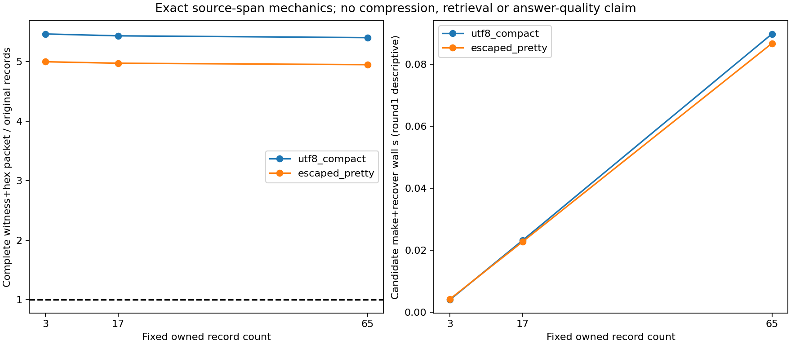

# v0.92 原文句子token定位与完整表示成本

固定18个全新owned Store子进程：3/17/65记录、两编码、三轮；510原记录/1020选中token/108拒绝控制/18旧SID检查通过独立原始JSONL边界及byte-token参考。H1=True；H2主65记录完整packet不大于原记录=False。未使用科学数据、gold、模型、旧API回答或新API。

|轮|记录|编码|原record B|选中token B|decoded B|witness B|完整packet B|packet/record|phase wall s|CPU s|parent wall s|RSS B|
|---|---|---|---|---|---|---|---|---|---|---|---|---|
|1|3|utf8_compact|578|228|207|2579|3158|5.463668|0.004040600033476949|0.0|0.11480799992568791|28106752|
|1|3|escaped_pretty|644|258|207|2579|3218|4.996894|0.004265399882569909|0.0|0.18464360013604164|28147712|
|1|17|utf8_compact|3301|1299|1180|14637|17932|5.432293|0.02320639998652041|0.015625|0.13595249992795289|28332032|
|1|17|escaped_pretty|3675|1469|1180|14638|18273|4.972245|0.022757500177249312|0.015625|0.1341360998339951|28397568|
|1|65|utf8_compact|12709|4995|4540|56002|68657|5.402235|0.08975440007634461|0.09375|0.1993290998507291|28504064|
|1|65|escaped_pretty|14139|5645|4540|56008|69963|4.948228|0.0867087000515312|0.09375|0.19799829996190965|28545024|
|2|3|utf8_compact|578|228|207|2579|3158|5.463668|0.004034900106489658|0.0|0.11377119994722307|28229632|
|2|3|escaped_pretty|644|258|207|2579|3218|4.996894|0.004433100111782551|0.015625|0.11356680002063513|28323840|
|2|17|utf8_compact|3301|1299|1180|14637|17932|5.432293|0.02290099998936057|0.015625|0.2097060999367386|28307456|
|2|17|escaped_pretty|3675|1469|1180|14638|18273|4.972245|0.023209300125017762|0.015625|0.13866350008174777|28164096|
|2|65|utf8_compact|12709|4995|4540|56002|68657|5.402235|0.09343629982322454|0.09375|0.20667489990592003|28557312|
|2|65|escaped_pretty|14139|5645|4540|56008|69963|4.948228|0.08623669994994998|0.09375|0.19432409992441535|28442624|
|3|3|utf8_compact|578|228|207|2579|3158|5.463668|0.004017899977043271|0.0|0.11421160004101694|28254208|
|3|3|escaped_pretty|644|258|207|2579|3218|4.996894|0.004473899956792593|0.0|0.11265879985876381|28041216|
|3|17|utf8_compact|3301|1299|1180|14637|17932|5.432293|0.022783099906519055|0.03125|0.13201960013248026|28254208|
|3|17|escaped_pretty|3675|1469|1180|14638|18273|4.972245|0.0218299999833107|0.015625|0.13313869992271066|28262400|
|3|65|utf8_compact|12709|4995|4540|56002|68657|5.402235|0.08694800012744963|0.09375|0.20066919992677867|28110848|
|3|65|escaped_pretty|14139|5645|4540|56008|69963|4.948228|0.08648880012333393|0.0625|0.19736039987765253|28487680|

每条witness需要独立可信原SID/path/fullfileSHA/recordrangeSHA/field；原token包括引号和转义，重复相同句子按原index/offset区分。独立byte-token递归解析和完整JSONL行边界复核，不允许嵌套JSON子对象冒充原record。六控制拒绝wrong external source/record、tokenSHA、duplicateindex、declaredB、newSID；HEAD改变后旧SID仍读。CAS损坏另为必要owned单测，不混作正式scale结果。

完整packet显式为witness与hex tokens，hex膨胀、metadata全部计费；H2结果无论正负均不改格式/摊销数/源record填充。原候选仍通过Store读完整record，make+recover阶段每record返回两次，不是全流程IO，控制/旧SID/audit/manifest/CAS/解压/物理SSD未完整仪表，保留null。O(N)UTF8 offsetmap、参考tokenlist和可能二次CPU另计，不声称常量RAM、提速、检索改进或净压缩。

所有18parent/child/finally和完整formalworker/analysis时钟分别保留；每case包含Store构建/HEAD更新/控制的全程，phase只是构造+恢复。三轮是机械复测，不是新科学样本。完整运行库67Python+HTML、所有scripts/协议/测试/原全部科学模型训练Store快照帧恢复派生失败API费用继承，不把复用算免费。

4096选中token预算不同于原4096整record准入，此版本没有更改任一预算/排序/提示，也未发API。原v089失败7/6/41继续关闭，不补发。E3净收益/E4整体/开放NLI/长期会话/回答泛化/无限上下文仍未完成；coldcache/crossmachine/掉电未测。

图须实际视觉检查；完整本地/实际发行资产/仓库外安装及最终proof重下载核验齐才交付。

## 结果解释与完整原时钟

定位机械保真通过，完整表示尺寸门槛未通过：65记录compact原12709B、选中token4995B、decoded4540B、witness56002B、完整packet68657B=5.402235倍；escaped原14139B、选中token5645B、decoded4540B、witness56008B、完整packet69963B=4.948228倍。三轮对应字节完全相等；不能把token减少当完整包节省，不能事后摊销完整file/SID重复字段或换传输格式让已冻结H2变正。本版提供可运行原文片段绑定及独立校验，但不是可用的紧凑格式或质量验证。

- formal-parent.json：{"parent_full_wall_s": 20.500702100107446, "parent_CPU_s": 0.015625, "exit_code": 0, "retries": 0}
- worker-finally.json：{"success": true, "full_wall_s": 20.405653800116852, "full_CPU_s": 0.1875, "peak_RSS_B": 27811840, "completed_cases": 18}
- analysis-parent.json：{"parent_full_wall_s": 1.0603014999069273, "parent_CPU_s": 0.0, "exit_code": 0, "retries": 0}
- analysis-finally.json：{"success": true, "full_wall_s": 0.9196718998719007, "full_CPU_s": 0.90625, "peak_RSS_B": 79245312}

CPU为0的短phase或parent是Windows进程计时粒度，不能解释为零开销。正式parent含18次额度读取、子进程启动、生成/构建/控制/文件写入，独立analysis含新Store/原bytes/参考token扫描/metadata SHA和绘图。各scope原计时不合并冒充算法成本，3轮数据全部保留。来源生成和新HEAD修改包含在各child全程，候选phase只make+recover，检查/控件/快照/解压/系统IO未完全计量保持null。

源冻结e55fda0a16e5c0ef0389642dfad19145888df70c，exactCI40898413314；584全检查583pass/1权限skip，11新增必要owned检查。所有17/65规模和正式18case在源码/协议/输入SHA+exactCI成功后首次运行，0正式重试。原始private准备阶段field变量遮蔽错误已在真实矩阵前修正，失败日志保留；本次正式及独立audit均一次成功。

本报告图已实际视觉检查：两编码packet/record比例均远高于1；右图仅第一轮phase描述，完整三轮计时见上表及rawJSON，不做速度门槛或泛化推断。元信息/源码/全库/完整旧科学模型训练API及所有残留文件费用均保留，详见source-resource.json。
