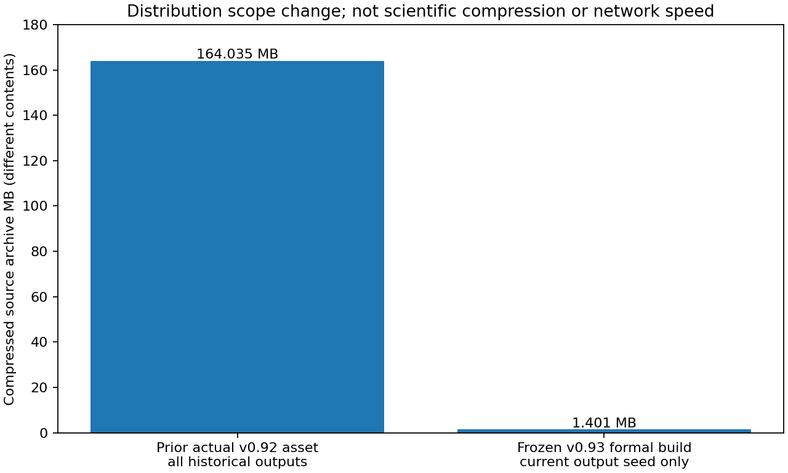

# v0.93 当前实验发行包与历史档案分离

H1完整源码/current输出成员SHA及独立参考、历史92个结果目录树不变=True。H2形式构建压缩包不大于旧actual资产10%=True。唯一正式构建0重试，后续最终报告/CI发行包有不同size/SHA，不能当同一资产。

旧v0.92实际资产164035251B；本轮formal 1401293B，比例0.00854263331483548。完整核验711所需源/当前seed文件，实际719文件；保留runtime67Python+HTML、scripts/tests/fixtures/docs/Rust/配置，所有历史结果仍在原Git/tag/Release。旧分析脚本若读取历史报告须获取对应目录；此包不是整个历史离线档案。原结果/负门槛/科学source/API费用没有删除或变0。

这是减少重复分发内容，不是lossless科学数据压缩、算法/生成加速或网络可靠性试验。0科学corpus/gold/model/旧API响应读取，0模型/HEAD请求，不重试或补发v089旧轮。

构建parent完整wall/exit和worker/analysis/finally另有原JSON。构建子进程CPU/RSS未独立仪表，保持null；workerCPU/RSS不是整个构建树峰值。历史保留字节以原costledger与Git树身份继承，未下载速度复测；最后打包、外安装、CI、实际资产/源码核验/proof传输成本另计，不回填旧科学时钟。

图需实际检查，完整local/actual发行source-member审计/仓库外wheel-native新旧sdist/proof重下载齐才交付。本轮formal只含冻结seed；实际final报告必须再次审计并记size，不以formal hash冒充最终包。

## 原始时钟、来源差异与交付范围

- formal parent：{"parent_full_wall_s": 5.740297599928454, "parent_CPU_s": 0.0, "exit_code": 0, "retries": 0}
- build parent：{"full_subprocess_wall_s": 5.632907500024885, "exit_code": 0, "build_subprocess_CPU_s": null, "build_subprocess_RSS_B": null, "retries": 0}
- worker：{"success": true, "full_wall_s": 5.633438100107014, "full_CPU_s": 0.0, "peak_RSS_B": 28209152, "scope": "Worker parent only; subprocess CPU/RSS uninstrumented null"}
- analysis parent：{"parent_full_wall_s": 1.189481999957934, "parent_CPU_s": 0.0, "exit_code": 0, "retries": 0}
- analysis：{"success": true, "full_wall_s": 1.0463906999211758, "full_CPU_s": 0.78125, "peak_RSS_B": 77094912}

源码冻结13ac20f91d7514aea3557e0649ae6773e0a24c77 / exactCI40990484469；588检查587pass/1权限skip。正式仅1构建，0重试。711必要文件、719实际文件、解压4436912B、wheel160888B。图已实际视觉检查，柱图两包内容明确不同；后续final/CI包新增完整报告，不能冒充这份1401293B正式归档。

五个已存在checkout CRLF/Git LF差异已在freeze manifest明确列出：LICENSE、docs/CDF-INFORMATION-AUDIT.md、docs/releases/v0.78.0.md、v0.79.0.md、v0.86.0.md。没有改动或重写它们。formal归档按原本地rawSHA精确验证，实际Linux CI归档将按tag Git字节验证；科学runtime67Python+HTML（init255BCRLF）严格冻结，不把跨平台文本差异隐藏为同一SHA。

历史92目录Git树全部保持不变；新源包不携带历史结果payload，原档案仍在Git固定commit/原tag/Release，旧依赖历史结果的analysis需获取对应目录。所有scripts/tests/docs/Rust源码与ownedfixtures保留；不是抹掉失败记录或计算资源。原v0.92定位包放大4.95–5.40倍的负结果、E3净收益未通过等均继承保留。
