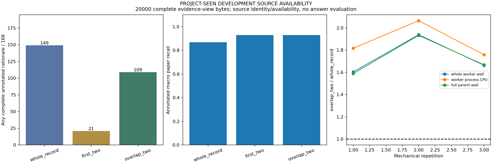

# 完整来源视图下的整记录与两句选择：已见开发集诊断

PROJECT-SEEN DEVELOPMENT SOURCE AVAILABILITY。H1=True，H2=False，H3=False，joint=False。完整计划 2430/2430 份预测，独特问题 270 个；三轮是机械复测，不能当作更多独立科学样本。图已实际打开检查；本报告本身不代表软件发行完成。

## 固定方法与分母

同一原始词法论文顺序/前12正分候选，A整条原始JSON记录hex，B原始前两句，C原token多重集交集最高两句，原索引打破平局并恢复原顺序。B/C保留完整原始token witness与hex。相同问题/SID/path/sourceSHA头；完整规范JSON证据视图20000字节，无arm名称字节偏差。该上限不同于旧4096整记录准入预算，也不是模型完整请求wire上限。所有候选先读取与验证，再决定是否准入，拒绝项读取不免费。

全部九进程按ABC/BCA/CAB完成，所有预测落盘后独立fresh Store恢复原corpus一次，独立BM25索引/物理JSONL边界/原始token/规范packet/贪心准入逐行检查；然后才读取标注。H2只检验C的完整标注rationale来源可用数严格大于A和B；完整指任一整组替代rationale全部原句索引可用。无标注题质量null，不是负例或NEI。来源身份及可用性不是语义蕴含、模型答案或开放科学泛化。

## 三轮完整计时与来源开销

|轮|方法|完整rationale/annotated|质量null|宏paper recall|完整worker wall s|worker CPU s|完整parent wall s|worker peakRSS B|所有候选原record返回B|入选验证返回B|完整view B|
|---|---|---|---|---|---|---|---|---|---|---|---|
|1|whole_record|149/168|102|0.867063492063492|10.292783200042322|8.34375|10.427956899860874|79179776|5425364|2232097|5100392|
|1|first_two|21/168|102|0.9282738095238094|16.42694709985517|15.015625|16.48584959981963|79147008|5425364|5344510|5146887|
|1|overlap_two|109/168|102|0.9282738095238094|16.505991500103846|15.15625|16.566559999948367|79360000|5425364|4962435|5183525|
|2|first_two|21/168|102|0.9282738095238094|19.97921339981258|18.390625|20.03965110005811|79028224|5425364|5344510|5146887|
|2|overlap_two|109/168|102|0.9282738095238094|22.47216850006953|20.9375|22.534111599903554|78913536|5425364|4962435|5183525|
|2|whole_record|149/168|102|0.867063492063492|11.59443060006015|10.140625|11.662101900205016|79200256|5425364|2232097|5100392|
|3|overlap_two|109/168|102|0.9282738095238094|15.915509599959478|14.640625|16.05279490002431|79122432|5425364|4962435|5183525|
|3|whole_record|149/168|102|0.867063492063492|9.568830900127068|8.328125|9.62861580005847|79306752|5425364|2232097|5100392|
|3|first_two|21/168|102|0.9282738095238094|16.246225700015202|14.875|16.305548599921167|78708736|5425364|5344510|5146887|

H3按每轮C/A完整worker wall、worker自身process CPU、完整parent wall均<=1；零或未知分母为null，不能通过。query计时不含最终预测序列化写盘，不能替换完整worker。官方quota子进程CPU未进入Python process_time，完整进程树CPU未知null；父CPU零可能为计时粒度，不能称免费。参考索引、全部源文件hash/不可变性核验、报告与画图单独完整计时，不混入候选时间来隐藏成本。详见raw-aggregate/analysis-finally和report-finally。

原Store完整记录读取、UTF8 O(N)offset map、复制/重复规范序列化、完整witness/hex/索引/旧model及整库成本均保留。reference_index内列原source返回B/一次独立索引构建与对象计数CPU/wall/进程peakRSS/postings与lengths的JSON大小/去重可达Python对象getsizeof之和；JSON大小不是完整索引，Python对象之和不是allocator/native内存或RSS，进程peakRSS也不是纯索引内存。应用返回B不是CAS解码量、SSD物理IO或全系统IO；冷缓存/跨机/掉电未测。旧训练/模型/Store/CAS/快照/帧/restored/derived/失败/API资源仍计费，未因复用归零。

## 逐题诊断（首轮；另外两轮必须完全一致）

|ID|A完整|B完整|C完整|A paper recall|B paper recall|C paper recall|
|---|---|---|---|---|---|---|
|100|True|False|True|1.0|1.0|1.0|
|1012|True|False|True|1.0|1.0|1.0|
|1020|True|False|True|1.0|1.0|1.0|
|1021|True|False|True|1.0|1.0|1.0|
|1024|True|False|True|1.0|1.0|1.0|
|1029|True|False|True|0.6666666666666666|1.0|1.0|
|1041|True|False|False|1.0|1.0|1.0|
|1049|False|False|False|0.0|0.0|0.0|
|1062|True|False|True|1.0|1.0|1.0|
|1086|True|False|True|1.0|1.0|1.0|
|1088|False|False|False|0.0|0.0|0.0|
|1089|True|False|False|1.0|1.0|1.0|
|1104|True|False|True|1.0|1.0|1.0|
|1107|True|False|True|1.0|1.0|1.0|
|1110|False|False|False|0.0|0.0|0.0|
|1121|True|False|False|1.0|1.0|1.0|
|113|True|False|True|1.0|1.0|1.0|
|1130|True|False|True|1.0|1.0|1.0|
|1132|True|False|False|1.0|1.0|1.0|
|1137|True|False|True|1.0|1.0|1.0|
|1140|False|False|False|0.0|1.0|1.0|
|1144|True|False|True|1.0|1.0|1.0|
|1146|True|False|True|1.0|1.0|1.0|
|115|True|False|False|1.0|1.0|1.0|
|1150|True|False|False|1.0|1.0|1.0|
|118|True|True|True|1.0|1.0|1.0|
|1180|True|True|True|1.0|1.0|1.0|
|1185|True|False|True|1.0|1.0|1.0|
|1187|True|False|True|1.0|1.0|1.0|
|1202|True|False|False|1.0|1.0|1.0|
|1216|True|False|True|1.0|1.0|1.0|
|1221|False|False|False|0.0|0.0|0.0|
|1225|True|False|True|1.0|1.0|1.0|
|1232|True|False|True|1.0|1.0|1.0|
|124|True|False|True|1.0|1.0|1.0|
|1259|True|False|True|1.0|1.0|1.0|
|1262|True|False|False|1.0|1.0|1.0|
|1266|True|False|True|1.0|1.0|1.0|
|1270|True|False|True|1.0|1.0|1.0|
|1271|True|False|False|1.0|1.0|1.0|
|1273|True|False|True|1.0|1.0|1.0|
|1274|True|False|False|1.0|1.0|1.0|
|129|True|False|True|1.0|1.0|1.0|
|1290|True|False|True|1.0|1.0|1.0|
|130|True|False|True|1.0|1.0|1.0|
|1303|True|True|True|1.0|1.0|1.0|
|1319|False|False|True|0.0|1.0|1.0|
|133|True|False|False|1.0|1.0|1.0|
|1335|True|False|False|1.0|1.0|1.0|
|1336|True|False|False|1.0|1.0|1.0|
|1337|True|False|True|1.0|1.0|1.0|
|1339|True|False|False|1.0|1.0|1.0|
|1352|True|False|False|1.0|1.0|1.0|
|1359|True|False|True|1.0|1.0|1.0|
|1368|False|False|False|0.0|0.0|0.0|
|137|True|False|False|1.0|1.0|1.0|
|1370|True|False|True|1.0|1.0|1.0|
|1379|True|False|True|0.25|0.5|0.5|
|1382|False|False|False|0.0|0.0|0.0|
|1385|True|False|True|1.0|1.0|1.0|
|1389|True|False|False|1.0|1.0|1.0|
|141|True|True|True|1.0|1.0|1.0|
|143|True|False|True|1.0|1.0|1.0|
|146|True|False|True|1.0|1.0|1.0|
|148|True|True|True|1.0|1.0|1.0|
|163|True|False|False|1.0|1.0|1.0|
|171|True|True|True|1.0|1.0|1.0|
|179|True|False|True|0.5|0.75|0.75|
|180|True|False|True|1.0|1.0|1.0|
|183|False|False|True|0.0|1.0|1.0|
|208|True|False|False|1.0|1.0|1.0|
|212|False|True|True|0.0|1.0|1.0|
|216|True|False|True|1.0|1.0|1.0|
|217|True|False|True|1.0|1.0|1.0|
|218|True|False|True|1.0|1.0|1.0|
|230|True|False|True|1.0|1.0|1.0|
|233|True|False|True|1.0|1.0|1.0|
|236|True|False|True|1.0|1.0|1.0|
|239|False|False|False|0.0|0.0|0.0|
|248|True|False|True|1.0|1.0|1.0|
|249|True|False|True|1.0|1.0|1.0|
|261|False|False|False|0.0|0.5|0.5|
|274|True|False|True|1.0|1.0|1.0|
|275|True|False|True|0.5|0.5|0.5|
|279|True|False|False|1.0|1.0|1.0|
|295|True|False|False|1.0|1.0|1.0|
|298|True|True|True|1.0|1.0|1.0|
|314|True|False|False|1.0|1.0|1.0|
|327|True|False|True|1.0|1.0|1.0|
|338|True|False|True|1.0|1.0|1.0|
|343|True|False|False|1.0|1.0|1.0|
|380|True|False|True|1.0|1.0|1.0|
|385|False|False|False|0.0|1.0|1.0|
|386|True|False|True|1.0|1.0|1.0|
|399|True|False|True|1.0|1.0|1.0|
|415|False|False|False|0.0|1.0|1.0|
|431|False|False|False|0.0|0.0|0.0|
|436|True|True|True|1.0|1.0|1.0|
|443|True|False|False|1.0|1.0|1.0|
|452|True|True|True|0.5|0.5|0.5|
|475|False|False|False|0.0|0.0|0.0|
|501|True|False|True|1.0|1.0|1.0|
|513|True|False|False|1.0|1.0|1.0|
|516|True|False|False|1.0|1.0|1.0|
|521|True|False|True|1.0|1.0|1.0|
|525|True|False|False|1.0|1.0|1.0|
|528|True|False|True|1.0|1.0|1.0|
|53|True|False|True|1.0|1.0|1.0|
|532|True|False|False|1.0|1.0|1.0|
|533|True|False|False|1.0|1.0|1.0|
|536|True|False|False|1.0|1.0|1.0|
|539|True|False|False|1.0|1.0|1.0|
|549|True|False|True|1.0|1.0|1.0|
|56|True|True|True|1.0|1.0|1.0|
|569|True|False|True|1.0|1.0|1.0|
|57|True|True|True|1.0|1.0|1.0|
|578|True|False|True|1.0|1.0|1.0|
|589|True|False|True|1.0|1.0|1.0|
|593|True|False|True|1.0|1.0|1.0|
|597|True|True|True|1.0|1.0|1.0|
|598|False|False|False|0.0|1.0|1.0|
|613|True|False|True|1.0|1.0|1.0|
|619|True|False|True|1.0|1.0|1.0|
|636|True|False|True|1.0|1.0|1.0|
|641|True|False|False|1.0|1.0|1.0|
|674|True|True|True|1.0|1.0|1.0|
|692|True|False|True|1.0|1.0|1.0|
|693|True|False|True|1.0|1.0|1.0|
|70|True|False|True|1.0|1.0|1.0|
|718|True|False|False|1.0|1.0|1.0|
|721|True|False|True|1.0|1.0|1.0|
|723|True|True|True|1.0|1.0|1.0|
|728|True|False|True|1.0|1.0|1.0|
|729|True|True|True|1.0|1.0|1.0|
|742|True|False|False|1.0|1.0|1.0|
|743|True|False|False|1.0|1.0|1.0|
|744|True|False|True|1.0|1.0|1.0|
|756|False|True|True|0.0|1.0|1.0|
|770|True|False|False|1.0|1.0|1.0|
|781|True|False|True|1.0|1.0|1.0|
|784|True|False|True|1.0|1.0|1.0|
|793|True|True|True|1.0|1.0|1.0|
|805|True|False|False|1.0|1.0|1.0|
|808|True|True|True|1.0|1.0|1.0|
|811|True|False|True|1.0|1.0|1.0|
|823|True|False|False|1.0|1.0|1.0|
|832|True|False|True|1.0|1.0|1.0|
|837|True|False|True|1.0|1.0|1.0|
|839|True|False|True|1.0|1.0|1.0|
|845|True|True|True|1.0|1.0|1.0|
|847|True|False|False|1.0|1.0|1.0|
|852|True|False|False|1.0|1.0|1.0|
|859|True|False|True|1.0|1.0|1.0|
|873|False|False|False|0.0|0.2|0.2|
|879|True|False|True|1.0|1.0|1.0|
|880|True|False|True|1.0|1.0|1.0|
|882|True|False|True|1.0|1.0|1.0|
|904|True|False|True|1.0|1.0|1.0|
|911|True|False|True|1.0|1.0|1.0|
|922|True|False|True|1.0|1.0|1.0|
|936|True|False|True|1.0|1.0|1.0|
|957|True|False|False|1.0|1.0|1.0|
|960|True|False|True|1.0|1.0|1.0|
|967|True|False|False|1.0|1.0|1.0|
|971|True|True|True|0.25|1.0|1.0|
|982|True|False|False|1.0|1.0|1.0|
|985|True|False|True|1.0|1.0|1.0|
|993|True|False|False|1.0|1.0|1.0|

所有回退、无提升与负结果保留；不更换预算、阈值、句数或问题追正，不拿旧API答案或子组代替headline。0新模型/提供方请求。原question/source/gold/model/完整packet私有；公开只含ID/SHA/索引/计数/时钟。E3净收益/E4整体/真实长期会话/回答泛化/无限上下文未完成。

交付仍需实际看图、README/ROADMAP/release、全local/outside实际安装与全部legacy owned sdist、ReleaseCI、实际7资产SHA/全source、外published安装和proof实际重下载8。本轮使用固定项目已见开发集；不是未知泛化测试，也尚未完成v0.94软件发行。

## 本轮实际冻结、完整资源与拒绝结果

source/protocol/input commit b57d18c0bb3cfc2950925a43617f7e18dfb8052a，exactCI41011054418成功。608项全回归607pass/1权限skip，20新public owned必要检查+2private完整流程检查；科学运行一次9freshworker/2430原预测，0科学重试/新训练/模型API/HEAD。全部原预测与来源不可变性独立检查通过，gold只在所有独立行后解析，三轮指标/packet一致。

三组macro paper recall为.86706349/.92827381/.92827381，完整rationale149/21/109（均/168），102无标注每组质量null。C能容纳更多标注论文不等于保留整组rationale；C超过B但低于A。C/A process-entry完整wall约1.60–1.94倍、CPU1.76–2.06倍、parent1.59–1.93倍，因此H2/H3及joint均False。既定强门槛保持，不以C对B或paper recall较高替代主假设。也不能外推“所有句子选择都无效”或“无上限上下文有效”。

正式plan process wall144.5286666s/自身CPU.171875s；含前置source/code/CI检查的plan父完整171.4001958s/自身CPU0计时粒度。独立audit wall14.9657948s/CPU13.671875s/进程peakRSS353955840B，analysis父42.5034608s；reference原corpus一次8307875B，5183记录、35664terms、534805posting entries，索引构建/计数wall.7564917s/CPU.75s、postings+lengths JSON9447650B、Python可达对象getsizeof和40443491B，后两者不冒充完整allocator/native/RSS。报告父28.6961444s，完整controller322.1014375s/自身CPU12.296875s；包含多次严格源/CI/输入hash检查，不能用worker query和替代完整实验成本。所有父、entry、body、analysis/report/footer原JSON单列，不回填旧时钟，CPU0不免费。

预运行基础设施修复全部在第一份真实预测前：Windows同路径斜杠拼写只在size/SHA相等后规范化；新输入清单自身CRLF checkout恢复为已冻结Git LF，原raw、原/新context、private实际执行code SHA与原失败日志保留。公开sourcecommit/算法/原科学input/参数/CI不变。不是科学重试，后续全源码仍需核验raw/frozenGit/最终tag；相关private资源在source-resource和finalproof分列。图已实际查看，runtime67Python+HTML/init255BCRLF不变。当前只完成研究与报告，发行安装/资产/proof8门槛仍待。

同一首轮168annotated预测的附加配对来源诊断（无新样本/重跑）：C对整记录 {'tie': 120, 'loss': 44, 'win': 4}；C对前两句 {'win': 88, 'tie': 80}。这是已见事后描述，非模型正确性/因果修复证明。
