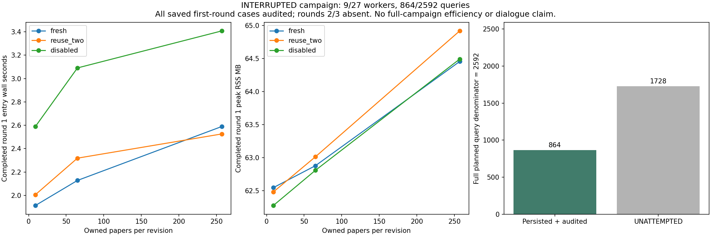

# v0.95 中断正式轮次：完整保留分母的独立审计报告

正式矩阵永久封存为未完成：27计划进程中9个完成，2592计划查询中864个持久化；18进程/1728查询未尝试，不补跑、不重放，不以首轮替代三轮。source freeze d6dcaaf8e23e9c3386e986c4fa1bb1abf71cf241；exactCI 41025946893成功后首次启动。616检查615pass/1权限skip，8项new owned检查通过。

## 中断证据与结论

实际检查没有活动Python进程，计划plan.json/plan-finally.json和外层formal-parent.json均缺失；9个子进程自身worker/body/entry/finally和父记录完整、exit0。确切终止来源未知，不能归因于模型、算法、配额或某个故障；缺失的计划/外层wall、CPU、RSS保持null，不从文件时间拼出计时。正式全轮H1=False（完整性未满足），H2/H3未完成null，joint=False。未完成不是低效或无效证据。

## 所有已保存进程，未作有利选择

|规模|角色|完整entry wall s|entry CPU s|parent wall s|peakRSS B|hits|misses|
|---|---|---|---|---|---|---|---|
|9|fresh|1.913675099844113|0.921875|1.9635107000358403|62545920|n/a|n/a|
|9|reuse_two|2.006066600093618|1.078125|2.056236600037664|62480384|64|32|
|9|disabled|2.589052499970421|1.453125|2.6393525002058595|62275584|0|96|
|65|fresh|2.128096899949014|1.109375|2.1808120000641793|62877696|n/a|n/a|
|65|reuse_two|2.318716200068593|1.234375|2.369585599983111|63012864|64|32|
|65|disabled|3.090653100050986|1.703125|3.1442627001088113|62808064|0|96|
|257|fresh|2.5892121999058872|1.5|2.6421064001042396|64454656|n/a|n/a|
|257|reuse_two|2.525809699902311|1.453125|2.5759497000835836|64917504|64|32|
|257|disabled|3.4072674999479204|2.0625|3.460729300044477|64491520|0|96|

## 首轮比值，仅诊断，不替代三轮门槛

|规模|B/A entry wall|B/A entry CPU|B/A parent wall|
|---|---|---|---|
|9|1.048279616669011|1.1694915254237288|1.047224545300482|
|65|1.089572660025089|1.1126760563380282|1.0865611524117513|
|257|0.9755128220059056|0.96875|0.9749606223208702|

每个entry包含imports、源生成/副本、Store、12修订/索引模型构造、96查询、写入、标准3拒绝控制和关闭；body/trajectory/query单列raw-aggregate。query和不代替完整entry，selfCPU不含quota子进程/fulltreeCPU unknownnull；0粒度不是免费。所有源/模型/Store/CAS/快照/持久化/失败输入/旧研究资源均保留。

## 第一次独立审计，未重跑候选查询

全部9个已保存worker的864查询通过外部冻结36种fixture identity、原JSONL完整BM25排名、4096贪心准入、原record范围与literal packet、显式SID/模型SHA/历史恢复检查。108原source恢复返回2876208B，8064原record绑定/1928274参考record B；9worker的27拒绝控制保留，原文件审计前后所有SHA不变。各规模同轮3角色96packet序列相同；每次模型hash与CAS验证、reader数量/rawpayload及关闭要求在完成子集中通过。未观察到的18个worker不推定通过。

## 方法、资源和边界

A每次新构造原读取器；B显式LRU容量2；C同wrapper容量0。B/C即使hit仍读取hash当前model，miss构造二次model读取分别记账；没有decoded source缓存/隐式HEAD。容量2*32MiB仅rawmodel payload界，非Python/native/allocator/总RSS界；peakRSS另列。应用返回B不是CASdecode或物理SSD/fullsystemIO。精确坏model/CAS输入及恢复原字节均私有保留。

0新模型API/HEAD/训练标注/下载；只读本轮owned数据，不开旧科学question/gold/model/answer。本轮是机械更新与历史请求，不是真实长期人类对话、科学NLI、回答泛化或无限上下文。E3净收益/E4整体与这些目标仍未完成；旧v094/v092/E3等全部负结果及旧成本不改。冷缓存/跨机器/掉电未测。

图已实际查看：全部9个完成进程的时间/RSS和864/1728分母清晰，未画不存在的后两轮。本报告现公开中断状态；原私有报告仍保留其当时边界。软件发行另行核验build/install/tag/ReleaseCI/实际资产/外安装/proof8；这些软件门槛即使通过，也不改变正式实验未完成状态，不把软件交付冒充完整实验。原冻结完整报告程序未改；本报告为中断后单独新增程序，身份及成本另列。

独立审计、原SHA前后检查、绘图及报告新程序完整wall1.6727358000352979s/selfCPU1.671875s/peakRSS81457152B，非原formal总时间。原计划与外层缺失计时仍为null。

## 完整已保存资源与复核材料

raw-aggregate.json保留全部9worker的entry/body/parent/trajectory/model验证与load返回B、hit/miss/eviction、payload、snapshot/model/sourceSHA。original-private-file-identities.json为所有原worker文件的相对路径/size/SHA，不公开原文与模型。source-resource.json另列68Python+HTML、全部scripts/tests/docs/Rust与历史资源账本身份；全部原Store/CAS/模型/坏输入、失败日志不删除。108修订/自建索引模型不是324，27拒绝不是81。所有尚未执行项完整保留分母。

原冻结程序和协议未修改；新中断审计/报告及打包程序身份和计时单列。源码上传15路径白名单恢复、seed非运行时353B CRLF vs350B GitLF的原SHA/执行wrapperSHA/原失败日志全部保留，均不改运行时算法或参数。正式轮仅启动一次，未填后两轮。最终软件发行状态须以实际发布proof为准。
