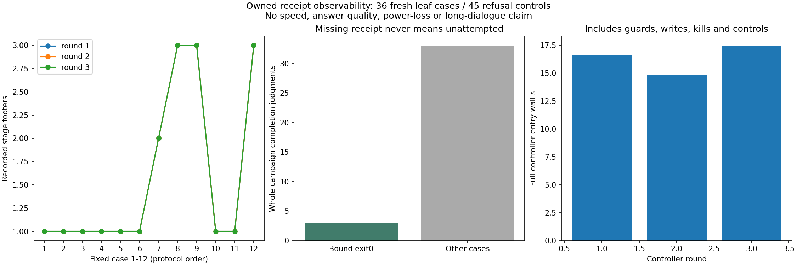

# v0.96 执行记录与外部退出凭据：完整owned故障对照

固定3fresh控制进程、36fresh叶进程、6次实际OS进程终止、24次主动exit76、6次exit0控制（其中3次具有完整外部退出凭据），45项独立坏输入/陈旧锁控制通过。H1/H2/H3/joint=True，只针对本轮机械观测合同；不称科学回答、NLI、长期会话、压缩或性能提升。0新模型API/HEAD/下载，0旧科学输入读取。

## 固定方法与完整结果

sourcefreeze 08892375208e2ebf7a5f885248863d3b31f4d3f6，exactCI 41859034865先于唯一正式轮。协议docs/RECEIPT-OBSERVABILITY.md固定12场景顺序/3阶段，全部分母36/45无筛选、0retry。只在全部阶段footer、外部SHA固定的父进程凭据绑定同一run/plan/完整log与实际PID/exit0、无残余writer锁时认定完成。没有凭据不能证明未尝试，reserved不冒充成功。0自动重放接口，坏/断/篡改记录保留并拒绝推断。

|轮|场景|实际退出码|第二阶段状态|完整完成判断|叶进程parent wall s|检查应用read B|
|---|---|---|---|---|---|---|
|1|before_reserve|76|unreserved|False|0.07915859999775421|935|
|1|after_reserve|76|reserved|False|0.11212869999872055|1050|
|1|after_started|76|started|False|0.10986469999625115|1166|
|1|partial_artifact|76|started|False|0.12617229999887059|1172|
|1|after_artifact|76|started|False|0.11713089999830117|1168|
|1|after_receipt|76|artifact_verified|False|0.1255853999973624|1400|
|1|after_stage_footer|76|stage_completed|False|0.12684080000326503|1534|
|1|all_stages_no_witness|0|stage_completed|False|0.16790510000282666|1893|
|1|success|0|stage_completed|True|0.17849549999664305|2115|
|1|kill_after_reserve|1|reserved|False|0.10406659999716794|1059|
|1|kill_after_artifact|1|started|False|0.11130599999887636|1177|
|1|exit_nonzero_allstages|76|stage_completed|False|0.17829179999534972|2146|
|2|before_reserve|76|unreserved|False|0.09849869999743532|935|
|2|after_reserve|76|reserved|False|0.10600870000052964|1049|
|2|after_started|76|started|False|0.10757220000232337|1166|
|2|partial_artifact|76|started|False|0.11941139999544248|1172|
|2|after_artifact|76|started|False|0.11083220000000438|1168|
|2|after_receipt|76|artifact_verified|False|0.12164349999511614|1400|
|2|after_stage_footer|76|stage_completed|False|0.1332745999970939|1534|
|2|all_stages_no_witness|0|stage_completed|False|0.15895699999964563|1893|
|2|success|0|stage_completed|True|0.15280619999975897|2115|
|2|kill_after_reserve|1|reserved|False|0.09557320000021718|1059|
|2|kill_after_artifact|1|started|False|0.12100469999859342|1177|
|2|exit_nonzero_allstages|76|stage_completed|False|0.16038169999956153|2146|
|3|before_reserve|76|unreserved|False|0.10050259999843547|935|
|3|after_reserve|76|reserved|False|0.09723769999982323|1050|
|3|after_started|76|started|False|0.09936369999923045|1166|
|3|partial_artifact|76|started|False|0.11590520000027027|1172|
|3|after_artifact|76|started|False|0.11068599999998696|1168|
|3|after_receipt|76|artifact_verified|False|0.11762550000275951|1400|
|3|after_stage_footer|76|stage_completed|False|0.1369806000002427|1534|
|3|all_stages_no_witness|0|stage_completed|False|0.18423369999800343|1893|
|3|success|0|stage_completed|True|0.18621329999587033|2115|
|3|kill_after_reserve|1|reserved|False|0.1083202000008896|1059|
|3|kill_after_artifact|1|started|False|0.12304239999502897|1177|
|3|exit_nonzero_allstages|76|stage_completed|False|0.17447140000149375|2146|

## 独立复核与费用

后置独立参考直接读取原plan/events/原artifact/父进程退出记录和witness，不调用candidate parser或重跑叶程序。核对原owned-one/two/three字节、SHA链、固定状态/顺序、外部plan/witness/实际PID退出绑定；原文件审计前后SHA全等，独立参考应用read 50444B。所有控制原坏字节、READY、锁、模型无关日志、parent/body/entry/finally与source资源账本保留。raw-aggregate含全部36叶parent clocks及3controller entry/selfCPU/RSS、full plan clocks；检查/写入/guard/进程启动及退出成本均保留，不以短querysum替代。selfCPU不含quota子进程/fulltreeCPU和RSS未知null；0CPU粒度非免费，文件字节非RAM，应用B非物理SSD/fullsystemIO。

每append重读前缀和artifact，聚合成本可能二次；上限64stage/32KiBplan-witness/512KiBlog/1MiBartifact，read限额+1实际收费。fsync文件不代表目录同步或掉电安全，实际kill不代表机器重启；并发/恶意竞态/跨机/冷缓存未测。SHA链不是自认证，调用方须信任外部父观察者。失败锁保留，无自动清理/重试。全部旧science/train/model/Store/CAS/snapshots/frames/restored/derived/failed/API费用保留，remoteweightsRAM unknownnull。

图已实际查看：三轮状态线完全重合、3/33完整判定及三个完整controller时钟均清晰。620全回归619pass/1权限skip以冻结日志为准。全部local/actual7资产SHA/allsource/仓库外实际安装与新旧actualsdist/proof8尚待；v095原27计划已封存不填，9/864保存记录与其余执行情况未知的观测更正保持，E3净收益/E4整体/回答与无限上下文未完成。

## 完整阶段时间与独立退出复核

根计划wall53.23526550000679s/selfCPU0.046875s，外层formal parent53.282243200002995s/selfCPU0.015625s；三controller完整entry wall16.638485600000422/14.810908699997526/17.45410979999724s，selfCPU0.328125/0.390625/0.265625s，RSS28581888/28491776/28626944B。独立参考+绘图+报告wall1.942709199996898s/selfCPU1.125s/RSS80830464B，analysis外层parent2.086933200000203s/selfCPU0grain。全部36实际退出码已另行按固定场景逐一核对；不重跑任何worker/audit。完整过程包含多次quota读取，不能把短故障点操作或selfCPU当全部进程树成本。新增报告整理/退出码核对单列post-report-finally.json，不回填原时钟。
