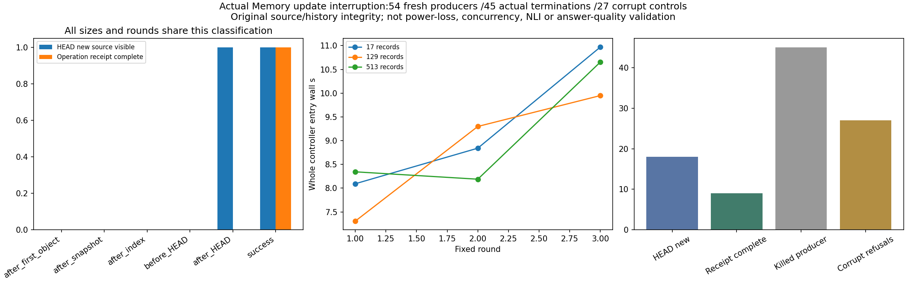

# v0.97 实际Memory更新中断：来源历史与完成凭据完整对照

固定9全新控制进程/54全新producer，45次真实producer终止/9成功控制，27项坏副本控制全部拒绝。144已保存来源查询、9次索引尚未发布的预期查询拒绝、18次坏CAS/缺失HEAD拒绝，共171次本地Memory.search尝试。H1/H2/H3/joint=True仅针对机械来源/发布/观测合同；不称推理、NLI、真人长期会话、无限上下文、压缩或性能提升。0新模型/HEAD提供方请求，0训练标签/旧科学问题-gold-model-回答读取。

## 预先固定方法

17/129/513条owned JSONL、两个原修订、3轮，每组对象后/快照后/索引后/HEAD前/HEAD后/成功6场景。实际Memory默认compact-budget-v3与zlib固定4096块，未修改运行时更新函数。owned child只包装原Store._publish/index build/_head，在原函数边界发布READY，父进程先绑定自己的producer句柄/真实PID并独立记录全部旧Memory文件后才准许更新，再终止指定producer并记录真实退出，launcher退出另列。不能由pid文本任意终止其他进程；Windows校验直接owned launcher子关系并保留handle直到Wait/GetExitCodeProcess。进程终止不是物理掉电或所有微指令边界证明。

source/protocol/input freeze cfef49552f772ab28a3353b8bbae4ed9ce309fea /exactCI 41979690570先成功后唯一正式轮；624回归623pass/1权限skip以原日志为准，4必要owned集成测试通过。全部54/27预定分母完整，0retry，无补跑旧v095。

## 全54进程原始结果

|轮|原记录数|边界|HEAD来源epoch|操作完整凭据|实际producer退出码|完整parent wall s|
|---|---|---|---|---|---|---|
|1|17|after_first_object|0|False|77|0.14063680000253953|
|1|17|after_snapshot|0|False|77|0.13668440000037663|
|1|17|after_index|0|False|77|0.14844879999873228|
|1|17|before_HEAD|0|False|77|0.1595697000011569|
|1|17|after_HEAD|1|False|77|0.164480099992943|
|1|17|success|1|True|0|0.16287129999545868|
|1|129|after_first_object|0|False|77|0.14290110000001732|
|1|129|after_snapshot|0|False|77|0.14388520001375582|
|1|129|after_index|0|False|77|0.1541663999960292|
|1|129|before_HEAD|0|False|77|0.16174139999202453|
|1|129|after_HEAD|1|False|77|0.15534389999811538|
|1|129|success|1|True|0|0.1715812000038568|
|1|513|after_first_object|0|False|77|0.15725010000460315|
|1|513|after_snapshot|0|False|77|0.1602724000113085|
|1|513|after_index|0|False|77|0.1917332000011811|
|1|513|before_HEAD|0|False|77|0.1862775000045076|
|1|513|after_HEAD|1|False|77|0.20349990000249818|
|1|513|success|1|True|0|0.22453639999730512|
|2|17|after_first_object|0|False|77|0.14772480000101496|
|2|17|after_snapshot|0|False|77|0.14248319999023806|
|2|17|after_index|0|False|77|0.17078939999919385|
|2|17|before_HEAD|0|False|77|0.17026280000573024|
|2|17|after_HEAD|1|False|77|0.16974230000050738|
|2|17|success|1|True|0|0.19524709999677725|
|2|129|after_first_object|0|False|77|0.15022959999623708|
|2|129|after_snapshot|0|False|77|0.14860729999782052|
|2|129|after_index|0|False|77|0.1655317999975523|
|2|129|before_HEAD|0|False|77|0.18281040000147186|
|2|129|after_HEAD|1|False|77|0.1776296000025468|
|2|129|success|1|True|0|0.1918085999932373|
|2|513|after_first_object|0|False|77|0.17370059998938814|
|2|513|after_snapshot|0|False|77|0.17852430000493769|
|2|513|after_index|0|False|77|0.2012861000112025|
|2|513|before_HEAD|0|False|77|0.22081950001302175|
|2|513|after_HEAD|1|False|77|0.2009902999998303|
|2|513|success|1|True|0|0.22058480000123382|
|3|17|after_first_object|0|False|77|0.15088860000832938|
|3|17|after_snapshot|0|False|77|0.14845609999611042|
|3|17|after_index|0|False|77|0.15738090001104865|
|3|17|before_HEAD|0|False|77|0.1649197000078857|
|3|17|after_HEAD|1|False|77|0.1760422999941511|
|3|17|success|1|True|0|0.17819479999889154|
|3|129|after_first_object|0|False|77|0.15604780000285245|
|3|129|after_snapshot|0|False|77|0.1630715999926906|
|3|129|after_index|0|False|77|0.17823400000634138|
|3|129|before_HEAD|0|False|77|0.16885960000217892|
|3|129|after_HEAD|1|False|77|0.20326229999773204|
|3|129|success|1|True|0|0.18095359999279026|
|3|513|after_first_object|0|False|77|0.17214850000164006|
|3|513|after_snapshot|0|False|77|0.18542409999645315|
|3|513|after_index|0|False|77|0.2202943000011146|
|3|513|before_HEAD|0|False|77|0.19026129999838304|
|3|513|after_HEAD|1|False|77|0.2253323999902932|
|3|513|success|1|True|0|0.23764970000775065|

## 独立原文、旧SID与真实可见状态

HEAD新来源可见18例，只有9例完整操作凭据；HEAD后终止9例仍是“来源已可见、请求完成未确认”，不能回滚、重发或当成没执行。其余36例保持旧HEAD。全部旧SID原文与查询仍可验证，旧文件除允许HEAD外SHA全等；相同规模所有case/三轮old/newSID相同。源快照已发布但索引尚未发布9例，原new source逐字恢复、显式newSID查询拒绝，无隐藏fallback。

外部固定6个(size,epoch)original size/SHA；独立后置审计读取原JSONL/range/length/原句/标题/重复句/unicode/CRLF、当前及旧SID、新SID与父baseline文件、producer/witness/事件链，所有workload审计前后SHA不变，不调用Memory.add/不重放被终止更新。每query恰有4个sentinel，原文本匹配不等于语义蕴含。坏副本selectedCAS、缺失HEADmanifest、返回原句篡改共27控制均拒绝，全部坏字节和副本保留。

## 完整资源与费用

主流程完整source恢复153次/应用返回2704785B；独立主审计另153次/2704785B，返回证据篡改控制另9次完整原文读取/159105B，总315次完整source返回。171本地search含上述错误/拒绝尝试，不冒充144成功查询或提供方请求。错误CAS解码/OS读取未独立仪表化，unknownnull而非0。源副本、Memory全Store/CAS/快照/索引/孤立对象/临时文件、parent/entry/body/finally/receipt/witness/READY、坏副本和整库源码/历史资源全部计入，不删孤立文件制造收益。

raw-aggregate列9controller完整entry/selfCPU/RSS、54producer parent wall/selfCPU及成功worker footer。kill缺失child footer保持CPU/RSS未知null，父selfCPU/0粒度不是child或整棵进程树成本。阶段含源生成、原始副本、Memory create、旧与新更新尝试/索引构造、查询、fullsource复核、receipt fsync、barrier/kill/wait/写出；外部quota子进程/fulltreeCPU未知null。应用返回B非物理SSD/fullsystemIO、文件字节非RAM，prefix校验可能二次成本，fsync非目录同步或掉电安全。并发、跨机、冷缓存、OS重启/供电中断未测。旧science/train/model/Store/CAS/snapshot/frame/restored/derived/failed/API成本保留，remoteweightsRAMunknownnull。

图已实际查看：HEAD可见/操作凭据分离、三个规模三轮完整controller时间与54进程/27控制总数均清晰。README/release与完整local/实际7资产SHA/全source/外安装actualwheel-currentnative与new+全部旧actualsdist/proof8尚待。v095原27计划始终封存9/27保存864/2592保存，缺失槽执行/额外成本未知，不补跑；旧E3net/v092packet/v094quality negatives保持，E4整体/NLI/真实长期对话/回答泛化未完成。

## 完整控制进程与外层时钟

|轮|源记录数|完整entry wall s|entry selfCPU s|peakRSS B|parent wall s|
|---|---|---|---|---|---|
|1|17|8.0934957999998|0.375|31121408|8.129195400004392|
|1|129|7.306798399993568|0.359375|31383552|7.343557100000908|
|1|513|8.344272000002093|0.578125|31801344|8.385415299999295|
|2|17|8.841912799995043|0.578125|31059968|8.890929299988784|
|2|129|9.299008000001777|0.53125|31039488|9.3464510999911|
|2|513|8.189126500001294|0.640625|32153600|8.231761099988944|
|3|17|10.96964910000679|0.453125|31023104|11.013930900007836|
|3|129|9.948717399995076|0.609375|31211520|9.989499699993758|
|3|513|10.653300899997703|0.71875|31969280|10.700921300012851|

全计划wall92.11972050000622s/selfCPU0.09375s；外层formal parent92.15361290000146s/selfCPU0.015625s。独立原source审计+全部坏副本+绘图报告wall3.2794671000010567s/selfCPU3.203125s/peakRSS86945792B；analysis parent3.4860724000027403s/selfCPU0.015625s。Primary与independentmain各2704785应用返回B，负面原句篡改控制另159105B；总5568675B为315次完整source返回，不是物理SSD或CAS解码总IO。45个kill producer无childfooter的CPU/RSS保留null，不能用parent数值补齐。后置文档/figureflag/资源更新的成本单列post-report-finally，无Memory.add或审计重放。

预正式原子信号修正：最初source1672只到CI等待、尚无正式输出，代码复核后将BASELINE_READY/FAULT_READY JSON改为写完+flush/fsync临时名再rename发布；尺寸/原始fixture/查询/边界与门槛不变。重新全回归624/623pass1skip后source cfef49552f772ab28a3353b8bbae4ed9ce309fea/exactCI41979690570先成功，正式54轮仅执行一次。早期tiny6准备及旧624测试记录/原worker/manifest/等待失败日志保留，不能当独立正式replication。
