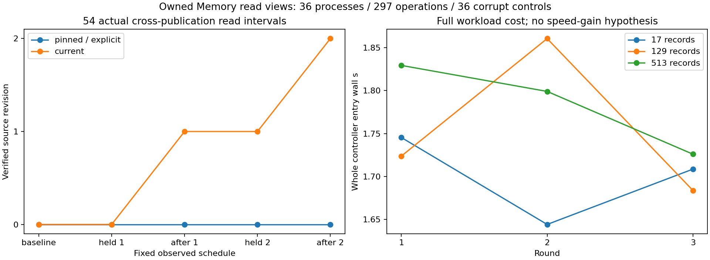

# v0.98 固定来源视图与真实读写交错

本轮完成固定9控制/36真实子进程/18更新/297读取操作。固定视图与原explicit SID逐次一致，current按预定出版边界选择版本；全部54真实query跨HEAD发布区间保持单个查询原版本，不混旧新证据。36隔离坏副本控制与36关闭调用拒绝通过，H1/H2/H3/joint仅本轮机械合同True。0原科学数据/新模型/提供方HEAD/训练/下载。不是NLI、科学回答、实际长期人类对话或无限上下文收益。

source freeze fdad26c4b4c861a90f47d35a2a5b7093dd977ece / exactCI 41994638712 先成功后唯一正式轮。完整628检查预期627pass/1权限skip，以原始日志为准；4新增必要owned检查，不把tiny准备当正式样本。

## 固定协议与可观测轨迹

17/129/513条自建JSONL，3轮；每controller一个真实writer、pinned/explicit/current三个真实reader，完整33操作。writer构造真实Store/快照/索引后在原HEAD函数前暂停，reader实际search已选SID并进入_manifest后暂停；父确认三条查询均已进入，再放行原HEAD。新HEAD实际发布后才允许原query继续source核验。固定视图和explicit一直epoch0；current基线0、第一次held0/after1、第二次held1/after2。current batch调用沿用原lookup_many要求的显式当前SID，不声称原API含隐式HEAD。

每row包含SID/原record物理offset/长度/SHA/原title/重复句/unicode/CRLF，外部9fixture完整size/SHA冻结；每次primary和独立Store恢复完整原JSONL。审计不调用writer、不重放更新，不使用新view验证主结果。pinned与原explicit除wall外完全一致；独立校验查询sentinel全集，不增加BM25科学质量结论。所有原有Memory文件除允许HEAD外SHA不变，三轮相同规模source/SID轨迹一致。实际PID/parent handle观察exit0、footer与launcher另列，全部原始文件在独立审计前后SHA不变。

## 九个完整控制进程

|轮|原记录数|完整entry wall s|self CPU s|peak RSS B|outer parent wall s|
|---|---|---|---|---|---|
|1|17|1.745349|0.171875|30707712|1.794246|
|1|129|1.723696|0.187500|30642176|1.772049|
|1|513|1.829428|0.187500|30937088|1.878649|
|2|17|1.643964|0.171875|30679040|1.691220|
|2|129|1.860711|0.187500|30621696|1.906862|
|2|513|1.799102|0.203125|30822400|1.845132|
|3|17|1.708499|0.203125|30605312|1.753739|
|3|129|1.683589|0.156250|30732288|1.730696|
|3|513|1.725902|0.187500|30961664|1.771667|

raw-aggregate另列全部36子进程从imports前开始的entry wall/selfCPU/RSS、父spawn至观察exit、54发布区间原始perf_counter_ns和全过程finally。4个reader/writer parent区间互相重叠，禁止相加冒充串行延迟或CPU。协议未提出提速/压缩/RSS改善门槛，没有从warm子阶段推导性能收益。

## 损坏、关闭与边界

每controller保存4个隔离控制：已打开pin后选中CAS被损坏、manifest记录数被改，后续lookup必须拒绝；后来HEAD指向缺失manifest，已有pin仍可按旧SID读真原文，新implicit pin拒绝；已保存返回literal被改，由独立原文审计拒绝。坏字节、原始副本、错误日志保留，不修复原库制造通过。每controller的info副本修改不改变view SID，close幂等后search/lookup/batch/enter四次拒绝，原Memory保持可用。

这是受控singlewriter/多reader的两次发布交错，未验证所有操作系统调度、多writer、掉电、目录同步、跨机或冷缓存，也不是整个多调用数据库事务/外部恶意改写的原子性证明。pin不保留decoded块/查询结果/SQLite句柄，不免除每次校验，也不宣称文件byte预算即RSS。

## 完整资源与成本

primary297次完整source返回5518557B，独立主审计297次5518557B，返回literal控制及已有pin面对坏HEAD的18次独立完整source返回334458B，共612次。额外36坏副本控制中的错误CAS/manifest读取、库构造与pin构造验证、全部查询内部范围读取/解码另发生，未仪表化的CASdecode/OS/SSD/fullsystemIO未知null，不当0。全部初始索引+18更新、原source/Store/CAS/snapshot/index/orphans、原始与坏副本、barrier fsync/rename、pidhandle/等待/写出、全部source与oldhistory成本保留。selfCPU不含quota subprocess，full process-tree CPU/RSS unknownnull，0CPU粒度不免费。root/controller/child/parent/body/analysis clocks分开，缺失不补造。

图已实际查看；软件local/实际7资产SHA/allsource/outside实际published wheel-currentnative+新旧全部actualsdist/proof8尚待。软件交付不代表科学或真实人类长期对话验收。v095原27计划仍封存9/27保存864/2592保存，剩余槽执行与额外成本unknownnull，不补跑；v089旧41槽不复用。E3net/v092packet/v094source选择负结果及全部science/train/models/Store/CAS/snapshots/derived/failed/API/source成本保持，E4整体未完成。
