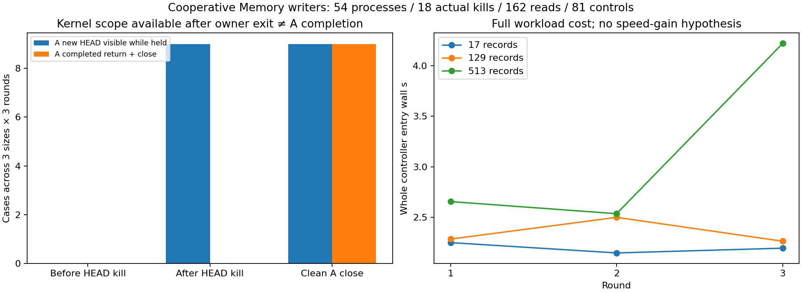

# v0.99 协作写入作用域、进程退出与来源历史

固定9controller/27case/54fresh writer、18次实际A进程终止、162来源查询、54锁竞争拒绝、81坏副本及54关闭调用拒绝完成；独立原始source/JSONL/历史SID/真实PID退出/锁竞争前后文件identity审计通过。H1/H2/H3/joint仅协作single-scope机械合同True，**原Memory.add仍可绕过作用域**。0新模型/提供方HEAD/原科学输入，不称通用多writer、掉电、NLI/科学回答或真人长期对话收益。

source freeze b618fa0c7250f67ba1b6fbf6a55e406281c8985f / exactCI 42017602297 先成功后唯一正式轮。632检查预计631pass/1权限skip，以完整实际日志为准；4新necessary owned checks，tiny准备与先前失败不计独立正式样本。

## API 与实际竞争

`Memory.writer()`立即尝试取得OS排他句柄，不等锁或重试；scope.add委托原Memory.add。Windows CreateFileW share0/OPEN_ALWAYS/非继承，POSIX flock EX|NB/非继承fd。固定`.writer.lock`不删除/替换/截断，字节不是owner身份；所有协作写入者必须使用作用域，直接add、配置变更、外部工具可绕过。创建进程/线程拥有scope，关闭后add/enter拒绝，scope异常/close/finalizer释放资源；不支持持锁fork或恶意unlink/reparse竞争，非数据库事务/完整跨进程访问控制。

每case先生成三份独立冻结source，原Memory建epoch0和oldSID/pin。A用scope执行epoch1，在原HEAD前/后暂停或add返回但close前暂停。父保存全Memoryidentity才启动B，B非阻塞拒绝且尚未调用add；A屏障期间全部source/对象/索引/HEAD前后SHA一致。Windows持锁文件按API不可打开，held账本仅该lock的SHA是null/size可观测，其余source全SHA严格；退出后lock字节完整计入账本。父用保留OS handle与owned launcher父子关系确认实际producerPID，观察A真实终止或cleanexit，才允许B再次取得scope。B执行已冻结独立epoch2新意图，绝不是重放A；B返回后仍持scope，父再次竞争拒绝。B实际close/exit0后父可再次取得空scope，无须删锁。全部27B成功，不对18中断A作自动重试/回滚。

## 全27场景

|轮|记录数|A边界|A-held当前epoch|A返回并关闭|A实际退出码|B实际退出码|
|---|---|---|---|---|---|---|
|1|17|before_HEAD|0|False|77|0|
|1|17|after_HEAD|1|False|77|0|
|1|17|clean_close|1|True|0|0|
|1|129|before_HEAD|0|False|77|0|
|1|129|after_HEAD|1|False|77|0|
|1|129|clean_close|1|True|0|0|
|1|513|before_HEAD|0|False|77|0|
|1|513|after_HEAD|1|False|77|0|
|1|513|clean_close|1|True|0|0|
|2|17|before_HEAD|0|False|77|0|
|2|17|after_HEAD|1|False|77|0|
|2|17|clean_close|1|True|0|0|
|2|129|before_HEAD|0|False|77|0|
|2|129|after_HEAD|1|False|77|0|
|2|129|clean_close|1|True|0|0|
|2|513|before_HEAD|0|False|77|0|
|2|513|after_HEAD|1|False|77|0|
|2|513|clean_close|1|True|0|0|
|3|17|before_HEAD|0|False|77|0|
|3|17|after_HEAD|1|False|77|0|
|3|17|clean_close|1|True|0|0|
|3|129|before_HEAD|0|False|77|0|
|3|129|after_HEAD|1|False|77|0|
|3|129|clean_close|1|True|0|0|
|3|513|before_HEAD|0|False|77|0|
|3|513|after_HEAD|1|False|77|0|
|3|513|clean_close|1|True|0|0|

HEAD新epoch1在18例A-held已可见，但只有9例A返回并关闭；其余9例afterHEAD终止仍请求完成未知。beforeHEAD终止9例保持旧HEAD，但不代表A未做过Store/索引工作。锁可重新取得仅说明句柄已释放，不是完成、rollback或重试许可。A缺footer的18例childCPU/RSS未知null，不能从父计时回填。

## 独立原source与完整成本

每case A-held和B-held各current/pin/explicit-old三次查询；current按0或1再2，pin/old一直0，全部原记录physicaloffset/length/SHA/title/重复/unicode/CRLF与完整Store source匹配。后置主审计不调用候选writer或add，不重放更新；仅读已保存query/原JSONL/Store和所有marker/actualexit。独立检查 ready<=B拒绝<父确认A退出<B取得scope<=B返回<=父拒绝<B退出。全部旧文件除允许HEAD外SHA不变，相同规模三场景三轮的old/A/B SID完全相同。隔离CAS/manifest坏字节让原pin读拒绝，返回literal篡改被独立校验拒绝；原始工作目录在审计前后全SHA不变。

primary162次完整source返回2789478B；独立主162次2789478B，literal坏返回控制27次464913B，共351次完整source返回。另81坏副本错误/拒绝、正常查询内部ranges/CASdecode/constructor验证/OSIO成本未完整仪表化处unknownnull，不当0。全部27baseline+27A尝试+27B新意图=81 source/index构造及临时/孤立对象、原source与坏副本、库/脚本/locks/ready/parent/cleanup/fsync、失败准备和所有旧science/train/model/Store/CAS/snapshot/frame/restored/derived/failed/API/sourceCPU-RAM账本保留。application返回B不是物理SSD/fullsystemIO，source/文件payload不是RSS，remoteweightsRAMunknownnull。

|轮|记录数|完整entry wall s|self CPU s|peak RSS B|outer parent wall s|
|---|---|---|---|---|---|
|1|17|2.251323|0.343750|31158272|2.296894|
|1|129|2.286372|0.343750|31490048|2.331819|
|1|513|2.656995|0.515625|32313344|2.702769|
|2|17|2.149326|0.359375|31371264|2.198285|
|2|129|2.501381|0.359375|31531008|2.548561|
|2|513|2.537255|0.546875|32186368|2.583758|
|3|17|2.196463|0.281250|31047680|2.241676|
|3|129|2.265476|0.359375|31195136|2.313690|
|3|513|4.219654|0.453125|32194560|4.267706|

raw-aggregate另列全部54producer与launcher观察退出、成功entry-beforeimports-finally/被kill缺footer、父区间、root与analysis完整时钟；A/B parent区间重叠，禁止相加成串行时延，parent selfCPU不是child或整棵树。quota subprocess不含selfCPU，fulltreeCPU/RSSunknownnull，0CPU粒度不免费。无提速/压缩/RSS门槛，不从子阶段挑正结论。非目录同步/掉电/冷缓存/跨机/恶意改写/所有并发调度保证。

图已实际查看；全部local/actual7SHA/allsource/outside actualpublished wheel-currentnative+new/ALLlegacyactualsdist/proof8尚待。完整软件交付不等于科学NLI/问答/长期人类会话/无限上下文能力验收；E3net/E4整体未完成，全部旧负结果和费用保留。v095缺失18/1728执行/额外成本unknownnull保持封存，不补跑；v089旧41槽不复用。
